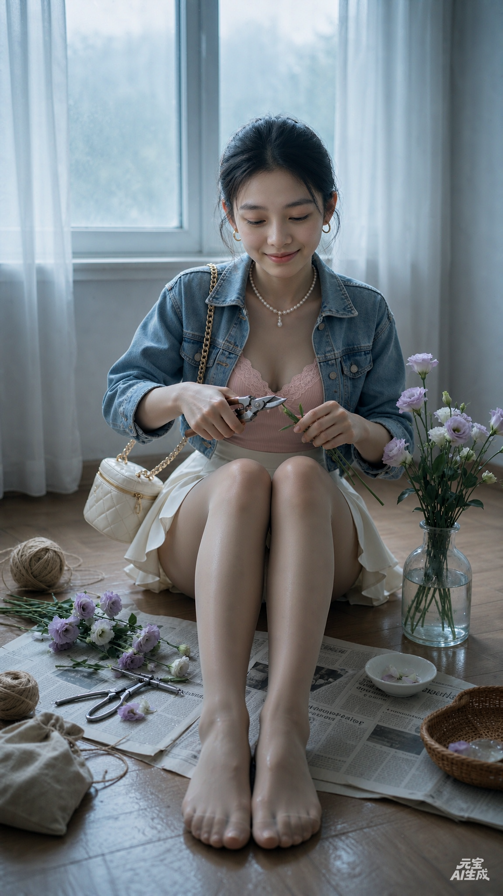

## 终稿提示词

```text
第2张 · 他（俯身到她肩侧）· 视点高度 1.25 米、隔 0.5 米看她在做什么。

9:16 满幅画面，宽 1080 高 1920，人物与地板道具铺满整幅，四条边即裁切边，人物头顶到脚底完整收在画内。

第一张图只定整套穿搭的版型配色面料，第二张图只定骨相五官，第三张图的线稿只定本张的躯干重心、脊线肩髋与两腿骨架；手臂走向完全由下文逐只链写承接。三张参考图与这段文字拼成一份资料，各写各的那一段。

她穿一件粉蓝水洗短牛仔外套，翻领、铜扣、袖口卷起一道、衣长刚落到腰线；里头一件藕粉细针织吊带，领口一道细褶；下身奶油白高腰伞裙，裙摆两层细褶在坐下来时铺开一小片、褶峰一道一道可数；奶白小方包搁在茶几角、金链松松垂着。她 24 小时穿着一层浅茶薄透连裤丝袜，从腿根连包到脚趾，脚趾由同色袜面完整包住、五趾在袜面里各自分明，袜面从小腿到脚背连成平顺同一片，脚趾与脚背看得出同色袜面的包覆边界，脚踝与小腿前缘有一道织物折光把袜面与腿肤色分出一层可辨边界。她赤足踩在浅木地板上，两只脚的脚背与五趾各自完整落在画内，浅茶袜面在脚背连成平顺同一片。

她梳雾栗棕里透一线灰粉光的及锁骨松螺旋卷长发，三七偏分的分缝用指尖拨出一道不规则浅弧；两缕长短错开的八字帘刘海从眉尾斜扫到颧骨上方，耳侧各留一撮细碎发贴着耳廓往外翘一小截、随侧坐低头滑到颊边露出一只小金豆耳钉；发尾卷峰不齐、外层几缕被朝东窗的冷青白天光勾出细亮边，卷势与粉蓝铜扣翻领和奶油白伞裙的细褶走向一顺；四张逐字同一顶。

清晨薄雾里的老公寓客厅：朝东长窗一层白纱帘把天光散成冷青白；浅木地板上摊开一张旧报纸，报纸上平铺着六七枝淡紫与奶白的洋桔梗、三两枝小雏菊、两片带水珠的叶；报纸边一把园艺小剪、一小卷麻绳、一小截刚剪下来的枝；茶几上一只透明玻璃花瓶盛着半瓶清水、瓶身一道冷白折光，一只白瓷小碟盛着几粒落瓣、一只藤编小托盘；那只牛皮纸花袋空着折在一旁；浅木地板映着窗那片冷青白反光。光色是清晨薄雾冷青白漫射天光铺满整幅，白纱帘把光滤得软而匀，花瓣水珠与玻璃瓶身各落一点冷白高光，地板青灰反光顺着腿线铺到袜面折光上，整幅没有第二色温。

她屈膝坐在浅木地板上、两腿并着收在身前，脊线从后颈经腰窝拉成一道柔缓的弧，肩往前送、鼻尖离摊开的花枝一掌远。右手从肩经肘腕到指尖一条链，拇指与食指捏着园艺小剪的剪柄、剪口正对着一枝洋桔梗的茎尾、茎上那道斜切口刚剪出来，这整条右臂只落在这一剪上；左手从肩经肘腕到指尖一条链，五指并拢轻轻按住旧报纸上那枝淡紫洋桔梗的花茎中段、指腹压着一粒水珠，这整条左臂只落在按花茎这一件事上。画面里只落她自己这一位人物，画外人由首行机位与这一眼的取景方向交待、画面四边以内只收她一人的轮廓与她手里那些道具；两条手臂各自从肩经肘腕连到指尖、两条腿各自从髋连到脚趾，全画共两条手臂、两只手、十根手指、两条腿，数与位一一对应她自身躯干两侧。

她俯身时睫尖压下一小片冷青白光，嘴角只朝捏剪那侧轻轻提起一点，视线顺着小剪刃口落在左手按住的洋桔梗花茎节上，鼻尖与下颌线被纱帘那片冷青白描出一道细亮边；这一眼的取景落点落在剪口与花茎相接那一寸、她按着花茎的指尖，以及从膝弯顺到脚背那一道平顺的浅茶折光上。
```

## 一句点评

坐地板比了三回才落那一剪
