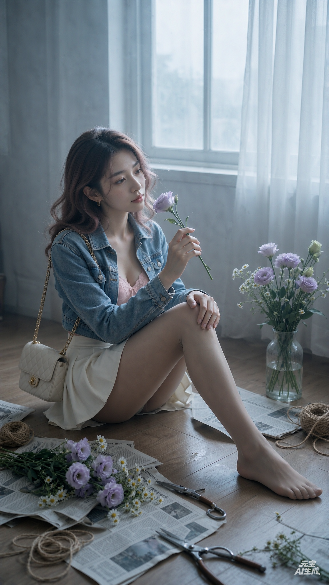

## 终稿提示词

```text
第3张 · 他（侧坐在她斜前方地板上）· 视点高度 0.90 米、隔 1.1 米看她在做什么。

9:16 满幅画面，宽 1080 高 1920，人物与地板道具铺满整幅，四条边即裁切边，人物头顶到脚底完整收在画内。

第一张图只定整套穿搭的版型配色面料，第二张图只定骨相五官，第三张图的线稿只定本张的躯干重心、脊线肩髋与两腿骨架；手臂走向完全由下文逐只链写承接。三张参考图与这段文字拼成一份资料，各写各的那一段。

她穿一件粉蓝水洗短牛仔外套，翻领、铜扣、袖口卷起一道；里头一件藕粉细针织吊带；下身奶油白高腰伞裙，裙摆两层细褶在侧坐时顺着腿铺开一小片；奶白小方包搁在身侧地板上、金链松松盘着。她 24 小时穿着一层浅茶薄透连裤丝袜，从腿根连包到脚趾，脚趾由同色袜面完整包住、五趾在袜面里各自分明，袜面从小腿到脚背连成平顺同一片，脚趾与脚背看得出同色袜面的包覆边界，脚踝与小腿前缘有一道织物折光把袜面与腿肤色分出一层可辨边界。她赤足踩在浅木地板上，两只脚的脚背与五趾各自完整落在画内，浅茶袜面在脚背连成平顺同一片。

她梳雾栗棕里透一线灰粉光的及锁骨松螺旋卷长发，三七偏分的分缝用指尖拨出一道不规则浅弧；两缕长短错开的八字帘刘海从眉尾斜扫到颧骨上方，耳侧各留一撮细碎发贴着耳廓往外翘一小截、随侧坐低头滑到颊边露出一只小金豆耳钉；发尾卷峰不齐、外层几缕被朝东窗的冷青白天光勾出细亮边，卷势与粉蓝铜扣翻领和奶油白伞裙的细褶走向一顺；四张逐字同一顶。

清晨薄雾里的老公寓客厅：朝东长窗一层白纱帘把天光散成冷青白；浅木地板上摊开的旧报纸里躺着剩下的几枝洋桔梗与小雏菊、一小卷麻绳、一把园艺小剪；茶几上一只透明玻璃花瓶已经插进三两枝、瓶身一道冷白折光、瓶里半瓶清水映着窗；白瓷小碟里几粒落瓣、藤编小托盘、折好的空牛皮纸袋都在；浅木地板映着窗那片冷青白反光。光色是清晨薄雾冷青白漫射天光铺满整幅，白纱帘把光滤得软而匀，花瓣水珠、玻璃瓶身与地板青灰反光各落一点冷白，冷青白顺着腿线一路铺到袜面折光上，整幅没有第二色温。

她侧坐在浅木地板上，髋留在后、肩往前送，脊线拉成一道柔缓的弧，一条腿屈起贴着身侧、另一条腿斜斜伸出去，伸出去那只脚的脚背整片落进窗纱漏下来的那道冷青白光里。右手从肩经肘腕到指尖一条链，拇指与食指捏着一枝淡紫洋桔梗的茎尾、把花举到眼前半尺、花瓣上那粒水珠正对着纱帘透光，这整条右臂只落在举花对光这一件事上；左手从肩经肘腕到指尖一条链，五指并拢搭在自己屈起的膝头、指腹压着伞裙一道细褶，这整条左臂只落在搭膝这一件事上。画面里只落她自己这一位人物，画外人由首行机位与这一眼的取景方向交待、画面四边以内只收她一人的轮廓与她手里那些道具；两条手臂各自从肩经肘腕连到指尖、两条腿各自从髋连到脚趾，全画共两条手臂、两只手、十根手指、两条腿，数与位一一对应她自身躯干两侧。

她微微偏头把右侧脸颊凑近那枝淡紫洋桔梗，眼睑半垂、视线落在花瓣透光的边缘上，嘴角只提起来一点点，像刚闻见花梗上清冷的水汽；这一眼的取景落点落在举起来的那朵淡紫洋桔梗与花瓣上那粒水珠、伸出去那只脚从膝头顺到脚背的浅茶折光，以及窗纱冷青白在脚背上那一小片亮。
```

## 一句点评

侧坐把花瓣举到冷青白光里连脚背一起给你看
