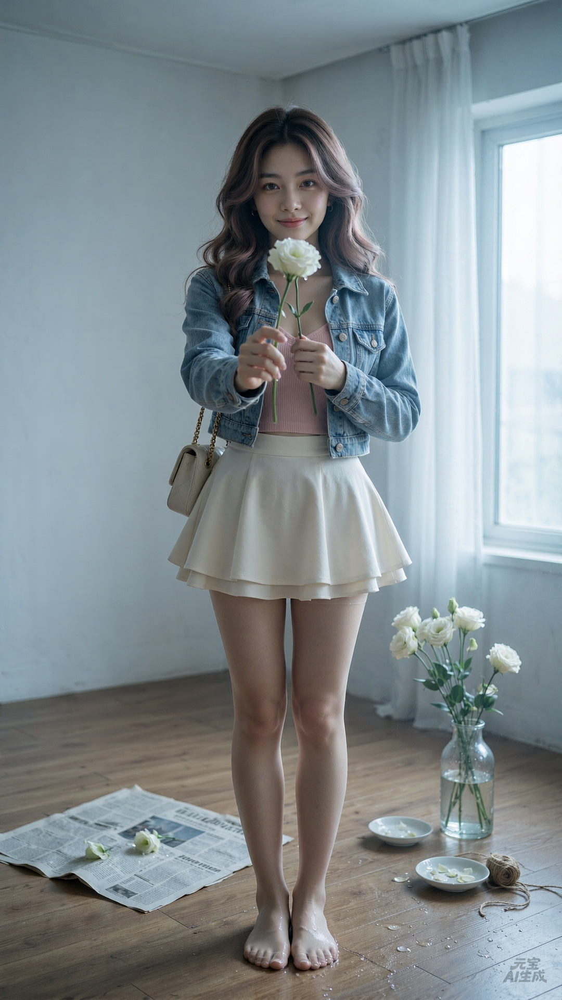

## 终稿提示词

```text
第4张 · 他（凑近到她面前）· 视点高度 0.95 米、隔 0.3 米看她在做什么。

9:16 满幅画面，宽 1080 高 1920，整幅一次成像落在同一个焦平面上，人物、举到两人中间的那枝花与画底一线浅木地板连成同一片光；四条边即裁切边。

输入图是一张三栏拼版：左栏对应下文「第一张图」（衣装层）、中栏对应「第二张图」（人脸）、右栏对应「第三张图的线稿」，按三栏分工取用。第一张图只定整套穿搭的版型配色面料，第二张图只定骨相五官，第三张图的线稿只定本张的躯干重心、脊线肩髋与两腿骨架；手臂走向完全由下文逐只链写承接。三张参考图与这段文字拼成一份资料，各写各的那一段。

她穿一件粉蓝水洗短牛仔外套，翻领、铜扣、袖口卷起一道；里头一件藕粉细针织吊带；下身奶油白高腰伞裙，裙摆两层细褶在画底露出一小截、褶峰一道一道可数；奶白小方包的金链在肩侧露一小角。她 24 小时穿着一层浅茶薄透连裤丝袜，从腿根连包到脚趾，脚趾由同色袜面完整包住、五趾在袜面里各自分明，袜面从小腿到脚背连成平顺同一片，脚趾与脚背看得出同色袜面的包覆边界，脚踝与小腿前缘有一道织物折光把袜面与腿肤色分出一层可辨边界。她赤足踩在浅木地板上，画底那一线浅木地板映着脚背与五趾的浅茶折光。

她梳雾栗棕里透一线灰粉光的及锁骨松螺旋卷长发，三七偏分的分缝用指尖拨出一道不规则浅弧；两缕长短错开的八字帘刘海从眉尾斜扫到颧骨上方，耳侧各留一撮细碎发贴着耳廓往外翘一小截、随侧坐低头滑到颊边露出一只小金豆耳钉；发尾卷峰不齐、外层几缕被朝东窗的冷青白天光勾出细亮边，卷势与粉蓝铜扣翻领和奶油白伞裙的细褶走向一顺；四张逐字同一顶。

清晨薄雾里的老公寓客厅：画底一线浅木地板与一角摊开的旧报纸，报纸上两片带水珠的叶；画侧透明玻璃花瓶的瓶口露出半幅、瓶里已插进三两枝、瓶身一道冷白折光；白瓷小碟里几粒落瓣、一小卷麻绳的绳头；画右朝东长窗一层白纱帘、一片冷青白漫射天光；画顶天花一片匀净冷白。光色是清晨薄雾冷青白漫射天光铺满整幅，白纱帘把光滤得软而匀，花瓣水珠、玻璃瓶口与画底袜面各落一点冷白高光，地板青灰反光顺着腿线铺到袜面折光上，整幅没有第二色温。

她把一枝奶白洋桔梗举到两人视线正中间，花冠正对这一眼、花瓣外沿一粒水珠将坠未坠；右手从肩经肘腕到指尖一条链，拇指与食指捏着花茎尾端、右臂朝这一眼的方向稳稳伸出去、花冠平平稳稳停在离她自己下唇一掌远的半空里、正对这一眼停住，茎上一道细小的斜切口在指节下露出来；左手从肩经肘腕到指尖一条链，五指交叠收在锁骨前、指腹贴着粉蓝牛仔外套的翻领边，这整条左臂只落在收于锁骨前这一件事上。画面里只落她自己这一位人物，画外人由首行机位与这一眼的取景方向交待、画面四边以内只收她一人的轮廓与她手里那些道具；两条手臂各自从肩经肘腕连到指尖、两条腿各自从髋连到脚趾，全画共两条手臂、两只手、十根手指、两条腿，数与位一一对应她自身躯干两侧。

她眼尾随花枝抬起来微微弯住，视线越过花冠稳稳落在这一眼上，嘴角只提起靠花枝那一侧的一点点、下唇轻抿出一点要你把这枝收下的得意，鼻梁与颊侧被冷青白漫射光压出一道清亮高光；花举完就停住、停在这一眼跟前；这一眼的取景落点落在花冠外沿那粒将坠未坠的水珠、她捏着花茎的指尖，以及画底那一线浅茶袜面折光上。
```

## 一句点评

站定把奶白那一枝举到你眼睛正中间
