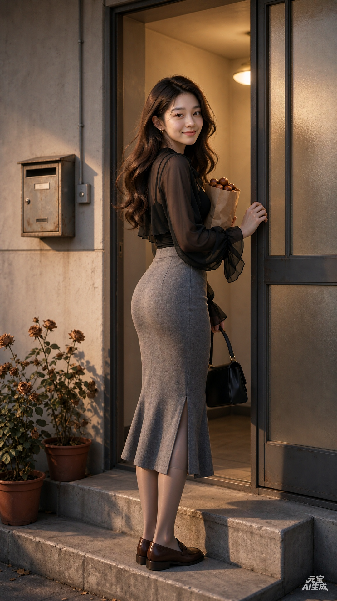

## 终稿提示词

```text
第1张 · 他（站）· 视点高度 1.55 米、隔 2.2 米看她站在单元门口回身朝这一眼举纸袋

三句分工：衣由槽 1 承担、脸由槽 2 承担、姿势由槽 3 承担；发型与丝袜那一层由第一波研究员联网读资料后一起设计一次、落一份基底写进四份，四份按本张姿势逐张落形态。
全画只一位成年人物，画面里只落她自己这一位人物，画外人由首行机位与这一眼的取景方向交待、画面四边以内只收她一人的轮廓与她手里那些道具。她自己左右各一只手臂各五根手指、两条手臂各自从肩连续到指尖、两只手各自从肩经肘腕连续到指尖、同一只手只出现一次只做一个动作；两条腿各自从髋连续到脚趾，全画共两条手臂、两只手、两条腿。槽 3 线稿只管躯干重心、脊线肩髋与两腿骨架，两条手臂走向完全由本段逐只链写的唯一落点承接。
按 [女主设定] 24h 穿一层连裤丝袜从腿根连包到脚趾、脚趾由同色袜面完整包住、五趾在袜面里各自分明、袜面从小腿到脚背连成平顺同一片、脚踝与小腿前缘有一道织物折光把袜面与腿肤色分出一层可辨边界；这一层四份按同一基底逐张落本张姿势下的形态、人物与道具完整落在 9:16 满幅画内。胸大腰细腿长靠合身剪裁写实呈现。
这一眼的取景落点落在袜面、脚背、腿线那一片光与折光上，深秋黄昏蜜色斜照与楼道暖黄声控灯的光顺着腿线落到袜面折光上写足，台阶青石背光处留一道灰青硬影，冷暖两色同在一幅。

深秋傍晚老公寓单元门口，磨砂玻璃门、旧铁皮信箱、墙根两盆枯了叶的月季、青石台阶三级。她穿黑色细吊带外罩黑纱荷叶边长袖罩衫、深灰呢料鱼尾长裙侧开衩、深棕软皮乐福鞋穿在一层浅茶灰半透连裤丝袜外面，黑方包挂在左腕。她刚要进门又回过身，右手把一只牛皮纸袋举到胸前，袋口露出几颗油亮的糖炒栗子，左手扶着门框边；发丝顺肩垂到背后，两缕八字弧刘海被穿堂风带得略偏；袜面平顺、踝骨上缘一道细折光。蜜色斜照从她右后方铺过台阶，楼道声控灯在她身后亮着一小团暖黄，青石背光一道灰青硬影。她眼尾弯着朝这一眼笑，下巴微抬一点。
```

## 一句点评

一套穿搭只设计一次发型与丝袜基底、四张逐张落形态
