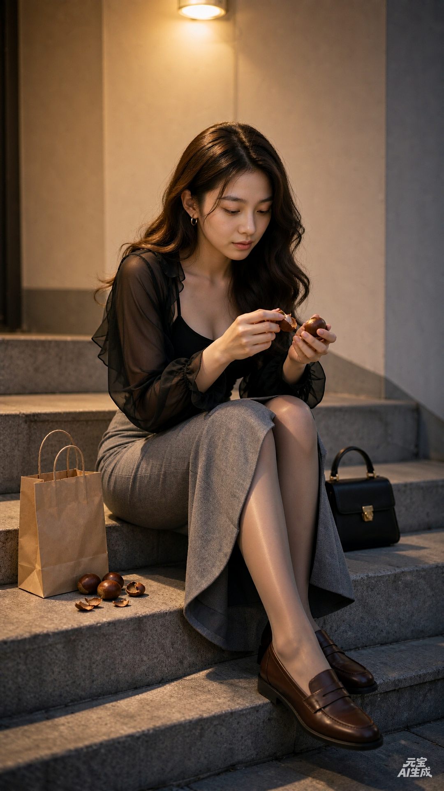

## 终稿提示词

```text
第2张 · 他（俯身）· 视点高度 1.05 米、隔 0.5 米看她坐在台阶上屈膝剥栗子

三句分工：衣由槽 1 承担、脸由槽 2 承担、姿势由槽 3 承担；发型与丝袜那一层由第一波研究员联网读资料后一起设计一次、落一份基底写进四份，四份按本张姿势逐张落形态。
全画只一位成年人物，画面里只落她自己这一位人物，画外人由首行机位与这一眼的取景方向交待、画面四边以内只收她一人的轮廓与她手里那些道具。她自己左右各一只手臂各五根手指、两条手臂各自从肩连续到指尖、两只手各自从肩经肘腕连续到指尖、同一只手只出现一次只做一个动作；两条腿各自从髋连续到脚趾，全画共两条手臂、两只手、两条腿。槽 3 线稿只管躯干重心、脊线肩髋与两腿骨架，两条手臂走向完全由本段逐只链写的唯一落点承接。
按 [女主设定] 24h 穿一层连裤丝袜从腿根连包到脚趾、脚趾由同色袜面完整包住、五趾在袜面里各自分明、袜面从小腿到脚背连成平顺同一片、脚踝与小腿前缘有一道织物折光把袜面与腿肤色分出一层可辨边界；这一层四份按同一基底逐张落本张姿势下的形态、人物与道具完整落在 9:16 满幅画内。胸大腰细腿长靠合身剪裁写实呈现。
这一眼的取景落点落在袜面、脚背、腿线那一片光与折光上，深秋黄昏蜜色斜照与楼道暖黄声控灯的光顺着腿线落到袜面折光上写足，台阶青石背光处留一道灰青硬影，冷暖两色同在一幅。

同一片深秋傍晚台阶，牛皮纸袋摊在上一级青石上，几颗栗子与两片裂开的壳散在袋口旁，黑方包搁在膝边。她屈膝坐着，鱼尾长裙开衩顺着屈起的腿滑到膝上，一缕长发从肩滑到胸前黑纱袖上；右手拇指与食指捏着一颗栗子壳正往外掰，左手掌心托着剥好的一颗，两条手臂各按这个唯一落点从肩经肘腕连到指尖。膝弯处袜色略深、褶影随屈膝堆出两道，一只乐福鞋踩实台阶、一只半悬在台阶沿。头顶楼道暖黄灯光压在她发顶与手背上，蜜色斜照横过她小腿前缘拉出一道织物折光，青石阴面留灰青。她低着头，眼尾从睫毛底下往这一眼抬半分。
```

## 一句点评

深秋黄昏蜜色斜照与楼道暖黄灯把暖写足、青石背光留灰青硬影
