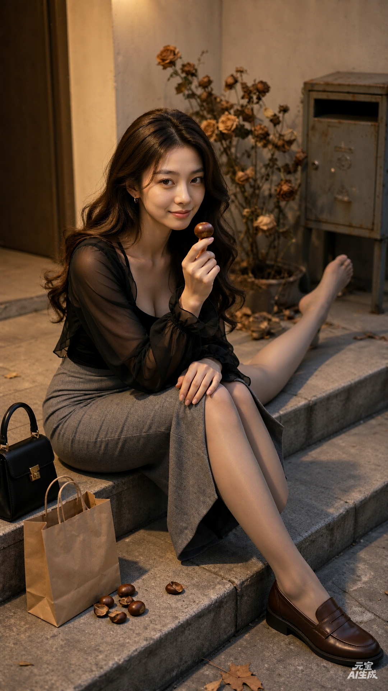

## 终稿提示词

```text
第3张 · 他（坐）· 视点高度 0.95 米、隔 1.1 米看她侧坐把一颗栗子举向这一眼

三句分工：衣由槽 1 承担、脸由槽 2 承担、姿势由槽 3 承担；发型与丝袜那一层由第一波研究员联网读资料后一起设计一次、落一份基底写进四份，四份按本张姿势逐张落形态。
全画只一位成年人物，画面里只落她自己这一位人物，画外人由首行机位与这一眼的取景方向交待、画面四边以内只收她一人的轮廓与她手里那些道具。她自己左右各一只手臂各五根手指、两条手臂各自从肩连续到指尖、两只手各自从肩经肘腕连续到指尖、同一只手只出现一次只做一个动作；两条腿各自从髋连续到脚趾，全画共两条手臂、两只手、两条腿。槽 3 线稿只管躯干重心、脊线肩髋与两腿骨架，两条手臂走向完全由本段逐只链写的唯一落点承接。
按 [女主设定] 24h 穿一层连裤丝袜从腿根连包到脚趾、脚趾由同色袜面完整包住、五趾在袜面里各自分明、袜面从小腿到脚背连成平顺同一片、脚踝与小腿前缘有一道织物折光把袜面与腿肤色分出一层可辨边界；这一层四份按同一基底逐张落本张姿势下的形态、人物与道具完整落在 9:16 满幅画内。胸大腰细腿长靠合身剪裁写实呈现。
这一眼的取景落点落在袜面、脚背、腿线那一片光与折光上，深秋黄昏蜜色斜照与楼道暖黄声控灯的光顺着腿线落到袜面折光上写足，台阶青石背光处留一道灰青硬影，冷暖两色同在一幅。

同一道青石台阶，纸袋与壳粒在身侧，墙根月季枯枝与旧信箱在远处。她侧坐着，一条腿屈起贴身、另一条斜斜伸进那道蜜色斜照里，发尾铺在鱼尾裙开衩旁的膝面上；右手食指尖捏着一颗最圆的栗子举到两人视线之间，左手搭在自己屈起的膝头，十指各自分明。小腿前缘那道织物折光被夕照拉成一整条亮线，脚背五趾在乐福鞋口外的袜面里各自分明。暖黄灯光落在她颧骨与黑纱袖口的一道透明边，青石背光灰青硬影切过画底。她头一偏，眼尾从栗子上方压下来看这一眼，嘴角只挑一点。
```

## 一句点评

三张底图与提示词按图词配合分工、只裁掉自带高跟那一处越界
