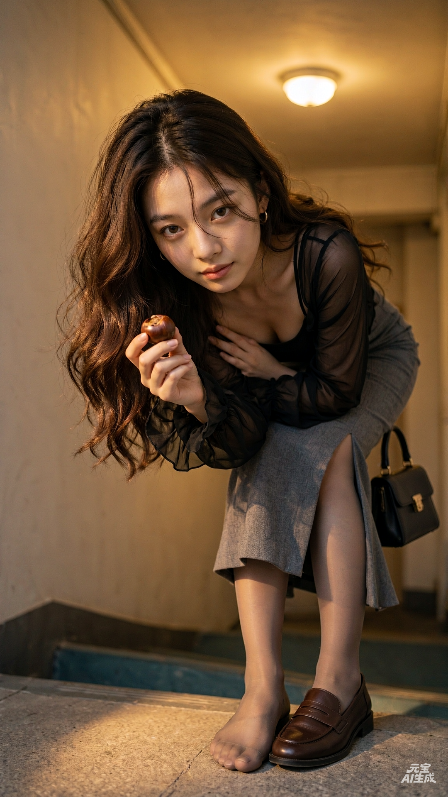

## 终稿提示词

```text
第4张 · 他（凑近）· 视点高度 0.85 米、隔 0.3 米看她俯身把那颗栗子递到面前

三句分工：衣由槽 1 承担、脸由槽 2 承担、姿势由槽 3 承担；发型与丝袜那一层由第一波研究员联网读资料后一起设计一次、落一份基底写进四份，四份按本张姿势逐张落形态。
全画只一位成年人物，画面里只落她自己这一位人物，画外人由首行机位与这一眼的取景方向交待、画面四边以内只收她一人的轮廓与她手里那些道具。她自己左右各一只手臂各五根手指、两条手臂各自从肩连续到指尖、两只手各自从肩经肘腕连续到指尖、同一只手只出现一次只做一个动作；两条腿各自从髋连续到脚趾，全画共两条手臂、两只手、两条腿。槽 3 线稿只管躯干重心、脊线肩髋与两腿骨架，两条手臂走向完全由本段逐只链写的唯一落点承接。
按 [女主设定] 24h 穿一层连裤丝袜从腿根连包到脚趾、脚趾由同色袜面完整包住、五趾在袜面里各自分明、袜面从小腿到脚背连成平顺同一片、脚踝与小腿前缘有一道织物折光把袜面与腿肤色分出一层可辨边界；这一层四份按同一基底逐张落本张姿势下的形态、人物与道具完整落在 9:16 满幅画内。胸大腰细腿长靠合身剪裁写实呈现。
这一眼的取景落点落在袜面、脚背、腿线那一片光与折光上，深秋黄昏蜜色斜照与楼道暖黄声控灯的光顺着腿线落到袜面折光上写足，台阶青石背光处留一道灰青硬影，冷暖两色同在一幅。

一气连成的近景，画顶紧贴她额前碎发、画底收进一小片青石与她脚背那一截暖光，没有硬边横切。她俯身凑近，长发向前垂挡住半边脸，额前碎发落到眉尾，耳侧两缕细发擦过下颌；右手拇指与食指捏着那颗剥好的栗子停在离这一眼一掌远，左手收在锁骨前、五指并着轻轻压住，两条手臂各从肩经肘腕连到指尖、各只做这一件事。黑纱袖口透出一线暖光，鱼尾裙开衩在画外，袜面只在画底一小片蜜色光里露出脚背那一截、折光最柔、五趾各自分明。楼道暖黄灯光贴着她脸侧，台阶青石灰青影退到画底边缘。她下巴微抬，眼尾压下来正正对上这一眼，不说话。
```

## 一句点评

音频链路按暂停开关只关入口与出口
