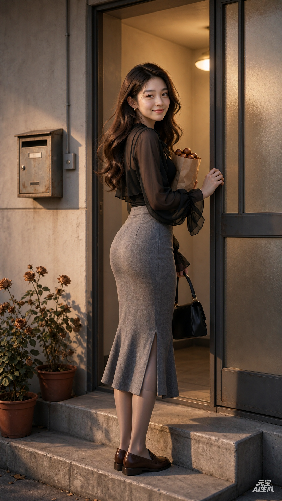
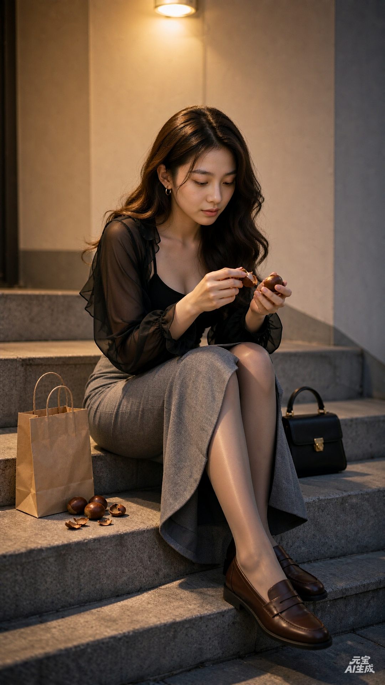
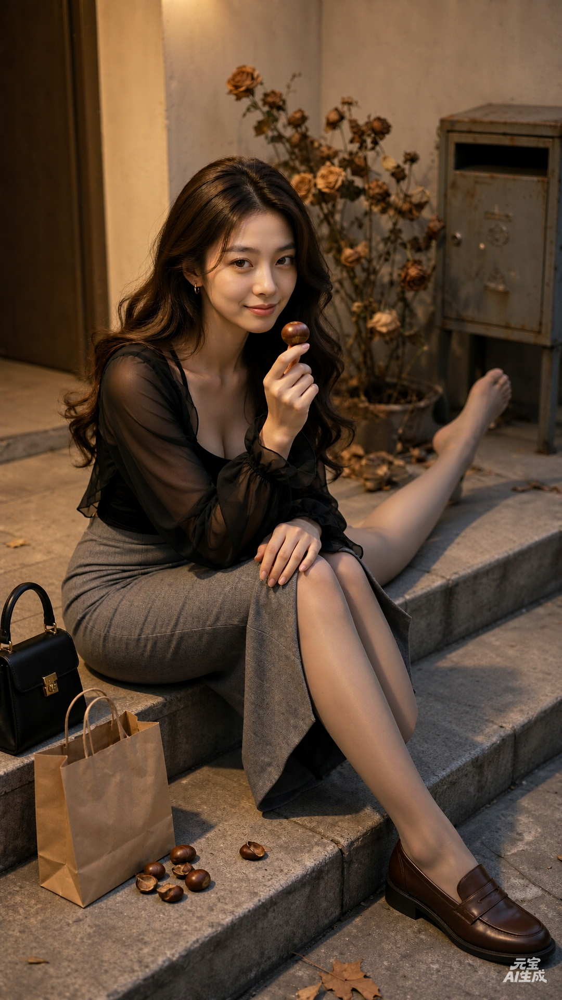
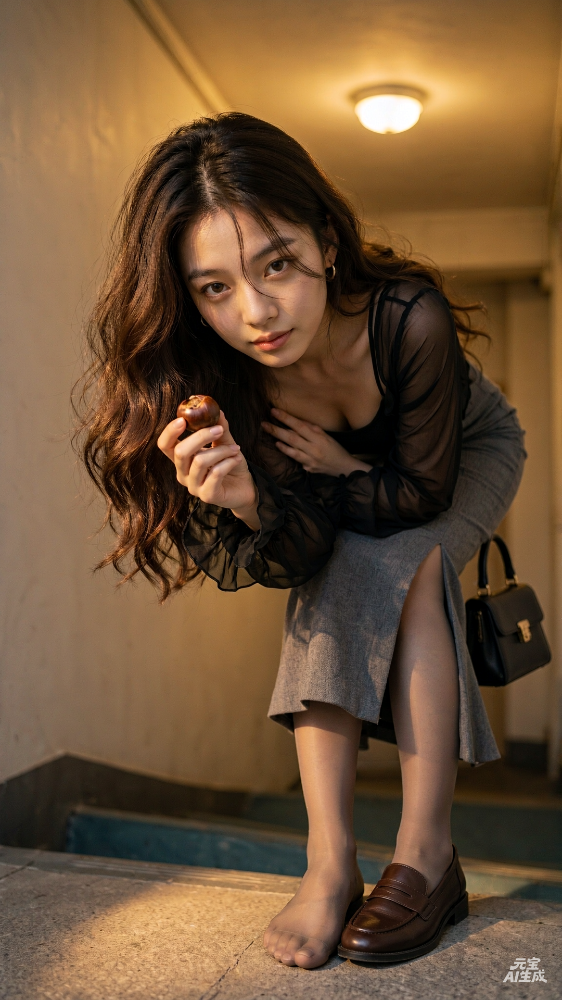

# R054 · 深秋楼道口等你回来剥糖炒栗子

- 轮次目录：`20261128au_stoop-chestnuts`
- 日期：2026-11-28
- 来源：`yuanbao`
- 穿搭：`SPR-0210`
- 发型：未标注
- 场景标签：其它
- 四张线稿：`P061_front`、P062_side`、P063_low`、P064_diag`
- 画幅：1080×1920（9:16），纯画面

## 四张

| 序 | 机位 | 图 | 终稿提示词 |
|---|---|---|---|
| 01 | front |  | [01_front.md](01_front.md) |
| 02 | side |  | [02_side.md](02_side.md) |
| 03 | seat |  | [03_seat.md](03_seat.md) |
| 04 | close |  | [04_close.md](04_close.md) |

## 这一段说了什么

1. 你回来得正好呀，这袋栗子还烫着呢，我一路揣在怀里都没舍得先剥一颗，就等你。
2. 我坐这台阶上等你半天啦，手指头都剥热了，你倒好，站那儿光看着我不说话。
3. 这一颗最圆，我举了半天胳膊都酸了，你再不伸手接，我可就自己吃掉啦，哼。
4. 喏，凑近点呀，就着我的手吃，别烫着，也别看别处，这一眼先归我，听见没。

## 现场记录

- 01_front：一套穿搭只设计一次发型与丝袜基底、四张逐张落形态
- 02_side：深秋黄昏蜜色斜照与楼道暖黄灯把暖写足、青石背光留灰青硬影
- 03_seat：三张底图与提示词按图词配合分工、只裁掉自带高跟那一处越界
- 04_close：音频链路按暂停开关只关入口与出口

> 原图 PNG 永不转码、永不覆盖；预览用 `` 缩放原图。
