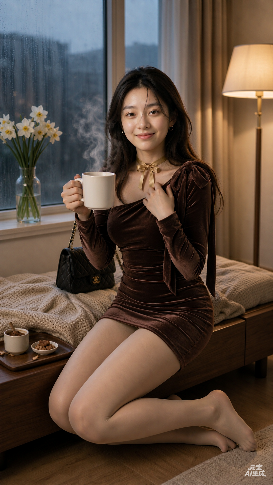

## 终稿提示词

```text
第4张 · 他（俯身）· 视点高度 0.8 米、隔 0.45 米看她跪在矮榻上朝这一眼俯下身把那只白瓷杯举到离这一眼一掌远停住

三句分工：衣由槽 1 承担、脸由槽 2 承担、姿势由槽 3 承担；发型与丝袜那一层由第一波研究员联网读资料后一起设计一次、落一份基底写进四份，四份按本张姿势逐张落形态。

9:16 满幅 1080×1920 竖版，四条边即裁切边，人物与道具铺满整幅。全画只一位成年人物，画面里只落她自己这一位人物，画外人由首行机位与这一眼的取景方向交待，画面四边以内只收她一人的轮廓与她手里那些道具。

这一张是四张里取景最紧的一眼，输入是一张三栏拼版图：左栏只管衣装、中栏只管骨相五官、右栏线稿只管躯干重心与两腿骨架。拼版左栏给整套穿搭的版型配色面料：深棕巧克力色丝绒单肩斜领横向抽褶迷你连衣裙，单肩处一只同色丝绒大蝴蝶结垂下两条长飘带，一侧长丝绒袖收口在腕骨，颈间一圈金色缎面细颈结系成小蝴蝶结，左肩挂一只深棕菱格链条小方包，抽褶从胸下一道一道叠到裙摆，裙长落在大腿中段。拼版中栏给骨相五官：脸年轻柔和、神态松弛、眼尾弯着朝这一眼、嘴角挑起一点点。拼版右栏给躯干重心、脊线肩髋与两腿骨架。

她跪在矮榻上朝这一眼俯下身、肩线往前送、下巴微微抬起，两只脚都并着从膝弯连到脚趾完整落在画底燕麦色短绒毯面上，十根脚趾一根一根在袜面里排得清楚，画框上边贴着她额前两缕碎发、画底留一线毯绒与两只完整脚背，这是四张里取景最紧的一眼，杯口那圈细热沫正停在画面正中。两条手臂各自从肩经肘腕连到指尖、在画内完整收口，两条腿各自从髋连续到脚趾、在画内完整收口，全画共两条手臂、两只手、十根手指、两条腿、十根脚趾。线稿只承担躯干重心、脊线肩髋与两腿骨架，手臂走向完全由下文逐只链写承接。

右手从肩经肘腕到指尖只落在把白瓷厚壁马克杯举到离这一眼一掌远、杯口那圈细热沫与两缕薄白汽停在画面正中；左手从肩经肘腕到指尖只落在收在锁骨前、五指并着轻轻压住，十根手指各自分明，同一只手只出现一次、只做这一个动作。

她 24 小时穿着一层连裤丝袜：15D 包芯丝，浅奶茶调里透一线暖栗灰，哑光里带一点马油般柔和的宽幅微光，从腿根连包到脚趾，脚趾由同色袜面完整包住、五趾在袜面里各自分明，袜面从小腿到脚背连成平顺同一片，脚踝与小腿前缘有一道织物折光把袜面与腿肤色分出一层可辨边界，膝弯拉伸处颜色略浅、起两道细褶影，小腿中段到大腿根是同一片连贯丝光。两只脚都赤着这一层丝袜踩实在燕麦色短绒毯面上，十根脚趾一根一根在袜面里排得清楚，画里两只脚背连着小腿连着膝连着腿根一整片平顺落进画内。

本张俯身凑近，画底脚背那一小截袜面折光最柔，十趾安分并着，膝头到脚背连成一条平顺亮线。

发型基底：深栗棕透一线暖茶光的低层次长发，长度落到胸下、发尾保留完整重量线，长偏分 S 型分缝把颅顶垫起来，脸周从颧骨起到下颌是渐进层次，两缕长 S 型弧刘海从眉尾划过颧骨自然外翻、额心整片露出来，耳侧两缕细碎发落到下颌角，卷度从耳下起由内向外的大弯、层次错落、发尾保留方向。

本张发丝整体朝这一眼向前垂，额前两缕碎发落到眉尾上，长 S 型弧刘海随俯身滑出另一道外翻的弧，耳侧细碎发擦过下颌角。

场景是初冬头一场雪前的傍晚、老公寓里屋：朝东长窗玻璃凝着一层薄薄水汽，窗台一盆水仙抽着两枝白花，窗外灰青暮色压着几线远楼暗影；深胡桃木矮榻铺着燕麦色粗针织毯，黄铜落地灯立在榻侧、灯罩把暖黄光铺成一小圈，深棕丝绒裙面吃进这圈暖光、抽褶里留一道深褐影；窗玻璃把冷青反光横过她的小腿前缘，与落地灯那道蜜暖光在袜面上交界，木地板与胡桃木榻沿反着一层温润木色光。深胡桃木托盘上搁着可可粉小陶罐、一根肉桂棒与一小碟绵白糖，白瓷厚壁马克杯口浮着一圈细热沫、升起两缕薄白汽。整幅一次成像落在同一个焦平面上，横贯画面的只有那一道从窗边斜进来的暖光与窗玻璃那一线冷青反光，人物头顶到脚趾完整收在画内。这一眼的取景落点落在她小腿前缘那一道织物折光与脚背那一片暖光上，色温按这一轮定的初冬傍晚落地灯暖黄混窗边冷青写足。
```

## 一句点评

音频链路按暂停开关只关入口与出口
