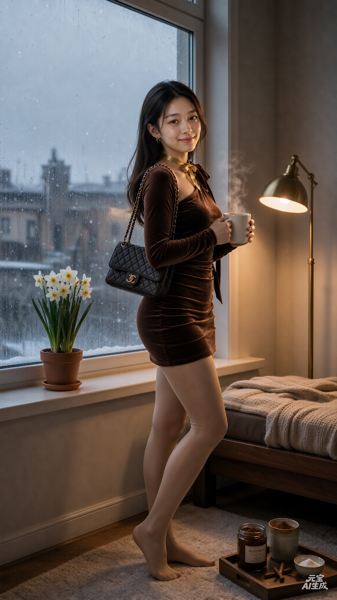
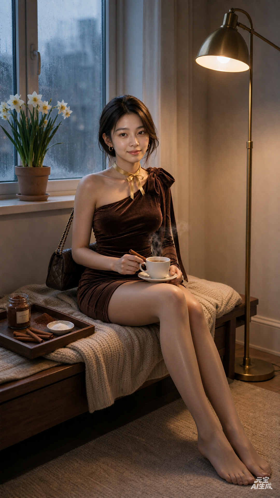
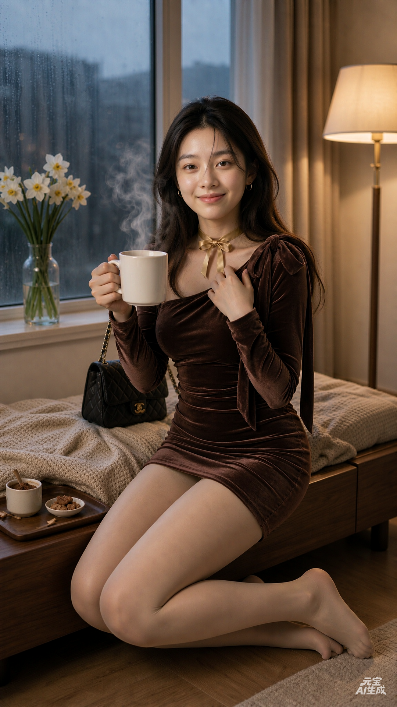

# R055 · 初冬窗边捧一杯热可可等你回来

- 轮次目录：`20261128av_window-cocoa`
- 日期：2026-11-28
- 来源：`yuanbao`
- 穿搭：`AUT-0020`
- 发型：未标注
- 场景标签：其它
- 四张线稿：`P015_side`、P002_side`、P012_diagonal`、P031_side`
- 画幅：1080×1920（9:16），纯画面

## 四张

| 序 | 机位 | 图 | 终稿提示词 |
|---|---|---|---|
| 01 | front |  | [01_front.md](01_front.md) |
| 02 | side |  | [02_side.md](02_side.md) |
| 03 | seat |  | [03_seat.md](03_seat.md) |
| 04 | close |  | [04_close.md](04_close.md) |

## 这一段说了什么

1. 这杯我捧了半天啦，你再不进来，可可上头那圈细沫可就自己先凉了，我才不替你热第二回。
2. 坐下来才发现矮榻比记得的软，我把肉桂棒搁杯沿转了一圈，你倒是说句话呀。
3. 腿伸进灯里这一下是我故意的，你眼睛往哪儿躲我都看见啦，哼，杯子我先不递。
4. 凑近点呀，就着我的手喝一口，别看别处，也别急着夸，这一眼先归我，听见没。

## 现场记录

- 01_front：一套穿搭只联网设计一次发型与丝袜基底四张逐张落形态
- 02_side：初冬傍晚落地灯暖黄与窗边冷青两色交界由场景物理定
- 03_seat：第4张初版俯身落幅与定稿对不上按终审硬伤另起一批重出通过
- 04_close：音频链路按暂停开关只关入口与出口

> 原图 PNG 永不转码、永不覆盖；预览用 `` 缩放原图。
