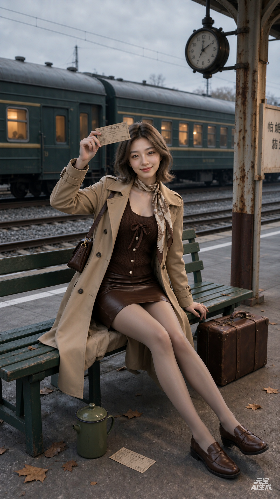

## 终稿提示词

```text
第3张 · 他（撑地）· 视点高度 1.05 米、隔 1.2 米看她侧坐在长椅边缘把一条腿斜伸进天光里再把车票举到眼尾上方

三句分工：衣由槽 1 承担、脸由槽 2 承担、姿势由槽 3 承担；发型与丝袜那一层由第一波研究员联网读资料后一起设计一次、落一份基底写进四份，四份按本张姿势逐张落形态。

9:16 满幅 1080×1920 竖版，四条边即裁切边，人物与道具铺满整幅。全画只一位成年人物，画面里只落她自己这一位人物，画外人由首行机位与这一眼的取景方向交待，画面四边以内只收她一人的轮廓与她手里那些道具。

第一张图给整套穿搭的版型配色面料：卡其色过膝双排扣长风衣，挺括大翻领、肩章、袖口绊带、腰带在腰侧松松系一个结，风衣敞开；内搭深棕麻花针织方领开衫，领口一只同色系带小蝴蝶结，前襟四粒珍珠扣，麻花辫织纹从肩一路绞到腰；下身深棕亮面皮质迷你裙，裙长落在大腿中段；一条米棕印花丝巾绕颈一周、一角斜斜垂在锁骨前；左肩挂一只深棕光面皮质小方包，金扣在包盖上。第二张图给骨相五官：脸年轻柔和、神态松弛、眼尾弯着朝这一眼、嘴角挑起一点点。第三张图给躯干重心、脊线肩髋与两腿骨架。

她侧坐在长椅边缘，一条腿屈起贴着身侧、另一条腿朝这一眼斜斜伸出去，鞋尖整片落进冷青白天光里；屈着那条腿的脚也完整露出，两只深棕乐福鞋都并排完整落进画内水泥地上、鞋口连着袜面，皮箱挪到画左远处，长椅上只留那只军绿搪瓷小水壶，画里任何一只鞋都清清楚楚看得到。两条手臂各自从肩经肘腕连到指尖、在画内完整收口，两条腿各自从髋连续到脚趾、在画内完整收口，全画共两条手臂、两只手、十根手指、两条腿、十根脚趾。线稿只承担躯干重心、脊线肩髋与两腿骨架，手臂走向完全由下文逐只链写承接。

右手从肩经肘腕到指尖只落在把那张硬壳纸质车票举到眼尾上方、票面正对这一眼、票角被风压出一道浅弯；左手从肩经肘腕到指尖只落在撑在身侧墨绿木条椅面上，五指松松压着木条，十根手指各自分明，同一只手只出现一次、只做这一个动作。

她 24 小时穿着一层连裤丝袜：20D 浅灰茶半透包芯丝，哑光低反射里带一点漫反射的柔和均匀感，色号贴她冷白皮，从腿根连包到脚趾，脚趾由同色袜面完整包住、五趾在袜面里各自分明，袜面从小腿到脚背连成平顺同一片，脚踝与小腿前缘有一道织物折光把袜面与腿肤色分出一层可辨边界，膝弯拉伸处颜色匀浅一点点、随膝骨转折起柔和明暗，小腿中段到大腿根是同一片连贯丝光，那一层从腿根到脚趾一路平顺连下去，脚尖处平整加固。四张同一双深棕软皮平底乐福鞋，两只鞋都实实穿在两只脚上、丝袜脚背连进鞋口、鞋口压着袜面收得平平整整，两只脚各自从髋连续到脚趾完整落在站台水泥地上，鞋尖那一截袜面在鞋里也服帖。

本张伸出去那条腿从小腿到鞋口的织物折光拉成整条亮线，两只鞋都实实穿在两只脚上，屈着那条腿的膝弯只有柔和明暗，鞋口连着袜面收得平平整整。

发型基底：雾感冷茶棕及锁骨下三厘米的低层次锁骨发，偏左七三深侧分把颅顶自然垫起，发身顺直带一点空气感，发尾统一向外翻一道浅弧；一缕长弧刘海从眉尾斜扫过颧骨、额心整片露出来；耳侧两缕细碎发被站台风微微吹起，后颈清爽地露在风衣立领外。

本张侧坐发尾铺在墨绿木条长椅上，刘海随偏头压出另一道弧，脸周那两缕细碎发贴着颧骨往耳后散。

场景是初冬午后薄云的城郊旧站台：灰白水泥地面上一道白漆安全线，线外是灰青道砟与两条铁轨，远处停着一列墨绿绿皮车厢、车窗里透出一小格暖黄；墨绿油漆木条长椅挨着锈铁立柱，柱上挂一块白底搪瓷站牌与一只老式黑铁圆挂钟，钟面指向两点十分；她脚边立着一只深棕旧皮箱，箱角磨出浅痕，长椅上搁着一只军绿搪瓷小水壶与一张硬壳纸质车票，水泥地缝里卡着两三片卷边的梧桐落叶，头顶电线与雨棚钢架在灰青天里拉出几道细线。初冬午后薄云把冷青白的天光铺满整片站台，雨棚在水泥地上投下一道灰青长影，绿皮车厢窗口与立柱上那只老式壁灯把一小圈暖黄落在她侧脸、风衣翻领与麻花针织的绞纹上；冷青天光顺着腿线落到袜面折光上，与那一小圈暖黄在皮裙边交界，木条长椅与皮箱反着一层温润木色光。整幅一次成像落在同一个焦平面上，人物头顶到鞋尖完整收在画内。这一眼的取景落点落在她小腿前缘那一道织物折光与脚背那一片冷青天光上，色温按这一轮定的初冬午后冷青白天光混站台壁灯一小圈暖黄写足。
```

## 一句点评

终审放大查出第1张横向袜口边第3张屈腿鞋被挡第4张赤足站姿三处硬伤另起两批重出通过
