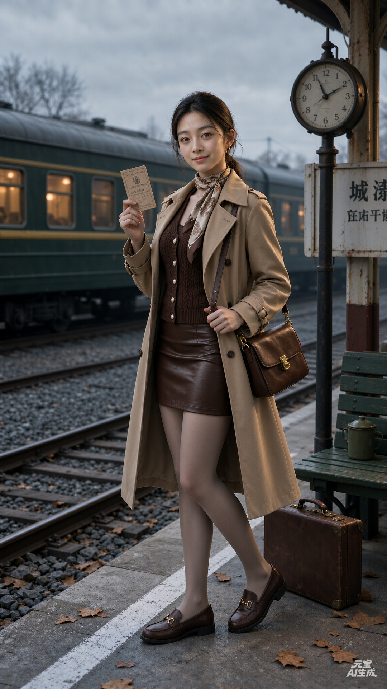
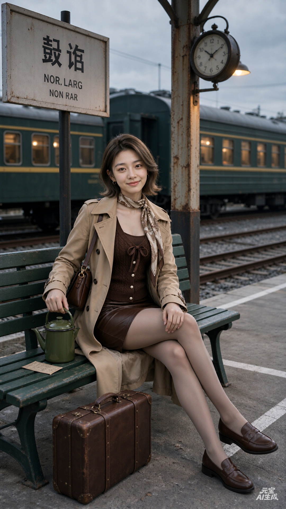
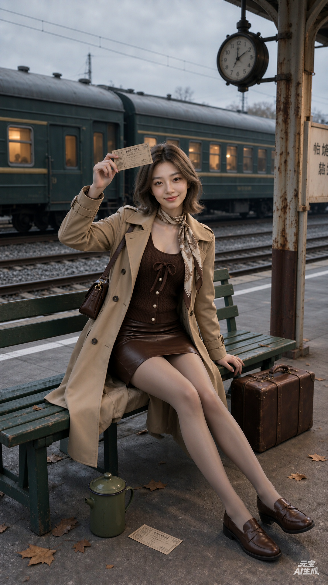
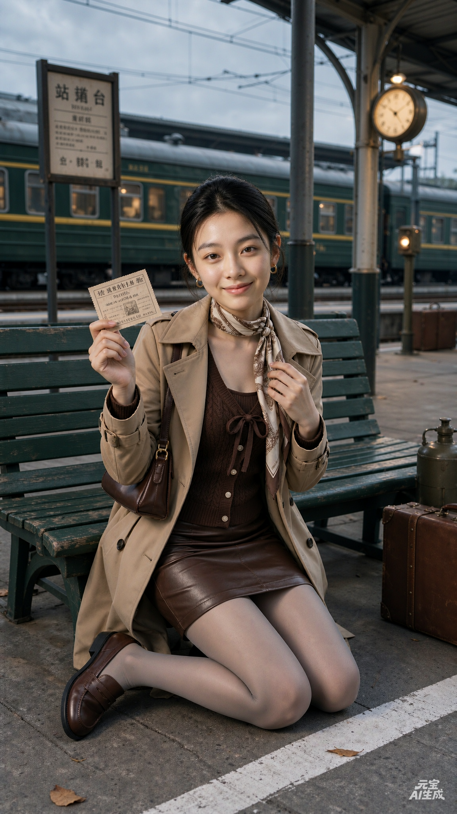

# R056 · 初冬旧站台等一趟晚点的慢车

- 轮次目录：`20261128aw_slow-train-platform`
- 日期：2026-11-28
- 来源：`yuanbao`
- 穿搭：`AUT-0027`
- 发型：未标注
- 场景标签：洗漱
- 四张线稿：`P003_side`、P025_diagonal`、P013_diagonal`、P017_side`
- 画幅：1080×1920（9:16），纯画面

## 四张

| 序 | 机位 | 图 | 终稿提示词 |
|---|---|---|---|
| 01 | front |  | [01_front.md](01_front.md) |
| 02 | side |  | [02_side.md](02_side.md) |
| 03 | seat |  | [03_seat.md](03_seat.md) |
| 04 | close |  | [04_close.md](04_close.md) |

## 这一段说了什么

1. 那株水仙我分好啦，白瓷盆搁窗台上不提它了～这趟慢车又晚点，车票我攥半天了，你再不来我可自己先上车。
2. 长椅凉是凉，我偏坐这头等你。皮箱我挨着放好了，搪瓷壶里还温着水，你光看我不说话，我就一口都不给你倒。
3. 腿伸进这道天光里是我故意的呀，你眼睛往哪儿躲我都看见啦，哼，车票我先不递，谁让你迟到。
4. 凑近点呀，这张票举半天了，就着我的手接，别看别处，这一眼先归我，听见没。

## 现场记录

- 01_front：一套穿搭联网设计一次发型与丝袜基底四张逐张落形态
- 02_side：初冬午后冷青白天光混站台壁灯一小圈暖黄由场景物理定
- 03_seat：终审放大查出第1张横向袜口边第3张屈腿鞋被挡第4张赤足站姿三处硬伤另起两批重出通过
- 04_close：音频链路按暂停开关只关入口与出口

> 原图 PNG 永不转码、永不覆盖；预览用 `` 缩放原图。
