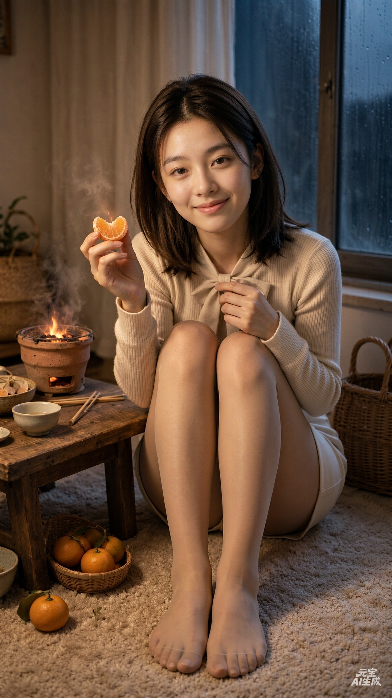

## 终稿提示词

```text
第4张 · 他俯身 · 视点高度 0.32 米、隔 0.3 米看她俯身把一瓣橘举到这一眼前

三句分工：衣由槽 1 承担、脸由槽 2 承担、姿势由槽 3 承担；线稿只管躯干重心、脊线肩髋与两腿骨架；发型与丝袜那一层由第一波研究员联网读资料后一起设计一次、落一份基底写进四份，发型基底句四份逐字一致、各补一句本张重力落点，丝袜那一层按同一基底逐张落本张姿势下的折光与褶影。文字腾给光位、场景、关系视角、构图调子、神态落点。

初冬入夜的老公寓里屋，燕麦色短绒地毯铺满画底，旧木矮桌上一只陶泥小炭炉，炉口一小圈暖橘火光，竹编小篮里几只带叶小蜜橘、粗陶小碟、白瓷小杯、细竹夹，墙角旧藤编筐，窗玻璃凝着薄薄一线水汽，窗侧一线冷蓝夜色，头顶低亮暖白纸罩灯把暖黄落在脸侧与罗纹领口。光色由这轮入夜炉火与纸罩灯定：该暖就把暖橘火光、暖黄灯光与旧木色反光写足，冷蓝窗色只贴着窗沿与地毯边走一线，一轮里冷暖交界也照写；这一轮定下的那种光顺着腿线落到袜面折光上。

奶白罗纹针织长袖上衣，领口一只同色小蝴蝶结，袖口罗纹收在腕骨；奶白皮质高腰迷你裙，裙摆齐整落在大腿中段，面料在炉光里泛一点柔和皮光；整套版型配色面料由槽 1 衣装层承担。

发型基底句：雾感深栗棕透一线暖茶光的及肩下五厘米低层次直发，右侧四六浅偏分把颅顶自然垫起，发身顺直、发尾厚实齐整只带一道极浅内扣，薄法式八字刘海从眉尾分向两侧、额心整片露出来，耳侧两缕细碎发落到下颌角，后颈清爽露在罗纹领外。
本张形态句：发束整体朝这一眼向前垂、额前两缕落到眉尾上，发尾擦过锁骨前那只手的指节，耳侧那两缕擦过下颌角。

她 24 小时穿着一层连裤丝袜：12D 浅杏奶茶半透包芯丝，哑光低反射里带一点柔和宽幅微光，色号贴她暖白皮呈自然浅杏奶茶，从腿根连包到脚趾，脚趾由同色袜面完整包住、五趾在袜面里各自分明，袜面从小腿到脚背连成平顺同一片，脚踝与小腿前缘一道织物折光把袜面与腿肤色分出一层可辨边界，膝弯拉伸处颜色略浅、起两道细褶影，小腿中段到大腿根是同一片连贯丝光。本张折光形态：画底脚背那一小截折光最柔，暖橘光落上去软软的，从小腿到脚背到脚趾连成平顺同一片，十根脚趾在袜面里安分排着。

她跪坐在矮桌前的地毯上朝这一眼俯下身，肩线往前送一点，下巴微微抬着，眼尾压下来正正对上这一眼，嘴角挑一点点。右手从肩经肘腕连到指尖把剥好的一瓣橘举在两人正中间，停住，橘瓣上一点暖橘火光与一点温热的白汽；左手从肩经肘腕连到指尖收在锁骨前，五根手指并着轻轻压住罗纹领口那只小蝴蝶结的一角。画底两只脚并着从膝弯连到脚趾完完整整落在燕麦色短绒毯上，画左留一角竹编篮与两只带叶小蜜橘，画右一线窗沿冷蓝。

画面里只落她自己这一位人物，画外人由首行机位与这一眼的取景方向交待；她自己两条手臂两条腿各自从躯干连续到指尖与脚趾、在画内完整收口，两条手臂各自从肩经肘腕连到指尖、各五根手指、各一个唯一落点，全画共两条手臂、两只手、十根手指、两条腿、十根脚趾。9:16 满幅画面内容，宽 1080 高 1920，人物与道具铺满整幅、四条边即裁切边，人物头顶到脚趾完整收在画内，两只脚从膝弯到脚趾完整落在画底燕麦色短绒毯上。成图自带工具水印原样保留。
```

## 一句点评

第4张抱膝举一瓣橘，两只脚并着完整落画底十趾分明
