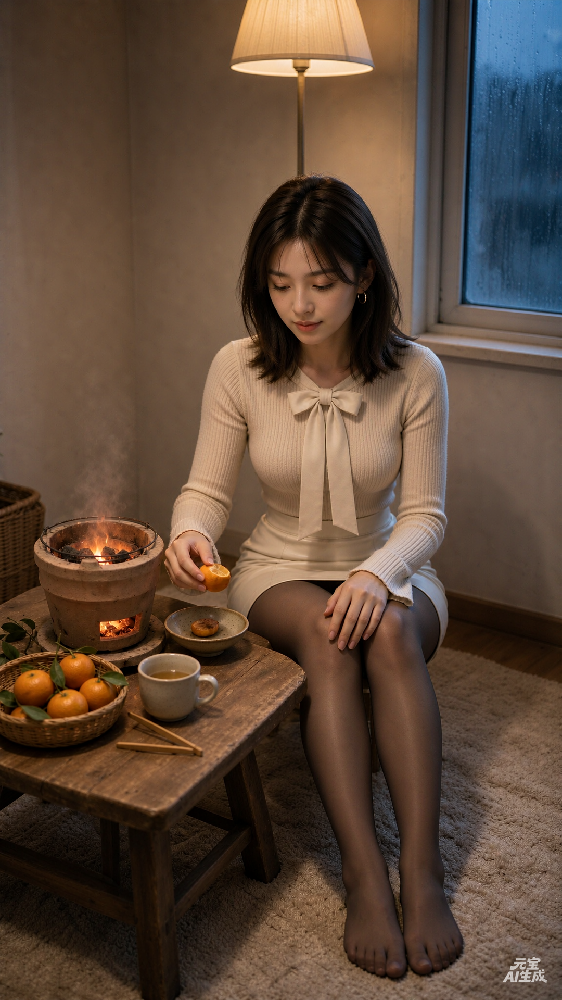

# R057 · 初冬炭炉烤小蜜橘

- 轮次目录：`20261128ax_brazier-oranges`
- 日期：2026-11-28
- 来源：`yuanbao`
- 穿搭：`WIN-0012`
- 发型：未标注
- 场景标签：其它
- 四张线稿：`full_single_P014_low`、full_single_P009_low`、full_single_P012_low`、full_single_P066_low`
- 画幅：1080×1920（9:16），纯画面

## 四张

| 序 | 机位 | 图 | 终稿提示词 |
|---|---|---|---|
| 01 | front |  | [01_front.md](01_front.md) |
| 02 | side |  | [02_side.md](02_side.md) |
| 03 | seat |  | [03_seat.md](03_seat.md) |
| 04 | close |  | [04_close.md](04_close.md) |

## 这一段说了什么

1. 炭炉刚旺起来呀，你站那么远干嘛，这只橘子我先夹着了，过来晚一步就归我吃。
2. 低头翻一下你就偷看我脚背是吧，哼，我自己都知道这层袜子在炉光里亮得过分。
3. 腿伸这儿是我故意的啊，你眼睛往哪儿躲我都看见啦，这只烤橘先不给你。
4. 凑近点呀，这一瓣我举半天了，就着我的手吃，别看别处，也别问甜不甜，这一口归我喂。

## 现场记录

- 01_front：第1张炉口竹夹夹橘回身，浅灰茶袜面顺小腿拉出一道长亮线
- 02_side：第2张并腿低头翻橘，两片脚背连成一小片柔光
- 03_seat：第3张侧坐伸腿举橘贴脸，织物折光拉成整条细亮线
- 04_close：第4张抱膝举一瓣橘，两只脚并着完整落画底十趾分明

> 原图 PNG 永不转码、永不覆盖；预览用 `` 缩放原图。
