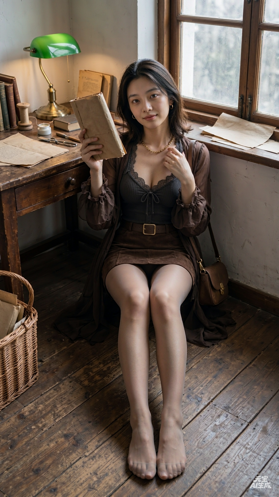

## 终稿提示词

```text
第4张 · 他俯身 · 视点高度 0.32 米、隔 0.3 米看她斜倚凑近、把写好名字的书封举到这一眼前

三句分工：衣由槽 1 承担、脸由槽 2 承担、姿势由槽 3 承担；线稿只管躯干重心、脊线肩髋与两腿骨架；发型与丝袜那一层由第一波研究员联网读资料后一起设计一次、落一份基底写进四份，发型基底句四份逐字一致、各补一句本张重力落点，丝袜那一层按 `[统一]` 四张同一色号、同一脚尖透明款、只随姿势与光位落折光与褶影。文字腾给光位、场景、关系视角、构图调子、神态落点。

初冬午后的旧书铺里屋，深胡桃木长书桌横在画左，桌上摊着一张裁好的牛皮纸、一摞旧书、一只绕着棉麻线的木线轴、一把黄铜裁纸刀、一小碟浆糊与一把扁刷，木格窗在画右，窗玻璃透进灰青白的薄云天光，窗台一叠裁剩的牛皮纸角，绿玻璃罩台灯在桌角亮着一小圈暖黄，旧木地板从画中一路铺到画底，画角一只藤编书筐靠着桌腿。光色由这轮初冬午后薄云天光与绿玻璃罩台灯定：该冷就把木格窗透进的青灰白天光、牛皮纸的冷白反光写足，该暖就把台灯那一小圈暖黄、旧木色反光写足，一轮里冷暖交界也照写；四张同一片光、同一色号、同一脚尖透明款，光只改折光落点与明暗、透明脚尖那一截把这一片光透到趾形上。

深灰罗纹针织挂脖上衣，蕾丝花边 V 领、前系带小蝴蝶结、前排小扣；深棕透明薄纱长罩衫，喇叭袖、层叠荷叶边、长及小腿；深棕麂皮 A 字迷你裙，金扣深棕皮带；深棕麂皮小挎包配金链；金色粗链颈圈；整套版型配色面料由槽 1 衣装层承担。

发型基底句：雾感黑茶棕透一线暖光的及肩胛骨低层次中长发，偏左三七分缝把颅顶自然垫起，上层保留长度与蓬松、发身带一道松缓大 C 弯，发尾 U 形圆润齐整并留住重量，脸周从颧骨起一层渐进碎发落到下颌角，耳侧两缕细碎发，后颈清爽露在罗纹领外。
本张形态句：发束整体朝这一眼向前垂、额前两缕落到眉尾上，发尾擦过锁骨前那只手的指节，耳侧两缕擦过下颌角。

丝袜身份项：15D 浅茶灰半透包芯丝这一个绝对色号，哑光低反射里带一点柔和宽幅微光，色号贴她暖白皮呈自然浅茶灰，四张同一色号、四张同一明度档、四张同一脚尖透明款，从腿根连包到脚趾，脚趾由同色透明袜面完整包住、五趾在透明袜面里各自分明，袜面从小腿到脚背到脚尖连成平顺同一片，脚尖一截同色通透薄纱，薄透度与小腿一致、从脚背平顺连到脚趾，五趾在薄纱里各自分明、脚趾与脚背靠一道织物折光分出同色袜面的包覆边界，透明是薄纱透出趾形、脚趾始终包在同一片袜面里，透明脚尖与脚背连成同一片同色，脚踝与小腿前缘一道织物折光把袜面与腿肤色分出一层可辨边界，膝弯拉伸处颜色略浅、起两道细褶影，小腿中段到大腿根是同一片连贯丝光。
本张形态句：画底脚背那一小截折光最柔，从小腿到脚背到脚趾连成平顺同一片，十根脚趾在透明袜面里安分排着、透明脚尖那一截把这一片光透到趾形上，两只脚并着从膝弯连到脚趾完完整整落在旧木地板上。

她斜倚在书桌前朝这一眼凑近，肩线往前送一点，下巴微微抬着，眼尾压下来正正对上这一眼，嘴角挑一点点。右手从肩经肘腕连到指尖把一本包好牛皮纸书皮的旧书举到两人正中间，书封上写好的名字朝这一眼，停住；左手从肩经肘腕连到指尖收在锁骨前，五根手指并着轻轻压住薄纱罩衫的领边。画底两只脚并着从膝弯连到脚趾完完整整落在旧木地板上，画左留一角藤编书筐，画右一线窗沿冷白。

画面里只落她自己这一位人物，画外人由首行机位与这一眼的取景方向交待；她自己两条手臂两条腿各自从躯干连续到指尖与脚趾、在画内完整收口，两条手臂各自从肩经肘腕连到指尖、各五根手指、各一个唯一落点，全画共两条手臂、两只手、十根手指、两条腿、十根脚趾。9:16 满幅画面内容，宽 1080 高 1920，人物与道具铺满整幅、四条边即裁切边，两只脚从膝弯到脚趾完整落在画底旧木地板上。成图自带工具水印原样保留。
```

## 一句点评

第4张坐着凑近举书封，画底两只脚并着透明脚尖一截薄纱透出趾形
