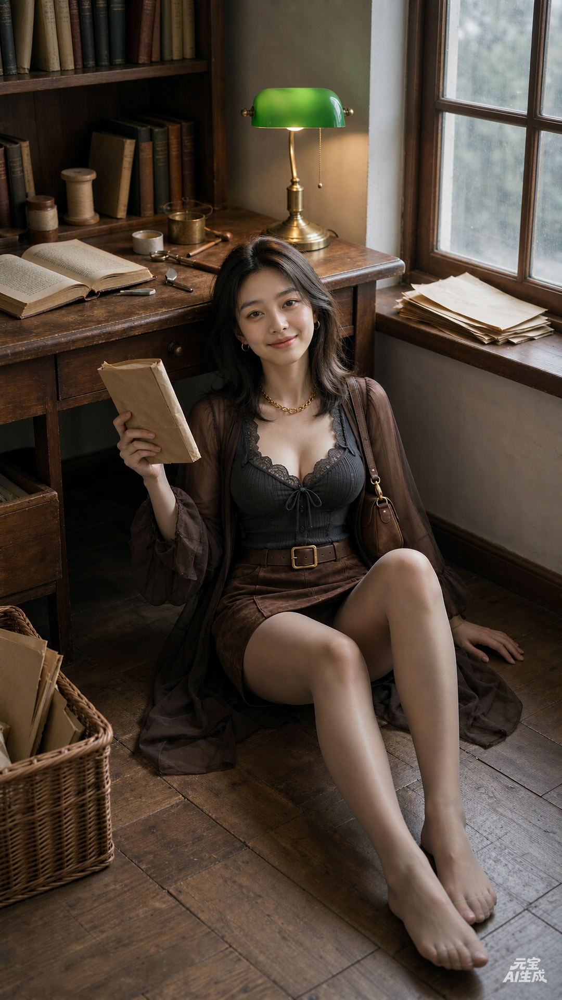
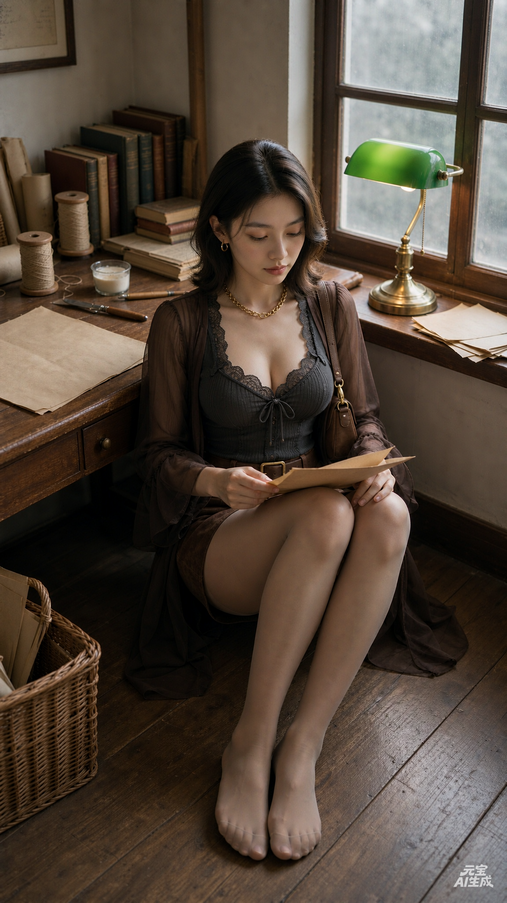
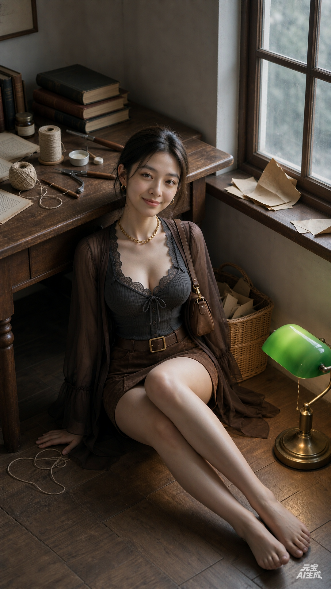
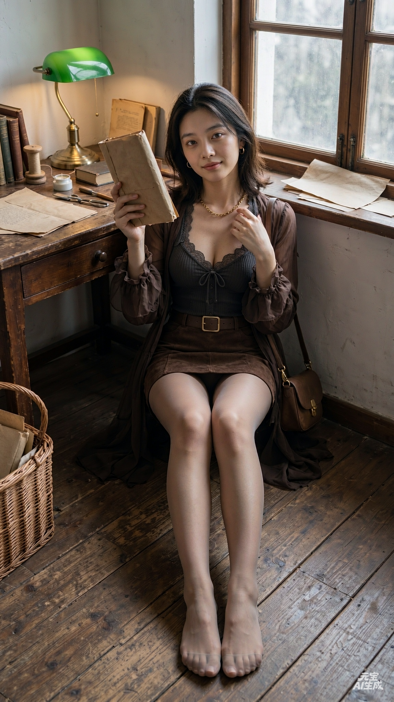

# R059 · 初冬旧书铺包旧书

- 轮次目录：`20261128ay_wrapping-old-books`
- 日期：2026-11-28
- 来源：`yuanbao`
- 穿搭：`AUT-0004`
- 发型：未标注
- 场景标签：其它
- 四张线稿：`full_single_P001_low`、full_single_P004_diag`、full_single_P006_low`、full_single_P007_diag`
- 画幅：1080×1920（9:16），纯画面

## 四张

| 序 | 机位 | 图 | 终稿提示词 |
|---|---|---|---|
| 01 | front |  | [01_front.md](01_front.md) |
| 02 | side |  | [02_side.md](02_side.md) |
| 03 | seat |  | [03_seat.md](03_seat.md) |
| 04 | close |  | [04_close.md](04_close.md) |

## 这一段说了什么

1. 包第一本就归你啦，我折角折了三回才肯放，你敢说歪我就自己重包一遍。
2. 牛皮纸角抹平了你就偷看我脚背是吧，哼，台灯那一小片光我自己都知道亮得过分。
3. 线绕到书脊上啦，我腿伸这儿是故意的，你眼睛往哪儿躲我都看见。
4. 凑近点呀，书封上这名字我写半天了，就着我的手看，这一本归我签给你。

## 现场记录

- 01_front：第1张后仰坐撑地举牛皮纸书皮旧书，窗光顺小腿拉出一道长亮线
- 02_side：第2张并腿低头抹平纸角，台灯在两片脚背连成一小片柔光
- 03_seat：第3张双腿斜伸，织物折光被窗光拉成整条细亮线
- 04_close：第4张坐着凑近举书封，画底两只脚并着透明脚尖一截薄纱透出趾形

> 原图 PNG 永不转码、永不覆盖；预览用 `` 缩放原图。
