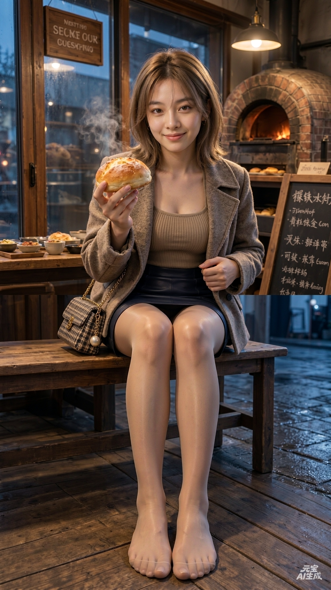

## 终稿提示词

```text
第4张 · 他俯身 · 视点高度 0.30 米、隔 0.28 米看她凑近把刚出炉的小圆面包举到两人正中间

三句分工：衣由槽 1 承担、脸由槽 2 承担、姿势由槽 3 承担；线稿只管躯干重心、脊线肩髋与两腿骨架；发型与丝袜那一层由第一波研究员联网读资料后一起设计一次、落一份基底写进四份，发型基底句四份逐字一致、各补一句本张重力落点，丝袜那一层按 `[统一]` 四张同一色号、同一脚尖透明款、只随姿势与光位落折光与褶影。文字腾给光位、场景、关系视角、构图调子、神态落点。

本轮这一站是巷口新开的旧窑烘焙铺，初冬傍晚刚亮灯：画里有玻璃门与木框、门上方一块木质招牌、门外湿青石板巷面与一线冷蓝暮色、进门左手一道原木柜台、柜上一排试吃小碟与一块靠在木架上的手写菜单牌、身后旧砖窑改的烤炉透出一圈暖橘光、靠窗一条长木凳与高脚凳、头顶一只暖黄吊灯。光色由这轮初冬傍晚的巷口暮色与店内炉火吊灯定：该冷就把玻璃门外青灰蓝的暮色、湿石板的冷反光写足，该暖就把烤炉暖橘、暖黄吊灯与旧木色反光写足，一轮里冷暖交界也照写；四张同一片光、同一色号、同一脚尖透明款，光只改折光落点与明暗、透明脚尖那一截把这一片光透到趾形上。

卡其罗纹针织挂脖背心，方领、细密竖罗纹；灰棕羊毛短外套，宽翻领、单粒深色扣、袖口翻边；藏青皮革高腰迷你裙，裙摆齐整落在大腿中段、皮面在炉光里泛一点柔光；金链格纹小挎包；整套版型配色面料由槽 1 衣装层承担。这套利落、方便推门走动，正合探店达人这一趟出门，外套挡得住巷口晚风，短裙让腿线整片落进这一眼。

发型基底句：雾感蜜茶棕透一线暖光的及锁骨低层次直发，偏右二八侧分把颅顶垫松，一侧发束自然垂在肩前、另一侧拨到耳后，发身顺直、发尾从耳下起剪出长短错落的低层次并往颈侧轻轻内扣，薄八字刘海从太阳穴弯弯落到颧骨，耳侧一缕细碎发落到下颌角，后颈清爽露在罗纹领外。
本张形态句：发束整体朝这一眼向前垂、额前两缕落到眉尾上，发尾擦过锁骨前那只手的指节，耳侧那一缕擦过下颌角。

丝袜身份项：22D 浅米杏半透包芯丝这一个绝对色号，哑光低反射里带一点柔和宽幅微光，色号贴她暖白皮呈自然浅米杏，四张同一色号、四张同一明度档、四张同一脚尖透明款，从腿根连包到脚趾，脚趾由同色透明袜面完整包住、五趾在透明袜面里各自分明，袜面从小腿到脚背到脚尖连成平顺同一片，脚尖一截同色通透薄纱，薄透度与小腿一致、从脚背平顺连到脚趾，五趾在薄纱里各自分明、脚趾与脚背靠一道织物折光分出同色袜面的包覆边界，透明是薄纱透出趾形、脚趾始终包在同一片袜面里，透明脚尖与脚背连成同一片同色，脚踝与小腿前缘一道织物折光把袜面与腿肤色分出一层可辨边界，膝弯拉伸处颜色略浅、起两道细褶影，小腿中段到大腿根是同一片连贯丝光。
本张形态句：画底脚背那一小截折光最柔，从小腿到脚背到脚趾连成平顺同一片，十根脚趾在透明袜面里安分排着、透明脚尖那一截把这一片光透到趾形上，两只脚并着从膝弯连到脚趾完完整整落在旧木地板上。

她坐在这张旧木长凳上朝这一眼凑近，肩线往前送一点，下巴微微抬着，眼尾压下来正正对上这一眼，嘴角挑一点点。右手从肩经肘腕连到指尖把一只刚出炉的小圆面包举到两人正中间，停住，面包顶上一点暖橘炉光与一点温热的白汽；左手从肩经肘腕连到指尖收在锁骨前，五根手指并着轻轻压住羊毛外套的翻领边。画底两只脚并着从膝弯连到脚趾完完整整落在旧木地板上，画左留一角柜台与一排试吃小碟，画右一线玻璃门外的冷蓝暮色。

画面里只落她自己这一位人物，画外人由首行机位与这一眼的取景方向交待；她自己两条手臂两条腿各自从躯干连续到指尖与脚趾、在画内完整收口，两条手臂各自从肩经肘腕连到指尖、各五根手指、各一个唯一落点，全画共两条手臂、两只手、十根手指、两条腿、十根脚趾。9:16 满幅画面内容，宽 1080 高 1920，人物与道具铺满整幅、四条边即裁切边，两只脚从膝弯到脚趾完整落在画底旧木地板上。成图自带工具水印原样保留。
```

## 一句点评

第4张坐旧木长凳凑近举刚出炉小圆面包，画底两只脚并着十趾在通透薄纱里各自分明
