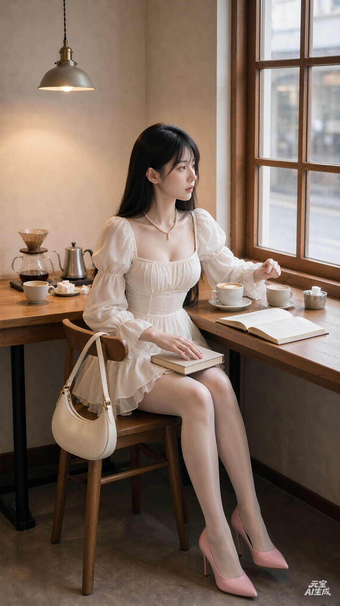

# R060 · 第一行归你写

- 轮次目录：`20261128b_lovers-first-cup`
- 来源：`lovers`
- 日期：2026-11-28
- 穿搭：`SPR-0070`
- 四张线稿：`代码手搓·78cm略低平视坐姿压摊开最后一页`、`代码手搓·132cm略高俯身仰头双手捧杯`、`代码手搓·44cm桌沿低机位推杯带画右接杯男主手`、`代码手搓·108cm侧后回头搭椅背压合起本子`
- 画幅：1080×1920（9:16），纯画面，工具水印随图保留

## 四张

| 序 | 机位 | 图 | 终稿提示词 |
|---|---|---|---|
| 01 | front |  | [01_front.md](01_front.md) |
| 02 | side |  | [02_side.md](02_side.md) |
| 03 | seat |  | [03_seat.md](03_seat.md) |
| 04 | close |  | [04_close.md](04_close.md) |

## 这一段说了什么

1. 短话
2. 主动话题

## 现场记录

- 用
- 户
- 看
- 思
- 考
- 过
- 程
- 时
- 对
- 上
- 一
- 轮
-  
- r
- o
- u
- n
- d
- _
- 2
- 0
- 2
- 6
- 1
- 1
- 2
- 8
- _
- d
- a
- w
- n
- _
- q
- u
- e
- u
- e
-  
- 那
- 款
- 发
- 型
- 当
- 面
- 点
- 踩
- （
- 点
- 踩
- 就
- 是
- 不
- 喜
- 欢
- 、
- 宁
- 愿
- 不
- 要
- 了
- 、
- 要
- 记
- 进
- 用
- 户
- 喜
- 好
- 文
- 件
- 、
- 重
- 新
- 开
- 一
- 轮
- ）
- 。
- P
- R
- E
- F
- E
- R
- E
- N
- C
- E
- S
- .
- m
- d
-  
- 第
- 五
- 节
- 新
- 增
- 点
- 踩
- 记
- 录
- 表
- ，
- 逐
- 字
- 记
- 被
- 点
- 踩
- 那
- 一
- 款
- 具
- 体
- 串
- （
- 及
- 肩
- 下
- 两
- 指
- 厚
- 重
- 齐
- 刘
- 海
- 短
- 直
- 发
- 、
- 分
- 缝
- 藏
- 刘
- 海
- 、
- 发
- 尾
- 三
- 厘
- 米
- 内
- 扣
- 圆
- 钝
- 弧
- 、
- 深
- 墨
- 黑
- 暖
- 栗
- 雾
- ）
- ，
- 效
- 力
- ＝
- 该
- 轮
- 四
- 张
- 不
- 复
- 用
- 、
- 重
- 开
- 一
- 轮
- 、
- 新
- 轮
-  
- 2
- .
- 5
-  
- 按
- 新
- 槽
-  
- 1
-  
- 重
- 新
- 设
- 计
- 一
- 款
- 、
- 不
- 拉
- 黑
- 短
- 发
- ／
- 齐
- 刘
- 海
- 品
- 类
- ；
- 原
- 误
- 写
- 「
- 点
- 彩
- 」
- 已
- 按
- 用
- 户
- 纠
- 正
- 统
- 一
- 改
- 「
- 点
- 踩
- 」
- 。
- R
- 0
- 5
- 8
-  
- 已
- 归
- 档
- 的
- 不
- 擅
- 自
- 回
- 滚
- 、
- 不
- 擅
- 自
- 重
- 出
- 。
- 本
- 轮
- 接
-  
- d
- a
- w
- n
- _
- q
- u
- e
- u
- e
-  
- 短
- 话
- 「
- 进
- 去
- 第
- 一
- 杯
- 你
- 点
- 还
- 是
- 我
- 点
- ？
- 」
- 走
- 到
- 卷
- 帘
- 门
- 开
- 、
- 进
- 店
- 、
- 靠
- 窗
- 木
- 桌
- 坐
- 下
- 、
- 第
- 一
- 杯
- 端
- 上
- 来
- 、
- 探
- 店
- 本
- 最
- 后
- 一
- 页
- 第
- 一
- 行
- 他
- 真
- 写
- 了
- 。
- S
- P
- R
- -
- 0
- 0
- 7
- 0
-  
- s
- p
- r
- i
- n
- g
- /
- d
- r
- e
- s
- s
-  
- 奶
- 油
- 白
- 方
- 领
- 抽
- 褶
- 泡
- 泡
- 长
- 袖
- 迷
- 你
- 蓬
- 裙
- （
- 方
- 领
- ＋
- 竖
- 抽
- 褶
- ＋
- 鱼
- 骨
- 收
- 腰
- ＋
- 双
- 层
- 荷
- 叶
- 边
- 蓬
- 摆
- ＋
- 灯
- 笼
- 袖
- 喇
- 叭
- 袖
- 口
- ）
- ＋
- 珍
- 珠
- 小
- 圆
- 珠
- 短
- 项
- 链
- 带
- 细
- 金
- 竖
- 坠
- ＋
- 米
- 白
- 弯
- 月
- 小
- 腋
- 下
- 包
- ＋
- 粉
- 色
- 尖
- 头
- 细
- 高
- 跟
- 鞋
- ；
- 发
- 型
- 由
-  
- 2
- .
- 5
-  
- 据
- 新
- 合
- 成
- 槽
-  
- 1
-  
- 重
- 新
- 设
- 计
- 为
- 过
- 肩
- 下
- 约
- 一
- 掌
- 中
- 分
- 长
- 直
- 发
- 、
- 轻
- 薄
- 空
- 气
- 碎
- 刘
- 海
- 露
- 眉
- 眼
- 、
- 发
- 尾
- 齐
- 整
- 垂
- 肩
- 胛
- 骨
- 中
- 段
- 不
- 内
- 扣
- 、
- 深
- 墨
- 黑
- 冷
- 茶
- 雾
- 哑
- 光
- ，
- 与
- 点
- 踩
- 那
- 款
- 在
- 长
- 度
- ／
- 刘
- 海
- ／
- 分
- 缝
- ／
- 发
- 尾
- ／
- 发
- 色
- 五
- 项
- 全
- 不
- 同
- 、
- 那
- 一
- 串
- 未
- 复
- 用
- ；
- 美
- 甲
- 蜜
- 桃
- 裸
- 粉
- 圆
- 短
- 甲
- ＋
- 极
- 细
- 奶
- 白
- 弧
- 。
- 下
- 装
- 膝
- 上
- 迷
- 你
- 蓬
- 裙
- ＝
- 裙
- 装
- ，
- 那
- 一
- 层
- 是
- 裙
- 里
- 丝
- （
- 奶
- 白
- 珠
- 光
- 匀
- 透
- 连
- 裤
- 丝
- 袜
- 、
- 从
- 髋
- 经
- 膝
- 到
- 脚
- 背
- 连
- 续
- 、
- 平
- 顺
- 连
- 进
- 粉
- 色
- 尖
- 头
- 鞋
- 口
- 、
- B
- 5
- -
- C
-  
- 无
- 罗
- 纹
- 收
- 口
- ）
- ，
- 不
- 是
- 裤
- 里
- 丝
- ；
- 按
-  
- L
- E
- G
- _
- S
- H
- O
- W
- .
- m
- d
-  
- 二
- 节
- 短
- 裙
- 腿
- 层
- 本
- 就
- 可
- 见
- ，
- 本
- 轮
- 不
- 触
- 发
- 展
- 示
- 张
- ，
- F
-  
- 组
- 不
- 适
- 用
- ，
- 四
- 张
- 全
- 无
- 提
- 起
- 裙
- 摆
- 动
- 作
- ，
- s
- k
- e
- t
- c
- h
- e
- s
-  
- 无
- 「
- 代
- 码
- 手
- 搓
- ·
- 展
- 示
- 张
- 」
- 项
- 。
- 四
- 张
- 取
- 景
-  
- 7
- 8
- /
- 1
- 3
- 2
- /
- 4
- 4
- /
- 1
- 0
- 8
- c
- m
-  
- 逐
- 张
- 单
- 独
- 设
- 计
- ，
- 与
- 上
- 一
- 轮
-  
- 1
- 6
- 5
- /
- 5
- 0
- /
- 1
- 2
- 0
- /
- 9
- 6
- c
- m
- 、
- 上
- 上
- 轮
-  
- 1
- 5
- 2
- /
- 6
- 8
- /
- 1
- 0
- 4
- /
- 4
- 2
- c
- m
-  
- 整
- 条
- 错
- 开
- ，
- 不
- 套
- 三
- 远
- 一
- 近
- 、
- 末
- 张
- 非
- 双
- 手
- 特
- 写
- ；
- 男
- 主
- 局
- 部
-  
- 0
- /
- 0
- /
- 1
- /
- 0
- （
- 仅
- 第
- 3
- 张
- 画
- 右
- 他
- 一
- 只
- 手
- 接
- 杯
- 、
- 天
- 然
- 短
- 甲
- 素
- 甲
- 、
- 深
- 灰
- 呢
- 料
- 袖
- 口
- 、
- 头
- 脸
- 画
- 外
- ）
- 。
- 四
- 张
- 槽
-  
- 3
-  
- 库
- 挑
-  
- -
- -
- s
- p
- r
- e
- a
- d
-  
- 落
- 在
-  
- u
- p
- p
- e
- r
- /
- d
- u
- o
- /
- f
- u
- l
- l
- _
- s
- e
- x
- y
- /
- f
- u
- l
- l
- _
- s
- t
- d
-  
- 逐
- 张
- 真
- 看
- 全
- 不
- 贴
- ，
- 四
- 张
- 全
- 部
- 第
- 2
- 步
- 代
- 码
- 手
- 搓
- ，
- 库
- 图
- 留
-  
- s
- l
- o
- t
- s
- /
- _
- b
- a
- c
- k
- u
- p
- /
- 。
- 6
- .
- 8
-  
- 元
- 宝
- 自
- 己
- 四
- 张
- 同
- 屏
- 亲
- 看
- ＋
- 逐
- 张
- 放
- 大
- ，
- 第
- 1
- 轮
- 即
- 判
- 四
- 张
- 全
- 合
- 格
- ，
- 无
- 补
- 图
- 循
- 环
- 、
- 无
- 重
- 生
- 成
- 、
- 四
- 张
- 首
- 版
- 终
- 稿
- 一
- 像
- 素
- 未
- 改
- ；
- 逐
- 张
- 放
- 大
- 核
- 过
- 腿
- 层
- 连
- 续
- 到
- 鞋
- 口
- 、
- B
- 5
- -
- C
-  
- 过
- 、
- A
- 2
- -
- M
-  
- 不
- 命
- 中
- 、
- 四
- 张
- 同
- 衣
- 同
- 发
- 同
- 甲
- 同
- 裙
- 里
- 丝
- 同
- 鞋
- 同
- 脸
- 、
- 双
- 光
- 位
- 一
- 致
- 、
- 单
- 幅
- 无
- 拼
- 贴
- 。
- 遗
- 留
- 轻
- 项
- ：
- 图
- 2
- 仍
- 被
- 正
- 面
- 全
- 身
- 人
- 台
- 拉
- 成
- 坐
- 姿
- 全
- 身
- 腿
- 脚
- 进
- 画
- （
- 与
- 「
- 只
- 取
- 头
- 肩
- 」
- 定
- 稿
- 有
- 出
- 入
- ，
- 按
- 不
- 硬
- 裁
- 好
- 图
- 放
- 行
- ）
- 、
- 图
- 3
- 她
- 两
- 手
- 都
- 在
- 杯
- 上
- 且
- 本
- 子
- 渲
- 成
- 整
- 页
- 手
- 写
- 行
- 、
- 图
- 1
- 桌
- 面
- 道
- 具
- 增
- 殖
- 、
- 槽
- 1
- 右
- 上
- 发
- 型
- 参
- 考
- 原
- 图
- 偏
- 齐
- 刘
- 海
- 而
- 成
- 图
- 按
- 定
- 稿
- 走
- 成
- 中
- 分
- 碎
- 刘
- 海
- ，
- 均
- 不
- 返
- 工
- 。
- 本
- 会
- 话
- 无
- 独
- 立
- 研
- 究
- 员
- 与
- 作
- 家
- 委
- 托
- 入
- 口
- ：
- 第
- 6
- 步
- 验
- 图
- 与
- 6
- .
- 8
- 第
- 三
- 方
- 意
- 见
- 职
- 能
- 由
- 元
- 宝
- 按
- 核
- 项
- 自
- 行
- 亲
- 看
- 承
- 担
- 、
- 6
- .
- 5
-  
- 文
- 章
- 由
- 元
- 宝
- 据
- 四
- 张
- 图
- 成
- 文
- ，
- 不
- 包
- 装
- 成
- 研
- 究
- 员
- 判
- 合
- 格
- 或
- 作
- 家
- 成
- 文
- 。
- 四
- 张
- 右
- 下
- 角
- 「
- 元
- 宝
-  
- A
- I
-  
- 生
- 成
- 」
- 角
- 标
- 按
- 水
- 印
- 无
- 所
- 谓
- 保
- 留
- 。
- 第
- 4
- 步
- 四
- 次
- 并
- 行
- 一
- 次
- 全
- 成
- ，
- f
- i
- t
-  
- 跑
- 1
- 次
- ，
- 四
- 份
- 定
- 稿
- 零
- 处
- 解
- 冻
- 。

> 原图 PNG 永不转码、永不覆盖；预览用 `` 缩放原图。
> 另有 `essay.md` 为本轮第一人称文章留证。
