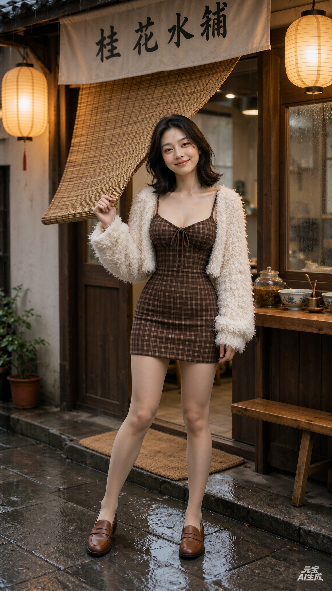

## 终稿提示词

```text
第1张 · 他站 · 视点高度 1.10 米、隔 2.0 米看她站在店门外湿青石板街面上抬手掀竹帘

三句分工：衣由槽 1 承担、脸由槽 2 承担、姿势由槽 3 承担；线稿只管躯干重心、脊线肩髋与两腿骨架，脚上那双鞋由本段文字写定；发型与丝袜那一层由第一波研究员联网读资料后一起设计一次、落一份基底写进四份，发型基底句四份逐字一致、各补一句本张重力落点，丝袜那一层按 `[统一]` 四张同一色号、同一脚尖透明款、只随姿势与光位落折光与褶影。文字腾给光位、场景、关系视角、构图调子、神态落点。

本轮这一站是初冬雨后入夜、巷口新开的桂花糖水铺，卖桂花糖水、姜撞奶与桂花糕：画里有檐下一块布幡招牌、两盏刚点亮的纸灯笼、一道竹帘店门、木框门面、门外雨后湿青石板街面与积水里一线青灰冷光、门内一块短绒门口脚垫、进门左手一道原木柜台、柜上一排玻璃糖水罐与几只青瓷小碗、一只小铜勺、靠墙一条长条木凳。这一片光由初冬雨后入夜的巷口天色与檐下纸灯笼定：该冷就把雨后青灰夜色、湿石板的冷反光、竹帘缝里那一线天青写足，该暖就把纸灯笼暖黄、柜台旧木色反光、糖水碗口那一缕温热白汽里的暖光写足，一轮里冷暖交界也照写；四张同一片光、同一色号、同一脚尖透明款，光只改折光落点与明暗、透明脚尖那一截把这一片光透到趾形上。这一眼是远景，竹帘挡着，门内原木柜台与那排玻璃糖水罐只从竹帘下沿露出一角，长条木凳笼在灯影里。

画里实有一双栗棕平底乐福鞋，两只脚各穿一只，鞋口压在脚踝下、棕皮鞋面在湿石板上映着一点纸灯笼暖黄，鞋里连着浅香槟丝袜脚背；这一双鞋是这一眼门里门外最要紧的一件实有物，跟着她从巷口一路走到店门前的湿青石板上。

棕格纹吊带迷你连衣裙，心形领、胸前一根细系带、细肩带、呢料格纹、裙摆齐整落在大腿中段；米白长毛绒开衫，落肩、蓬松长毛、袖口一圈毛边；一只棕皮金扣小挎包斜搭在肩。整套版型配色面料由槽 1 衣装层承担。格纹呢料挡得住雨后巷口的晚风，米白长毛绒在纸灯笼下泛一层软软的暖光，短裙让腿线整片落进这一眼，正合探店达人这一趟从巷口走来的出门装。

发型基底句：雾感黑茶棕透一点冷调光的及肩下两厘米低层次微卷发，中分偏左一点点把颅顶垫松，发身从耳下起是松松的大弯、每一弯宽窄都随发束走，发尾最后两厘米往外轻翻，额前几缕薄碎发斜落眉尾，耳侧两缕细碎发贴着颧骨落到下颌角，后颈清爽露在心形领外。
本张形态句：发束被巷口晚风带向一侧、落在毛绒开衫肩上，额前那一缕随抬头压出一道浅弧，耳侧那一缕贴着颊边。

丝袜身份项：20D 浅香槟雾面半透包芯丝这一个绝对色号，哑光低反射里带一点柔和宽幅微光，色号贴她冷白皮呈自然浅香槟灰调，四张同一色号、四张同一明度档、四张同一脚尖透明款，从腿根连包到脚趾，脚趾由同色透明袜面完整包住、五趾在透明袜面里各自分明，袜面从小腿到脚背到脚尖连成平顺同一片，脚尖一截同色通透薄纱，薄透度与小腿一致、从脚背平顺连到脚趾，五趾在薄纱里各自分明、脚趾与脚背靠一道织物折光分出同色袜面的包覆边界，透明是薄纱透出趾形、脚趾始终包在同一片袜面里，透明脚尖与脚背连成同一片同色，脚踝与小腿前缘一道织物折光把袜面与腿肤色分出一层可辨边界，膝弯拉伸处颜色略浅、起两道细褶影，小腿中段到大腿根是同一片连贯丝光。
本张形态句：站在雨后湿青石板街面上，膝弯两道细褶影最清楚，巷口青灰冷光顺小腿前缘拉出一道长亮线一路到鞋口，鞋口处一道织物折光把袜面与腿肤色分出一层可辨边界，透明脚尖那一截在包趾鞋里把这一片光透到趾形上，明暗只在同一色号内深浅一档以内，色相与色号守住同一支；这一层浅香槟袜面在小腿前缘有一道可辨的织物折光把袜面与腿肤色分出一层边，脚踝上缘一圈极浅的袜面织物反光，鞋口里那一小截脚背是半透薄纱、五根脚趾的轮廓在薄纱里一根一根透出来。

本张鞋的判断（状态：栗棕平底乐福鞋）：这一张她还在门外雨后湿青石板街面上、刚从巷口一路走过来还没进门，两只栗棕平底乐福鞋都实实穿在两只脚上、丝袜脚背连进鞋口、鞋穿在丝袜外面，鞋面一点被雨气蹭亮的柔光，因为这一眼要交待她从街面走来的动线来路、鞋在画里是实有物，透明脚尖在包趾鞋里按成图实见难逐根核五趾的鞋型遮挡口径放行；再一步就是掀帘进门。

她站在店门外湿青石板街面上，肩线朝这一眼微微侧过来，下巴抬一点，眼尾弯起来，嘴角挑一点点，笑意收在眼睛里。右手从肩经肘腕连到指尖捏着竹帘下缘往侧边掀开一道缝，五根手指松松压着竹篾；左手从肩经肘腕连到指尖垂在米白长毛绒开衫的袖口边，五根指头并着轻轻贴着毛边。两只脚各穿着一只栗棕平底乐福鞋、从膝弯到鞋尖完整落在画底湿青石板上，画左一线檐下纸灯笼的暖黄，画右积水里那一线青灰天光。

画面里只落她自己这一位人物，画外人由首行机位与这一眼的取景方向交待；她自己两条手臂两条腿各自从躯干连续到指尖与脚趾、在画内完整收口，两条手臂各自从肩经肘腕连到指尖、各五根手指、各一个唯一落点，全画共两条手臂、两只手、十根手指、两条腿、十根脚趾。9:16 满幅画面内容，宽 1080 高 1920，人物与道具铺满整幅、四条边即裁切边，两只脚各穿着一只栗棕平底乐福鞋、从膝弯到鞋尖完整落在画底湿青石板街面上。成图自带工具水印原样保留。
```

## 一句点评

第1张门外湿青石板街面掀竹帘、两只栗棕平底乐福鞋实实穿好、鞋口连着浅香槟丝袜脚背
