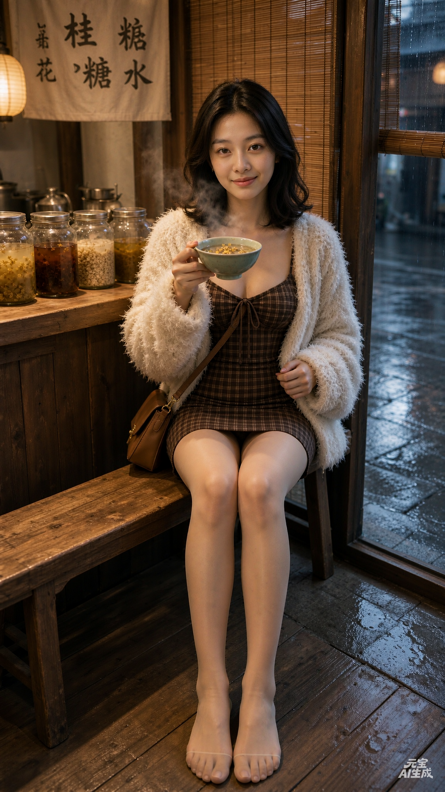

## 终稿提示词

```text
第4张 · 他俯身 · 视点高度 0.30 米、隔 0.30 米看她凑近把青瓷小碗举到两人正中间

三句分工：衣由槽 1 承担、脸由槽 2 承担、姿势由槽 3 承担；线稿只管躯干重心、脊线肩髋与两腿骨架；发型与丝袜那一层由第一波研究员联网读资料后一起设计一次、落一份基底写进四份，发型基底句四份逐字一致、各补一句本张重力落点，丝袜那一层按 `[统一]` 四张同一色号、同一脚尖透明款、只随姿势与光位落折光与褶影。文字腾给光位、场景、关系视角、构图调子、神态落点。

本轮这一站是初冬雨后入夜、巷口新开的桂花糖水铺，卖桂花糖水、姜撞奶与桂花糕：画里有檐下一块布幡招牌、两盏刚点亮的纸灯笼、一道竹帘店门、木框门面、门外雨后湿青石板街面与积水里一线青灰冷光、门内一块短绒门口脚垫、进门左手一道原木柜台、柜上一排玻璃糖水罐与几只青瓷小碗、一只小铜勺、靠墙一条长条木凳。这一片光由初冬雨后入夜的巷口天色与檐下纸灯笼定：该冷就把雨后青灰夜色、湿石板的冷反光、竹帘缝里那一线天青写足，该暖就把纸灯笼暖黄、柜台旧木色反光、糖水碗口那一缕温热白汽里的暖光写足，一轮里冷暖交界也照写；四张同一片光、同一色号、同一脚尖透明款，光只改折光落点与明暗、透明脚尖那一截把这一片光透到趾形上。9:16 满幅竖画面，上半幅收她凑近的脸、肩线与举起来的青瓷小碗，下半幅完整收她并着朝这一眼伸出去的两只脚，她整个人坐在门内长条木凳上，两只脚落在门内旧木地板上，画左一角原木柜台与玻璃糖水罐，画右一线竹帘缝外的青灰夜色只作背景。

棕格纹吊带迷你连衣裙，心形领、胸前一根细系带、细肩带、呢料格纹、裙摆齐整落在大腿中段；米白长毛绒开衫，落肩、蓬松长毛、袖口一圈毛边；一只棕皮金扣小挎包斜搭在肩。整套版型配色面料由槽 1 衣装层承担。格纹呢料挡得住雨后巷口的晚风，米白长毛绒在纸灯笼下泛一层软软的暖光，短裙让腿线整片落进这一眼，正合探店达人这一趟从巷口走来的出门装。

发型基底句：雾感黑茶棕透一点冷调光的及肩下两厘米低层次微卷发，中分偏左一点点把颅顶垫松，发身从耳下起是松松的大弯、每一弯宽窄都随发束走，发尾最后两厘米往外轻翻，额前几缕薄碎发斜落眉尾，耳侧两缕细碎发贴着颧骨落到下颌角，后颈清爽露在心形领外。
本张形态句：发束整体朝这一眼前垂、额前两缕落到眉尾上，发尾擦过锁骨前那只手的指节，耳侧那一缕擦过下颌角。

丝袜身份项：20D 浅香槟雾面半透包芯丝这一个绝对色号，哑光低反射里带一点柔和宽幅微光，色号贴她冷白皮呈自然浅香槟灰调，四张同一色号、四张同一明度档、四张同一脚尖透明款，从腿根连包到脚趾，脚趾由同色透明袜面完整包住、五趾在透明袜面里各自分明，袜面从小腿到脚背到脚尖连成平顺同一片，脚尖一截同色通透薄纱，薄透度与小腿一致、从脚背平顺连到脚趾，五趾在薄纱里各自分明、脚趾与脚背靠一道织物折光分出同色袜面的包覆边界，透明是薄纱透出趾形、脚趾始终包在同一片袜面里，透明脚尖与脚背连成同一片同色，脚踝与小腿前缘一道织物折光把袜面与腿肤色分出一层可辨边界，膝弯拉伸处颜色略浅、起两道细褶影，小腿中段到大腿根是同一片连贯丝光。
本张形态句：画底脚背那一小截折光最柔，从小腿到脚背到脚趾连成平顺同一片，十根脚趾在透明袜面里安分排着、透明脚尖那一截把这一片光透到趾形上，两只脚并着从膝弯连到脚趾完完整整落在门内旧木地板上，明暗只在同一色号内深浅一档以内，色相与色号守住同一支；这一层浅香槟袜面在小腿前缘有一道可辨的织物折光把袜面与腿肤色分出一层边，脚踝上缘一圈极浅的袜面织物反光，脚背到脚尖是一整片半透薄纱、五根脚趾在薄纱里一根一根透出轮廓、趾根一道折光把趾形与脚背分出同色包覆边界，灯笼暖黄落在这片薄纱上把趾形照得清清楚楚。

本张鞋的判断（状态：赤足）：这一张她坐门内长条木凳朝这一眼凑近、两只脚并着完完整整落在门内旧木地板上，十趾由同色透明袜面完整包住、脚尖一截通透薄纱与脚背同一片，鞋留在门边、画里只收她两只完整的脚，因为凑近递碗这一眼整个人都收在纸灯笼暖黄里、画底脚背那一小截折光最柔，取景落点全给这一片袜面与透明脚尖。

她坐在门内长条木凳上朝这一眼凑近，肩线往前送一点，下巴微微抬着，眼尾压下来正正对上这一眼，嘴角挑一点点。右手从肩经肘腕连到指尖独自把一只青瓷小碗举到两人正中间停住，碗里桂花糖水浮着几点桂花、碗口一缕温热白汽；左手从肩经肘腕连到指尖收在锁骨前，五根手指并着轻轻压住米白长毛绒开衫的边。画底两只脚并着从膝弯连到脚趾完完整整落在门内旧木地板上，画左一角原木柜台与那排玻璃糖水罐，画右一线竹帘缝外的冷青只作背景。

画面里只落她自己这一位人物，画外人由首行机位与这一眼的取景方向交待；她自己两条手臂两条腿各自从躯干连续到指尖与脚趾、在画内完整收口，两条手臂各自从肩经肘腕连到指尖、各五根手指、各一个唯一落点，全画共两条手臂、两只手、十根手指、两条腿、十根脚趾。9:16 满幅画面内容，宽 1080 高 1920，人物与道具铺满整幅、四条边即裁切边，两只脚从膝弯连到脚趾完整落在画底门内旧木地板上。成图自带工具水印原样保留。
```

## 一句点评

第4张凑近独自举青瓷小碗、画底两只脚并着、脚尖一截通透薄纱与脚背同一片、趾根一道折光分出包覆边界
