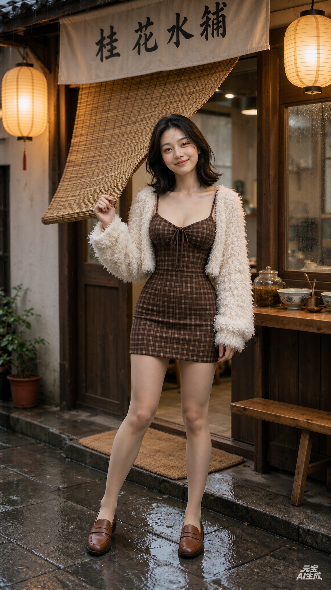
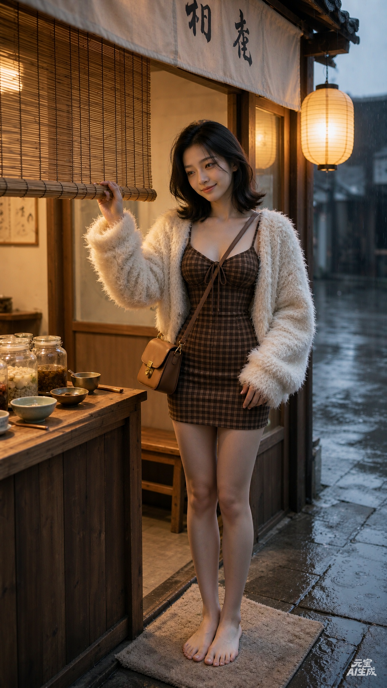
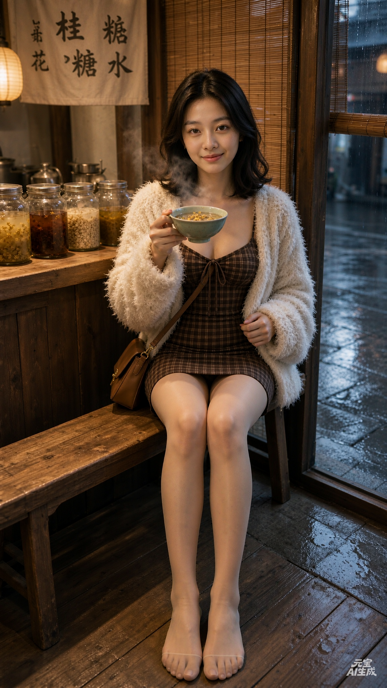

# R064 · 初冬雨后桂花糖水铺探店

- 轮次目录：`20261128ba_osmanthus-soup`
- 日期：2026-11-28
- 来源：`yuanbao`
- 穿搭：`WIN-0259`
- 发型：未标注
- 场景标签：桂花糖水铺、糖水、老街
- 四张线稿：`full_single_P017_front`、full_single_P017_diag`、full_single_P003_side`、full_single_P004_front`
- 画幅：1080×1920（9:16），纯画面

## 四张

| 序 | 机位 | 图 | 终稿提示词 |
|---|---|---|---|
| 01 | front |  | [01_front.md](01_front.md) |
| 02 | side |  | [02_side.md](02_side.md) |
| 03 | seat |  | [03_seat.md](03_seat.md) |
| 04 | close |  | [04_close.md](04_close.md) |

## 这一段说了什么

1. 这家糖水铺我盯了整三天啦，布幡今早才挂上，你走慢一点呀，竹帘我来掀。
2. 巷尾那家旧物铺我改天再去啦，今天先归这碗桂花糖水呀，你只准看着呀。
3. 姜撞奶我替你先尝一口啦，甜得刚刚好呀，下一站往桥头那碗热汤圆走呀。
4. 凑近一点呀，这一碗第一个我留给你啦，就着我的手接过去吧，别看别处呀。

## 现场记录

- 01_front：第1张门外湿青石板街面掀竹帘、两只栗棕平底乐福鞋实实穿好、鞋口连着浅香槟丝袜脚背
- 02_side：第2张推门这一步换赤足、两只脚并着落在短绒门口脚垫上、十趾由透明袜面完整包住
- 03_seat：第3张坐门内长条木凳两腿斜伸、灯笼暖黄把织物折光拉成整条细亮线、柜台青瓷小碗与玻璃糖水罐都在
- 04_close：第4张凑近独自举青瓷小碗、画底两只脚并着、脚尖一截通透薄纱与脚背同一片、趾根一道折光分出包覆边界

> 原图 PNG 永不转码、永不覆盖；预览用 `` 缩放原图。
