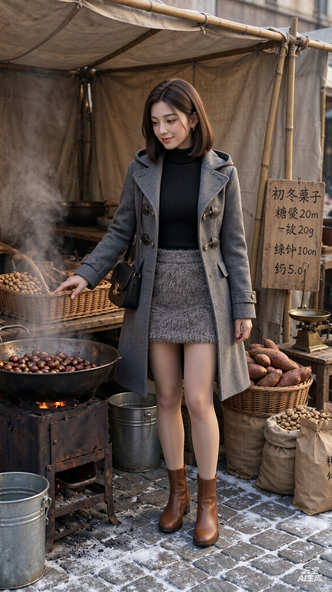

## 终稿提示词

```text
第2张 · 他站 · 视点高度 1.05 米、隔 1.4 米看她站在摊前朝那口糖炒栗子铁锅微微侧过去

三句分工：衣由槽 1 承担、脸由槽 2 承担、姿势由槽 3 承担；线稿只管躯干重心、脊线肩髋与两腿骨架，两只手的落点与脚上那双鞋全由本段文字写定；发型与丝袜那一层由第一波研究员联网读资料后一起设计一次、落一份基底写进四份，发型基底句四份逐字一致、各补一句本张重力落点，丝袜那一层按 `[统一]` 四张同一色号、同一脚尖透明款、只随姿势与光位落折光与褶影。文字腾给光位、场景、关系视角、构图调子、神态落点。

本轮这一站是初冬晴冷霜晨七点、桥头新支的糖炒栗子与烤红薯市集摊，卖糖炒栗子、烤红薯与热豆浆：画里有摊外干爽的旧砖街面与河埠头石阶、一道棚布与两根竹竿、一块手写木价牌、一口糖炒栗子铁锅与黑砂、一把铁铲、立着的麻袋、竹筐、牛皮纸袋、小铜秤、煤炉、白铁皮桶、热豆浆保温桶，棚内一段旧木踏板、炉边一条矮木凳与一小块旧毡垫。这一片光由晴冷霜晨的桥头天色与煤炉定：该冷就把霜青天光、白亮斜照、旧砖上那一层薄霜写足，该暖就把蜜色晨光斜照、煤炉橘红、铁锅黑砂里翻亮的栗子壳、哈气白雾里的暖光写足，一轮里冷暖交界也照写；四张同一片光、同一色号、同一脚尖透明款，光只改折光落点与明暗、透明脚尖那一截把这一片光透到趾形上。这一眼仍在摊外，铁锅里翻着的栗子与黑砂在画左，手写木价牌与小铜秤在画右，棚布下沿露出棚内那一小段旧木踏板。

画里实有那一双焦糖棕短靴，两只脚各穿一只，靴口压在脚踝下、焦糖棕靴面映着一点炉火橘红，靴口里连着浅奶茶杏丝袜脚背；这一双靴跟着她从结霜街面走到摊前，这一眼仍穿在脚上。

雾灰连帽羊毛大衣，翻领、两对牛角扣、长袖、袖口各一粒铜扣、A 字下摆落膝上；炭黑罗纹高领针织衫，高领翻折、长袖；灰长毛绒迷你裙，横向绒纹、齐整落在大腿中段；一只黑色半月形金扣小挎包斜搭在肩。整套版型配色面料由槽 1 衣装层承担。灰羊毛大衣挡得住桥头霜晨的风，高领护着脖子，毛绒短裙让腿线整片落进煤炉那圈暖光里，正合探店达人一早出门挑新摊的出门装。

发型基底句：雾感冷可可棕透一点浅茶光的锁骨下两厘米低层次齐直发，中分把颅顶压得平整，发身顺直带自然垂坠，发尾一刀切齐平、最末一截往内收一个极浅的 C 弯，额前一缕薄碎发斜落眉骨，耳侧两缕细碎发贴着颧骨落到下颌角，后颈清爽露在高领外。
本张形态句：发束顺肩垂在连帽大衣翻领两侧、朝锅口那一侧带出一道浅弧，额前那一缕落得最低，耳侧那一缕擦过下颌，与另外三张是同一顶。

丝袜身份项：30D 浅奶茶杏微绒哑光半透天鹅绒这一个绝对色号，微绒哑光里带一点柔和宽幅漫反射，色号贴她冷白皮呈自然浅奶茶杏调，四张同一色号、四张同一明度档、四张同一脚尖透明款，从腿根连包到脚趾，脚趾由同色透明袜面完整包住、五趾在透明袜面里各自分明，袜面从小腿到脚背到脚尖连成平顺同一片，脚尖一截同色通透薄纱，薄透度与小腿一致、从脚背平顺连到脚趾，五趾在薄纱里各自分明、脚趾与脚背靠一道织物折光分出同色袜面的包覆边界，透明是薄纱透出趾形、脚趾始终包在同一片袜面里，透明脚尖与脚背连成同一片同色，脚踝与小腿前缘一道织物折光把袜面与腿肤色分出一层可辨边界，膝弯拉伸处颜色略浅、起两道细褶影，小腿中段到大腿根是同一片连贯微绒丝光。
本张形态句：站在摊外旧砖街面上，蜜色晨光斜落在小腿外侧连成一小片宽幅微光，靴口压在脚踝下、靴口处一道织物折光把袜面与腿肤色分出一层可辨边界，靴口里那一小截脚背是半透薄纱、五根脚趾的轮廓在薄纱里一根一根透出来，炉火橘红贴着靴面映一点暖边，明暗只在同一色号内深浅一档以内，色相与色号守住同一支。

本张鞋的判断（状态：短靴）：第 1 张还在摊外结霜旧砖街面，这一张仍站在摊外旧砖街面上、朝那口铁锅微微侧过去、下一站才掀棚布进棚，两只焦糖棕短靴同一双都实实穿在两只脚上、丝袜脚背连进靴口、鞋穿在丝袜外面，因为这一眼还在棚外、鞋在画里是实有物、要写明哪一张还在摊外，换留到第 3 张坐进棚里那一步，透明脚尖在包趾靴里按成图实见难逐根核五趾的鞋型遮挡口径放行。

她站在摊前朝那口铁锅微微侧过去，肩线朝这一眼侧过来，下巴低一点，眼尾从锅口上方抬起来看这一眼，嘴角勾一线。右手从肩经肘腕连到指尖搭在摊边竹筐的筐沿上，五根手指并着压住竹篾；左手从肩经肘腕连到指尖垂在雾灰大衣的袖口边，五根指头贴着羊毛呢，两条手臂各自从肩经肘腕连到指尖各一个落点。两只脚各穿着一只焦糖棕短靴、从膝弯到靴尖完整落在画底旧砖街面上，画左铁锅与黑砂，画右手写木价牌与小铜秤。

画面里只落她自己这一位人物，画外人由首行机位与这一眼的取景方向交待；她自己两条手臂两条腿各自从躯干连续到指尖与脚趾、在画内完整收口，两条手臂各自从肩经肘腕连到指尖、各五根手指、各一个唯一落点，全画共两条手臂、两只手、十根手指、两条腿、十根脚趾。9:16 满幅画面内容，宽 1080 高 1920，人物与道具铺满整幅、四条边即裁切边，两只脚各穿着一只焦糖棕短靴、从膝弯到靴尖完整落在画底旧砖街面上。成图自带工具水印原样保留。
```

## 一句点评

第2张仍站摊外朝糖炒栗子铁锅微微侧过去、同一双短靴、右手搭竹筐沿、重出后回到同一顶顺直齐平发
