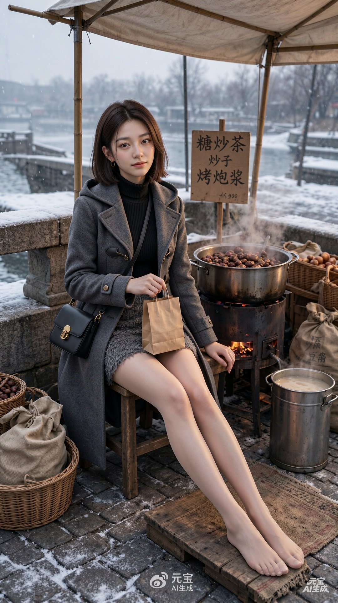

## 终稿提示词

```text
第3张 · 他撑地 · 视点高度 0.50 米、隔 0.9 米看她掀棚布坐进炉边矮木凳、两腿斜斜伸出去

三句分工：衣由槽 1 承担、脸由槽 2 承担、姿势由槽 3 承担；线稿只管躯干重心、脊线肩髋与两腿骨架；发型与丝袜那一层由第一波研究员联网读资料后一起设计一次、落一份基底写进四份，发型基底句四份逐字一致、各补一句本张重力落点，丝袜那一层按 `[统一]` 四张同一色号、同一脚尖透明款、只随姿势与光位落折光与褶影。文字腾给光位、场景、关系视角、构图调子、神态落点。

本轮这一站是初冬晴冷霜晨七点、桥头新支的糖炒栗子与烤红薯市集摊，卖糖炒栗子、烤红薯与热豆浆：画里有摊外干爽的旧砖街面与河埠头石阶、一道棚布与两根竹竿、一块手写木价牌、一口糖炒栗子铁锅与黑砂、一把铁铲、立着的麻袋、竹筐、牛皮纸袋、小铜秤、煤炉、白铁皮桶、热豆浆保温桶，棚内一段旧木踏板、炉边一条矮木凳与一小块旧毡垫。这一片光由晴冷霜晨的桥头天色与煤炉定：该冷就把霜青天光、白亮斜照、旧砖上那一层薄霜写足，该暖就把蜜色晨光斜照、煤炉橘红、铁锅黑砂里翻亮的栗子壳、哈气白雾里的暖光写足，一轮里冷暖交界也照写；四张同一片光、同一色号、同一脚尖透明款，光只改折光落点与明暗、透明脚尖那一截把这一片光透到趾形上。这一眼已经进棚，煤炉与白铁皮桶在她身侧，铁锅与手写木价牌只从棚布掀开的那一道缝外留一线霜青背景，棚内旧木踏板与炉边旧毡垫都在画里。

雾灰连帽羊毛大衣，翻领、两对牛角扣、长袖、袖口各一粒铜扣、A 字下摆落膝上；炭黑罗纹高领针织衫，高领翻折、长袖；灰长毛绒迷你裙，横向绒纹、齐整落在大腿中段；一只黑色半月形金扣小挎包斜搭在肩。整套版型配色面料由槽 1 衣装层承担。灰羊毛大衣挡得住桥头霜晨的风，高领护着脖子，毛绒短裙让腿线整片落进煤炉那圈暖光里，正合探店达人一早出门挑新摊的出门装。

发型基底句：雾感冷可可棕透一点浅茶光的锁骨下两厘米低层次齐直发，中分把颅顶压得平整，发身顺直带自然垂坠，发尾一刀切齐平、最末一截往内收一个极浅的 C 弯，额前一缕薄碎发斜落眉骨，耳侧两缕细碎发贴着颧骨落到下颌角，后颈清爽露在高领外。
本张形态句：发束朝膝头前滑、垂在肩前那侧落到灰长毛绒裙边，额前那一缕被炉光勾亮，耳侧那一缕贴着颧骨往耳后散，与另外三张是同一顶。

丝袜身份项：30D 浅奶茶杏微绒哑光半透天鹅绒这一个绝对色号，微绒哑光里带一点柔和宽幅漫反射，色号贴她冷白皮呈自然浅奶茶杏调，四张同一色号、四张同一明度档、四张同一脚尖透明款，从腿根连包到脚趾，脚趾由同色透明袜面完整包住、五趾在透明袜面里各自分明，袜面从小腿到脚背到脚尖连成平顺同一片，脚尖一截同色通透薄纱，薄透度与小腿一致、从脚背平顺连到脚趾，五趾在薄纱里各自分明、脚趾与脚背靠一道织物折光分出同色袜面的包覆边界，透明是薄纱透出趾形、脚趾始终包在同一片袜面里，透明脚尖与脚背连成同一片同色，脚踝与小腿前缘一道织物折光把袜面与腿肤色分出一层可辨边界，膝弯拉伸处颜色略浅、起两道细褶影，小腿中段到大腿根是同一片连贯微绒丝光。
本张形态句：两条腿一齐朝这一眼斜斜伸出去，煤炉橘红把织物折光拉成整条细亮线一路连到脚背，屈着那条腿膝弯只有一点柔和明暗，十根脚趾在透明袜面里各自分明、透明脚尖那一截把橘红透到趾形上，脚背整片落进炉光那一圈暖里，明暗只在同一色号内深浅一档以内，色相与色号守住同一支；这一层浅奶茶杏袜面在小腿前缘有一道可辨的织物折光把袜面与腿肤色分出一层边，脚踝上缘一圈极浅的袜面织物反光，脚背到脚尖是一整片半透薄纱、五根脚趾在薄纱里一根一根透出轮廓、趾根一道折光把趾形与脚背分出同色包覆边界。

本张鞋的判断（状态：赤足）：换就在第 2 张到第 3 张「掀棚布坐进炉边矮凳」这一步，第 1／2 张还在摊外旧砖街面穿那双焦糖棕短靴，这一张已经进棚、两只脚各自完整、十趾由同色透明袜面完整包住、脚尖一截通透薄纱与脚背同一片，短靴留在棚外竹筐边、画里只收她两只完整的脚，因为坐定烤火这一眼煤炉橘红要把两片脚背与透明脚尖整片照进光里、十趾在薄纱里各自分明，取景落点全给这一片袜面折光。

她侧身靠煤炉坐在棚内矮木凳上，两条腿一齐朝这一眼斜斜伸出去，头一偏，眼尾从棚布掀开那一道缝上方压下来看这一眼，嘴角挑一点点，带一点自己先得意起来的小脾气。右手从肩经肘腕连到指尖捏着一只牛皮纸袋的袋口、纸袋搁在膝头边，五根手指松松压着袋沿；左手从肩经肘腕连到指尖撑在矮木凳边的旧木踏板上，五根指头压出五个小小的窝。两只脚从膝弯连到脚趾完整落在棚内旧木踏板与那一小块旧毡垫上，白铁皮桶与小铜秤挨着炉边排好，画右一线棚布缝外的霜青街面只作背景。

画面里只落她自己这一位人物，画外人由首行机位与这一眼的取景方向交待；她自己两条手臂两条腿各自从躯干连续到指尖与脚趾、在画内完整收口，两条手臂各自从肩经肘腕连到指尖、各五根手指、各一个唯一落点，全画共两条手臂、两只手、十根手指、两条腿、十根脚趾。9:16 满幅画面内容，宽 1080 高 1920，人物与道具铺满整幅、四条边即裁切边，两只脚从膝弯连到脚趾完整落在画底棚内旧木踏板上。成图自带工具水印原样保留。
```

## 一句点评

第3张掀棚布坐进炉边矮凳这一步换赤足、两腿斜伸、炉火橘红把织物折光拉成整条细亮线
