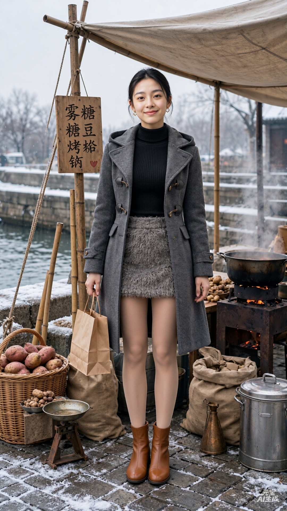
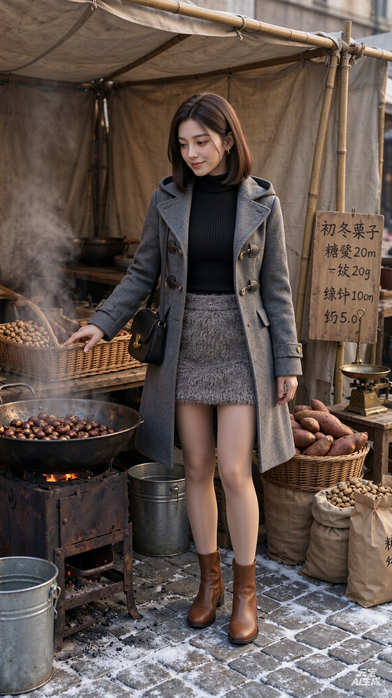
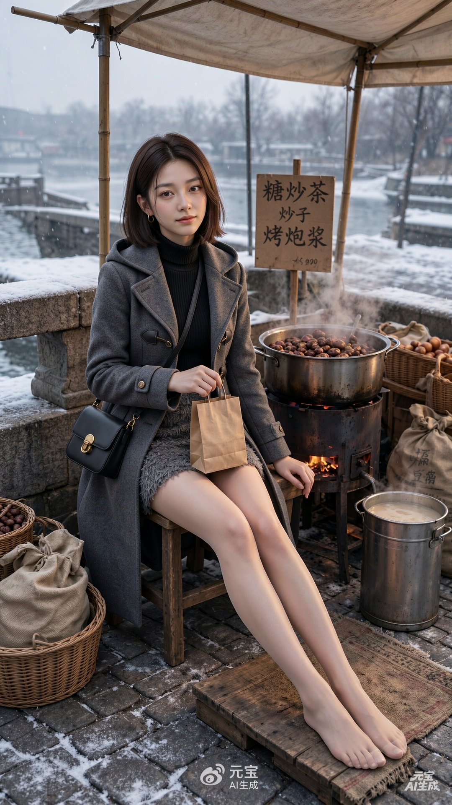
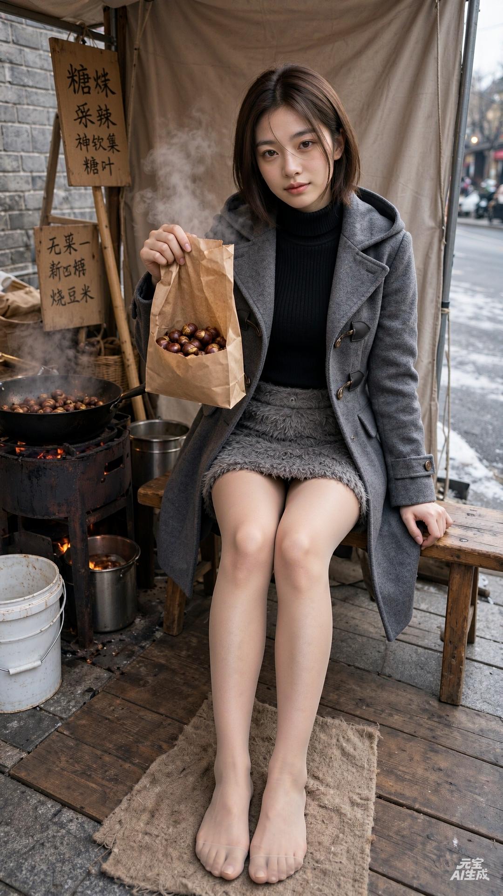

# R065 · 初冬霜晨桥头糖炒栗子摊探店

- 轮次目录：`20261128bb_chestnut-stall`
- 日期：2026-11-28
- 来源：`yuanbao`
- 穿搭：`WIN-0253`
- 发型：未标注
- 场景标签：糖炒栗子摊、市集摊、桥头
- 四张线稿：`full_single_P022_front`、full_single_P017_high`、full_single_P003_diag`、full_single_P007_front`
- 画幅：1080×1920（9:16），纯画面

## 四张

| 序 | 机位 | 图 | 终稿提示词 |
|---|---|---|---|
| 01 | front |  | [01_front.md](01_front.md) |
| 02 | side |  | [02_side.md](02_side.md) |
| 03 | seat |  | [03_seat.md](03_seat.md) |
| 04 | close |  | [04_close.md](04_close.md) |

## 这一段说了什么

1. 这家栗子摊我盯了两天啦，铁锅今早才支起来，你走慢一点呀，我先替你看一眼。
2. 桥头那碗热汤圆呀我改天再喝，翻篇，今天先归这袋糖炒栗子，你只准看着呀。
3. 烤红薯我替你先掰一半啦，甜得刚刚好呀，下一站往河对岸那家馄饨小馆走。
4. 凑近一点呀，这一袋第一个我留给你啦，就着我的手接过去吧，别看别处呀。

## 现场记录

- 01_front：第1张结霜旧砖街面正面站在摊外、两只焦糖棕短靴实实穿好、霜青天光顺小腿前缘拉到靴口
- 02_side：第2张仍站摊外朝糖炒栗子铁锅微微侧过去、同一双短靴、右手搭竹筐沿、重出后回到同一顶顺直齐平发
- 03_seat：第3张掀棚布坐进炉边矮凳这一步换赤足、两腿斜伸、炉火橘红把织物折光拉成整条细亮线
- 04_close：第4张凑近独自举牛皮纸袋、画底两只脚并着落旧毡垫、脚尖一截通透薄纱与脚背同一片

> 原图 PNG 永不转码、永不覆盖；预览用 `` 缩放原图。
