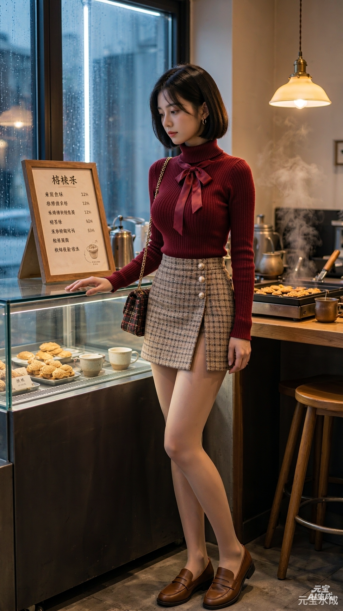

## 终稿提示词

```text
第2张 · 他站 · 视点高度 0.95 米、隔 1.2 米看她走到玻璃柜台前、侧身看那块木框粉笔菜单牌

三句分工：衣由槽 1 承担、脸由槽 2 承担、姿势由槽 3 承担；线稿只管躯干重心、脊线肩髋与两腿骨架，两只手的落点与脚上那双鞋全由本段文字写定；发型与丝袜那一层由第一波研究员联网读资料后一起设计一次、落一份基底写进四份，发型基底句四份逐字一致、各补一句本张重力落点，丝袜那一层按 `[统一]` 四张同一色号、同一脚尖透明款、只随姿势与光位落折光与褶影。文字腾给光位、场景、关系视角、构图调子、神态落点。

本轮这一站是初冬雨歇傍晚五点四十、老街拐角新开的焙茶与现烤鲷鱼烧小铺，卖焙茶、现烤鲷鱼烧与柚子茶：画里有一块新挂上的店招小木匾、一扇玻璃门与黄铜门把、门口一张素麻脚垫、柜台上斜立的一块木框粉笔菜单牌、一排玻璃柜台、鲷鱼烧铁模与铜夹、竹托盘、焙茶粗陶壶与两只粗陶杯、焙茶茶叶罐、一只小铜盘、一盏暖黄纸罩吊灯、一道木吧台、两张圆木高脚凳、落地窗沿一串小灯珠、门外雨后巷面一层薄水光、靠墙一辆旧自行车。这一片光由雨歇薄暮与店里那盏灯一起定：落地窗玻璃上的青蓝暮色、雨后巷面那一层冷反光与窗沿小灯珠的一线白亮压在画的一侧，暖黄纸罩吊灯、木吧台的蜜色反光、粗陶壶口一缕白汽与鲷鱼烧铁模边一点橘红铺在另一侧，冷暖在同一幅里交成一道界线；四张同一片光、同一色号、同一脚尖透明款，光只改折光落点与明暗、透明脚尖那一截把这一片光透到趾形上。这一眼已到玻璃柜台前，木框粉笔菜单牌与玻璃柜台在画左，鲷鱼烧铁模与铜夹、竹托盘在画右，暖黄纸罩吊灯就在她头顶上方，落地窗那一线青蓝暮色从画右边缘透进来；贴着玻璃柜台沿略低的角度取景，画底两只栗棕乐福鞋与鞋口那一截袜面占画面下三分之一，近大远小把这一眼压得稳稳的。

酒红罗纹高领针织衫，高领翻折、长袖、袖口微微张开，领口系一只酒红缎带蝴蝶结；米棕格纹粗花呢迷你裙，前侧三粒珍珠扣、右侧一道小开衩、齐整落在大腿中段；一只格纹链条小挎包斜搭在肩，金链贴着酒红针织衫。整套版型配色面料由槽 1 衣装层承担。

本张鞋型是栗棕乐福鞋：两只脚各穿一只，鞋口压在脚踝下、栗棕皮面被玻璃柜台下沿的暖黄灯照出一道细亮边，鞋口里连着浅蜜杏丝袜脚背；这一双鞋跟着她从门口脚垫走到柜台前，这一眼仍穿在脚上。

发型基底句：雾感黑茶棕透一点冷灰的齐下颌一刀切短发，中分自眉心正上方向后压成一条直缝、左右等量贴颅，发身顺直、自然垂坠，发尾齐平落在下颌角下缘一指内、最末一截往内收一个极浅的 C 弯，额前一缕极薄斜扫眉骨上沿的碎弧刘海，耳侧两缕细碎发各长至下颌角、一缕别在耳后一缕贴颧骨落下，整顶自然披落、发面只留一道细而窄的缎面顺光、发量中等蓬松贴头，后颈碎发贴着高领外缘收齐。
本张形态句：侧身低头看菜单牌时整顶顺重力垂向柜台那一侧，额前那一缕随低头的弧度压低半分搭在眉骨上，朝柜台一侧的耳侧碎发被转头带离耳廓、贴着颧骨落到下颌角，另一侧那一缕仍收在耳后，后颈碎发贴住酒红高领外沿。

丝袜身份项：25D 浅蜜杏柔缎丝光高透锦纶氨纶这一个绝对色号，锦纶氨纶细丹尼织面、透出冷白皮底色的高透档，光泽取柔缎中亮一档、亮面收成一道细窄定向亮线，色号贴她冷白皮呈自然浅蜜杏调，四张同一色号、四张同一明度档、四张同一脚尖透明款、四张同一片通透薄纱从脚背平顺连到脚趾，从腿根连包到脚趾，脚趾由同色透明袜面完整包住、五趾在透明袜面里各自分明，袜面从小腿到脚背到脚尖连成平顺同一片，脚尖一截同色通透薄纱，薄透度与小腿一致、从脚背平顺连到脚趾，五趾在薄纱里各自分明、脚趾与脚背靠一道织物折光分出同色袜面的包覆边界，透明是薄纱透出趾形、脚趾始终包在同一片袜面里，透明脚尖与脚背连成同一片同色，脚踝与小腿前缘一道织物折光把袜面与腿肤色分出一层可辨边界，膝弯受力处织物随形绷开、起两道细褶影、色号守住同一支，小腿中段到大腿根是同一片连贯柔缎丝光。
本张形态句：直立承重时膝弯亮线收细、起两道浅褶影，暖黄纸罩吊灯落在小腿外侧连成一小片宽幅微光，鞋口处一道织物折光把袜面与腿肤色分出一层可辨边界，鞋口里那一小截脚背是与小腿同一片柔缎丝光的同色通透薄纱、五根脚趾的轮廓在薄纱里一根一根透出来，落地窗那一线青蓝贴着小腿后缘走，明暗只在同一色号内深浅一档以内，色相与色号守住同一支。

本张鞋的判断（状态：栗棕乐福鞋）：第 1 张刚推门还站在门口素麻脚垫，这一张已走到玻璃柜台前侧身看那块木框粉笔菜单牌、仍站在柜台外这一侧，写明哪一张刚进门、哪一张已到柜台，两只栗棕乐福鞋同一双都实实穿在两只脚上、丝袜脚背连进鞋口、鞋穿在丝袜外面，因为这一眼还在柜台外、鞋在画里是实有物、玻璃柜台的暖黄灯正好把皮面照出一道细亮边，换留到第 3 张绕进吧台里侧那一步；两只栗棕乐福鞋实穿在两只脚上，鞋面皮口压住袜面，鞋内那截脚背与脚尖同属一片浅蜜杏同色通透薄纱。

她在玻璃柜台前侧身站着，肩线朝这一眼侧过来，下巴低一点，舌尖轻抵上唇，眼尾先扫过木框粉笔菜单牌再落向这一眼，嘴角勾一线。右手从肩经肘腕连到指尖搭在玻璃柜台的柜沿上，五根手指并着压住冰凉的玻璃边；左手从肩经肘腕连到指尖垂在酒红针织衫的袖口边，五根指头贴着罗纹，两条手臂各自从肩经肘腕连到指尖各一个落点。两只脚各穿着一只栗棕乐福鞋、从膝弯到鞋尖完整落在画底木吧台前的木地板上，画左木框粉笔菜单牌与玻璃柜台，画右鲷鱼烧铁模、铜夹与竹托盘。

画面里只落她自己这一位人物，画外人由首行机位与这一眼的取景方向交待；她自己两条手臂两条腿各自从躯干连续到指尖与脚趾、在画内完整收口，两条手臂各自从肩经肘腕连到指尖、各五根手指、各一个唯一落点，全画共两条手臂、两只手、十根手指、两条腿、十根脚趾。9:16 满幅画面内容，宽 1080 高 1920，人物与道具铺满整幅、四条边即裁切边，两只脚各穿着一只栗棕乐福鞋、从膝弯到鞋尖完整落在画底木地板上。成图自带工具水印原样保留。
```

## 一句点评

四张从门外素麻脚垫走到玻璃柜台再绕进吧台里侧
