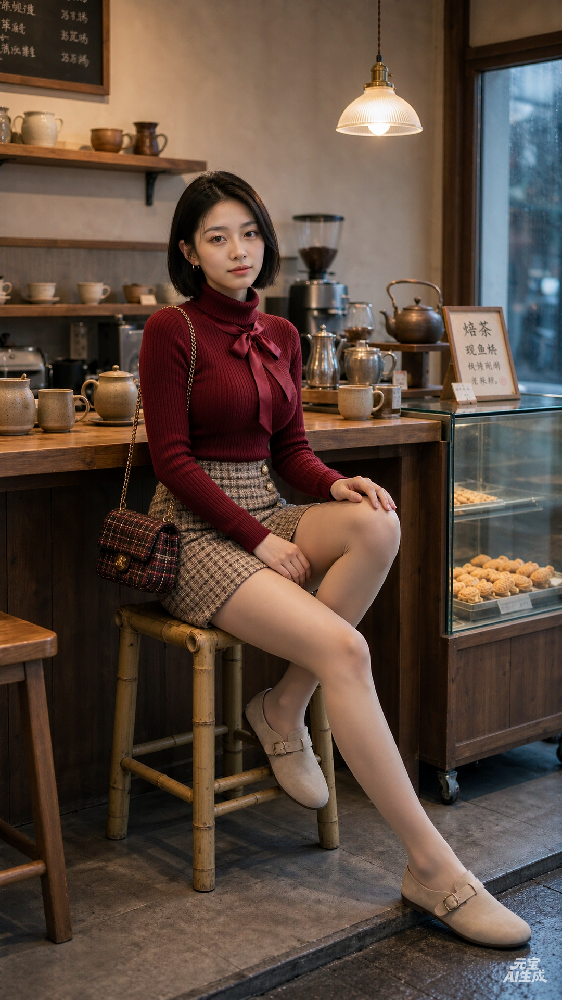

## 终稿提示词

```text
第3张 · 他坐 · 视点高度 0.62 米、隔 0.8 米看她绕进吧台里侧、坐进矮竹圆凳、一条腿屈起踩着凳档

三句分工：衣由槽 1 承担、脸由槽 2 承担、姿势由槽 3 承担；线稿只管躯干重心、脊线肩髋与两腿骨架；发型与丝袜那一层由第一波研究员联网读资料后一起设计一次、落一份基底写进四份，发型基底句四份逐字一致、各补一句本张重力落点，丝袜那一层按 `[统一]` 四张同一色号、同一脚尖透明款、只随姿势与光位落折光与褶影。文字腾给光位、场景、关系视角、构图调子、神态落点。

本轮这一站是初冬雨歇傍晚五点四十、老街拐角新开的焙茶与现烤鲷鱼烧小铺，卖焙茶、现烤鲷鱼烧与柚子茶：画里有一块新挂上的店招小木匾、一扇玻璃门与黄铜门把、门口一张素麻脚垫、柜台上斜立的一块木框粉笔菜单牌、一排玻璃柜台、鲷鱼烧铁模与铜夹、竹托盘、焙茶粗陶壶与两只粗陶杯、焙茶茶叶罐、一只小铜盘、一盏暖黄纸罩吊灯、一道木吧台、两张圆木高脚凳、落地窗沿一串小灯珠、门外雨后巷面一层薄水光、靠墙一辆旧自行车。这一片光由雨歇薄暮与店里那盏灯一起定：落地窗玻璃上的青蓝暮色、雨后巷面那一层冷反光与窗沿小灯珠的一线白亮压在画的一侧，暖黄纸罩吊灯、木吧台的蜜色反光、粗陶壶口一缕白汽与鲷鱼烧铁模边一点橘红铺在另一侧，冷暖在同一幅里交成一道界线；四张同一片光、同一色号、同一脚尖透明款，光只改折光落点与明暗、透明脚尖那一截把这一片光透到趾形上。这一眼已经绕进吧台里侧，暖黄纸罩吊灯正在她头顶，焙茶粗陶壶与两只粗陶杯、焙茶茶叶罐、小铜盘挨着排好，玻璃柜台与木框粉笔菜单牌只从吧台外沿露出一线；取景下沿压到画底拖尖、上沿只留到她压下来的眼尾，落地窗那一整片青蓝暮色沿她伸腿一侧的后缘与拖口前缘各落一道冷折光，与头顶暖黄在同片袜面上相接。

酒红罗纹高领针织衫，高领翻折、长袖、袖口微微张开，领口系一只酒红缎带蝴蝶结；米棕格纹粗花呢迷你裙，前侧三粒珍珠扣、右侧一道小开衩、齐整落在大腿中段；一只格纹链条小挎包斜搭在肩，金链贴着酒红针织衫。整套版型配色面料由槽 1 衣装层承担。酒红高领收住雨后巷口凉意，格纹呢裙齐大腿中段把腿线交给吊灯那圈光，正合探店达人绕进吧台里侧跟老板搭两句话的姿势。

本张鞋型是米杏绒面软底包趾拖：两只脚各穿一只，平底软绒鞋底平贴吧台里侧木踏板，整片米杏绒布鞋面哑柔贴着脚背，暖黄吊灯在绒面上照出一层细软的绒光，拖口落在脚背中段、松软贴着脚背，拖口前缘露出一截与小腿同一片柔缎丝光的同色通透薄纱脚背，五根脚趾的轮廓在薄纱里一根一根透出来，鞋身是整片软绒、平底、包趾，室内软底绒布拖鞋的松软口沿贴着脚踝下那一圈袜面。

发型基底句：雾感黑茶棕透一点冷灰的齐下颌一刀切短发，中分自眉心正上方向后压成一条直缝、左右等量贴颅，发身顺直、自然垂坠，发尾齐平落在下颌角下缘一指内、最末一截往内收一个极浅的 C 弯，额前一缕极薄斜扫眉骨上沿的碎弧刘海，耳侧两缕细碎发各长至下颌角、一缕别在耳后一缕贴颧骨落下，整顶自然披落、发面只留一道细而窄的缎面顺光、发量中等蓬松贴头，后颈碎发贴着高领外缘收齐。
本张形态句：头往屈膝那侧偏低，发束顺着偏头整体滑向画左、外侧一片贴住高领肩线，内侧一缕被下颌挡住折回，额前那一缕随低头压出一道浅弧搭在眉骨，耳侧别在耳后的那一缕稳住、贴颧骨那一缕随偏头略离开颊面，与另外三张是同一顶。

丝袜身份项：25D 浅蜜杏柔缎丝光高透锦纶氨纶这一个绝对色号，锦纶氨纶细丹尼织面、透出冷白皮底色的高透档，光泽取柔缎中亮一档、亮面收成一道细窄定向亮线，色号贴她冷白皮呈自然浅蜜杏调，四张同一色号、四张同一明度档、四张同一脚尖透明款、四张同一片通透薄纱从脚背平顺连到脚趾，从腿根连包到脚趾，脚趾由同色透明袜面完整包住、五趾在透明袜面里各自分明，袜面从小腿到脚背到脚尖连成平顺同一片，脚尖一截同色通透薄纱，薄透度与小腿一致、从脚背平顺连到脚趾，五趾在薄纱里各自分明、脚趾与脚背靠一道织物折光分出同色袜面的包覆边界，透明是薄纱透出趾形、脚趾始终包在同一片袜面里，透明脚尖与脚背连成同一片同色，脚踝与小腿前缘一道织物折光把袜面与腿肤色分出一层可辨边界，膝弯受力处织物随形绷开、起两道细褶影、色号守住同一支，小腿中段到大腿根是同一片连贯柔缎丝光。
本张形态句：一条腿屈起踩着矮竹圆凳的横档、另一条腿朝这一眼斜斜伸出去，屈起腿膝弯一道柔褶影、胫前柔缎亮线收窄，斜伸腿从小腿前缘到脚背拉成一条整亮线直进拖口，暖黄吊灯落在拖口前缘那一截同色通透薄纱脚背上、五根脚趾的轮廓在薄纱里一根一根透出来，青蓝暮色压在伸腿外缘，透明脚尖那一截与脚背连成同一片同色、把冷暖两道光一起透到趾形上，明暗只在同一色号内深浅一档以内，色相与色号守住同一支；这一层浅蜜杏袜面在小腿前缘有一道可辨的织物折光把袜面与腿肤色分出一层边，脚踝上缘一圈极浅的袜面织物反光，拖口那一小截脚背是与小腿同一片柔缎丝光的同色通透薄纱。

本张鞋的判断（状态：米杏软底包趾拖）：换就在第 2 张到第 3 张「从玻璃柜台前绕进吧台里侧木踏板、换上店家给客人的米杏绒面软底包趾拖」这一步，第 1／2 张还在门口脚垫与柜台外这一侧穿那双栗棕乐福鞋，这一张已经绕进吧台里侧，两只米杏绒面软底包趾拖都实实穿在两只脚上、平底软绒鞋底平贴木踏板、丝袜脚背连进拖口、拖穿在丝袜外面，栗棕乐福鞋留在画外门口鞋柜边，写明哪一张刚进门、哪一张已到柜台、换在哪一步，因为坐进矮竹圆凳这一眼要让拖口前缘那一截同色通透薄纱脚背与透明脚尖整片落进暖黄吊灯那圈光里、十趾在薄纱里各自分明，整片米杏绒布鞋面哑柔包趾、拖口前缘五趾轮廓根根可辨。

她侧身坐进吧台里侧的矮竹圆凳，一条腿屈起踩着凳下横档、另一条腿朝这一眼斜斜伸出去，头一偏，眼尾从焙茶粗陶壶那一缕白汽上方压下来看这一眼，嘴角挑一点点，带一点自己先得意起来的小脾气。右手从肩经肘腕连到指尖搭在屈起那条腿的膝头，五根手指把格纹呢裙的裙边往下按半寸；左手从肩经肘腕连到指尖撑在矮竹圆凳的凳面上，五根指头压出五个小小的窝，两只手各自只做这一个动作。两只脚各穿着一只米杏绒面软底包趾拖、平底软绒贴着吧台里侧木踏板，从膝弯到拖尖完整落在画底，焙茶粗陶壶、两只粗陶杯、茶叶罐与小铜盘挨着排好。

画面里只落她自己这一位人物，画外人由首行机位与这一眼的取景方向交待；她自己两条手臂两条腿各自从躯干连续到指尖与脚趾、在画内完整收口，两条手臂各自从肩经肘腕连到指尖、各五根手指、各一个唯一落点，全画共两条手臂、两只手、十根手指、两条腿、十根脚趾。9:16 满幅画面内容，宽 1080 高 1920，人物与道具铺满整幅、四条边即裁切边，两只脚各穿着一只米杏绒面软底包趾拖、从膝弯到拖尖完整落在画底吧台里侧木踏板上。成图自带工具水印原样保留。
```

## 一句点评

鞋三态逐张动脑子判乐福鞋换米杏软底包趾拖再赤足
