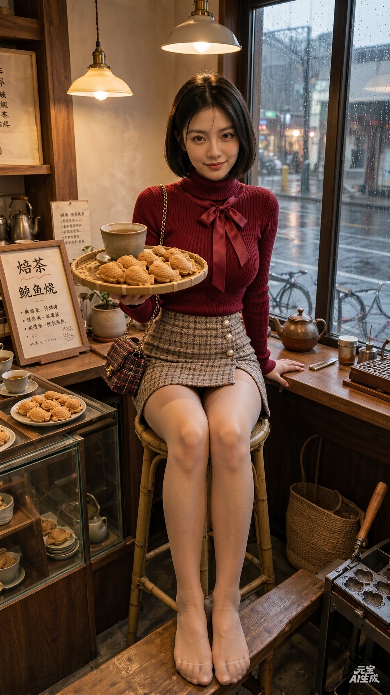

## 终稿提示词

```text
第4张 · 他俯身 · 视点高度 0.30 米、隔 0.30 米看她凑近把竹托盘举到两人正中间

三句分工：衣由槽 1 承担、脸由槽 2 承担、姿势由槽 3 承担；线稿只管躯干重心、脊线肩髋与两腿骨架；发型与丝袜那一层由第一波研究员联网读资料后一起设计一次、落一份基底写进四份，发型基底句四份逐字一致、各补一句本张重力落点，丝袜那一层按 `[统一]` 四张同一色号、同一脚尖透明款、只随姿势与光位落折光与褶影。文字腾给光位、场景、关系视角、构图调子、神态落点。

9:16 满幅竖画面，宽 1080 高 1920，四条边即裁切边。近身近景：上半幅收她坐在吧台里侧矮竹圆凳上朝画面前方凑近的脸、肩线与举起来的一只竹托盘，下半幅完整收她并着朝画面前方伸出去的两只脚，从膝弯连到脚趾完完整整落在吧台里侧木踏板上，十根脚趾在 25D 浅蜜杏同色透明袜面里各自分明、脚尖一截通透薄纱与脚背同一片、小腿前缘一道可辨的织物折光把袜面与腿肤色分出一层边；托盘下沿压到画面中线再低一指，这一眼先撞脚背那片薄纱再上到眼尾，木踏板前缘映一点凳腿的竹影。

本轮这一站是初冬雨歇傍晚五点四十、老街拐角新开的焙茶与现烤鲷鱼烧小铺，卖焙茶、现烤鲷鱼烧与柚子茶：画里有一块新挂上的店招小木匾、一扇玻璃门与黄铜门把、门口一张素麻脚垫、柜台上斜立的一块木框粉笔菜单牌、一排玻璃柜台、鲷鱼烧铁模与铜夹、竹托盘、焙茶粗陶壶与两只粗陶杯、焙茶茶叶罐、一只小铜盘、一盏暖黄纸罩吊灯、一道木吧台、两张圆木高脚凳、落地窗沿一串小灯珠、门外雨后巷面一层薄水光、靠墙一辆旧自行车。这一片光由雨歇薄暮与店里那盏灯一起定：落地窗玻璃上的青蓝暮色、雨后巷面那一层冷反光与窗沿小灯珠的一线白亮压在画的一侧，暖黄纸罩吊灯、木吧台的蜜色反光、粗陶壶口一缕白汽与鲷鱼烧铁模边一点橘红铺在另一侧，冷暖在同一幅里交成一道界线；四张同一片光、同一色号、同一脚尖透明款，光只改折光落点与明暗、透明脚尖那一截把这一片光透到趾形上。画左一角焙茶粗陶壶、茶叶罐与那只小铜盘，落地窗那一线青蓝暮色贴着画右边缘走，暖黄吊灯的蜜色落在托盘与脚背上，铁模边一点橘红点进趾尖。

酒红罗纹高领针织衫，高领翻折、长袖、袖口微微张开，领口系一只酒红缎带蝴蝶结；米棕格纹粗花呢迷你裙，前侧三粒珍珠扣、右侧一道小开衩、齐整落在大腿中段；一只格纹链条小挎包斜搭在肩，金链贴着酒红针织衫。整套版型配色面料由槽 1 衣装层承担。

发型基底句：雾感黑茶棕透一点冷灰的齐下颌一刀切短发，中分自眉心正上方向后压成一条直缝、左右等量贴颅，发身顺直、自然垂坠，发尾齐平落在下颌角下缘一指内、最末一截往内收一个极浅的 C 弯，额前一缕极薄斜扫眉骨上沿的碎弧刘海，耳侧两缕细碎发各长至下颌角、一缕别在耳后一缕贴颧骨落下，整顶自然披落、发面只留一道细而窄的缎面顺光、发量中等蓬松贴头，后颈碎发贴着高领外缘收齐。
本张形态句：发束整体朝这一眼前垂，额前那一缕随低头压出一道贴眉尾的浅弧，耳侧别在耳后的那一缕滑出来贴住颧骨，后颈那几缕被前送的肩带起一点离开高领。

丝袜身份项：25D 浅蜜杏柔缎丝光高透锦纶氨纶这一个绝对色号，锦纶氨纶细丹尼织面、透出冷白皮底色的高透档，光泽取柔缎中亮一档、亮面收成一道细窄定向亮线，色号贴她冷白皮呈自然浅蜜杏调，四张同一色号、四张同一明度档、四张同一脚尖透明款、四张同一片通透薄纱从脚背平顺连到脚趾，从腿根连包到脚趾，脚趾由同色透明袜面完整包住、五趾在透明袜面里各自分明，袜面从小腿到脚背到脚尖连成平顺同一片，脚尖一截同色通透薄纱，薄透度与小腿一致、从脚背平顺连到脚趾，五趾在薄纱里各自分明、脚趾与脚背靠一道织物折光分出同色袜面的包覆边界，透明是薄纱透出趾形、脚趾始终包在同一片袜面里，透明脚尖与脚背连成同一片同色，脚踝与小腿前缘一道织物折光把袜面与腿肤色分出一层可辨边界，膝弯受力处织物随形绷开、起两道细褶影、色号守住同一支，小腿中段到大腿根是同一片连贯柔缎丝光。
本张形态句：画底脚背那一小截折光最柔，从小腿到脚背到脚趾连成平顺同一片，十根脚趾在透明袜面里安分排着、透明脚尖那一截把暖黄吊灯透到趾形上，两只脚并着从膝弯连到脚趾完完整整落在吧台里侧木踏板上，明暗只在同一色号内深浅一档以内，色相与色号守住同一支；这一层浅蜜杏袜面在小腿前缘有一道可辨的织物折光把袜面与腿肤色分出一层边，脚踝上缘一圈极浅的袜面织物反光，脚背到脚尖是一整片同色通透薄纱、五根脚趾在薄纱里一根一根透出轮廓、趾根一道折光把趾形与脚背分出同色包覆边界，暖黄吊灯落在这片薄纱上把趾形照得清清楚楚，落地窗那一线青蓝贴着小腿后缘走。

本张鞋的判断（状态：赤足）：这一张她坐在吧台里侧矮竹圆凳上朝这一眼凑近、两只脚并着完完整整落在木踏板上，十趾由同色透明袜面完整包住、脚尖一截通透薄纱与脚背同一片，第 3 张那双米杏软底包趾拖留在这一眼的取景之外、画里只收她两只完整的脚、木踏板前缘映一点凳腿的竹影，因为凑近举竹托盘这一眼整个人都收在暖黄吊灯与落地窗青蓝暮色的交界里、画底脚背那一小截折光最柔，取景落点全给这一片袜面与透明脚尖，十趾在薄纱里各自分明。

她坐在吧台里侧矮竹圆凳上朝画面前方凑近，肩线往前送一点，下巴微微抬着，眼尾压下来正正对上这一眼，唇角收成一点得意。右手从肩经肘腕连到指尖独自把一只竹托盘举到画面正中两人之间停住，托盘里一只现烤鲷鱼烧还冒着一点白汽、旁边一只粗陶杯盛着焙茶；左手从肩经肘腕连到指尖撑在矮竹圆凳的凳面上，五根手指并着轻轻压住竹编纹路。画底两只脚并着从膝弯连到脚趾完完整整落在吧台里侧木踏板上，画左一角焙茶粗陶壶、茶叶罐与小铜盘，落地窗那一线青蓝暮色贴着画右边缘走。

画面里只落她自己这一位人物，画外人由首行机位与这一眼的取景方向交待；她自己两条手臂两条腿各自从躯干连续到指尖与脚趾、在画内完整收口，两条手臂各自从肩经肘腕连到指尖、各五根手指、各一个唯一落点，全画共两条手臂、两只手、十根手指、两条腿、十根脚趾。成图自带工具水印原样保留。
```

## 一句点评

两波黑盒审图加作家一波改润后四张全过自己拍板
