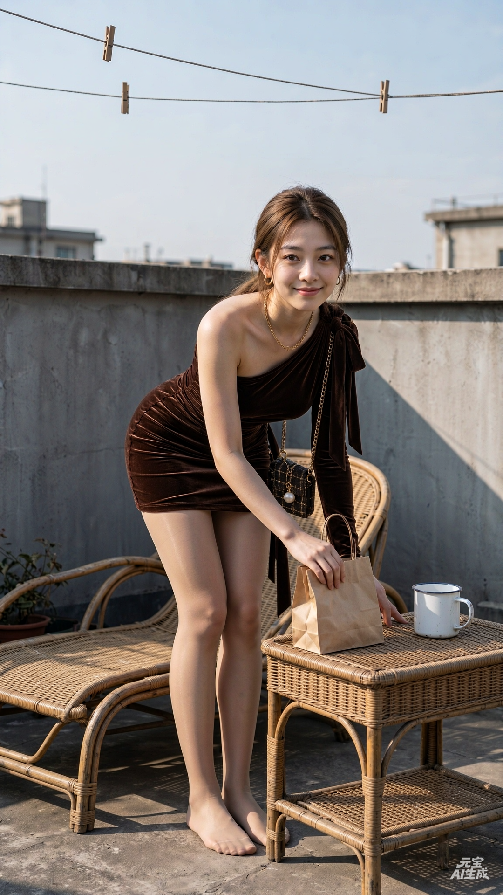

## 终稿提示词

```text
第2张 · 他（躺）·视点高度 0.45 米、隔 1.1 米看她走到躺椅边俯身把纸袋搁上小几

9:16 满幅 1080×1920，四条边即裁切边，人物与道具铺满整幅。全画只一位成年人物。

三槽分工：衣由第 1 张干净衣装层承担、脸由第 2 张人脸底图承担、姿势由第 3 张线稿承担；发型与丝袜那一层由第一波联网读两类公开资料后合出唯一一份基底写进四份。

初冬午后薄云转晴的老公寓天台：青灰女儿墙与一道背光硬影、旧藤编躺椅与蜜色木纹、晾衣绳与两只木夹、藤编小几、白搪瓷杯、天台铁门与水泥地、墙角一盆枯了半边的天竺葵；她刚从老街拐角那家新挂木匾的烤点心铺子探店回来，左手拎着印店名的牛皮纸袋，小本子与笔搁在小几上，这几样是本轮这一站带回来的实有物

午后白亮直射天光铺满水泥地，天台水泥地一层暖白反光，女儿墙背光一道青灰硬影，藤编躺椅蜜色木纹反光，冷硬影与白亮光面在同一幅里交成一道界线；四张同一片光、同一色号、同一脚尖透明款，这一片光的折光顺着腿线落到袜面与透明脚尖上，光只改折光落点与明暗、不改袜色

深巧克力棕丝绒单肩斜领抽褶迷你连衣裙，右肩头一只同料大蝴蝶结垂下两条长飘带搭到手肘，腰胯横向抽褶，裙摆齐齐落在大腿中段，颈上一圈金色细项链，金链格纹小方包带一颗珍珠斜搭在肩。

雾感浅栗棕透一线暖茶光的及肩胛骨低层次长发，偏左三七浅弧分缝，发身顺直、发尾一道极浅内扣，两缕薄八字刘海从眉尾分向两侧露出额心，耳侧两缕细碎发落到下颌角。
俯身发束整体朝小几那一侧前垂，发尾落到纸袋边上薄薄一小片，额前那一缕落得最低，耳侧细碎发擦过下颌角。

25D 浅蜜杏半透包芯丝，哑光低反射里一点漫反射柔光，四张同一色号、不随本张光位改色、四张同一脚尖透明款，脚尖一截同色通透薄纱，薄透度与小腿一致、从脚背平顺连到脚趾，五趾在薄纱里各自分明、脚趾与脚背靠一道织物折光分出同色袜面的包覆边界，透明是薄纱透出趾形、脚趾始终包在同一片袜面里，透明脚尖与脚背连成同一片同色，脚踝与小腿前缘有一道织物折光把袜面与腿肤色分出一层可辨边界，脚趾由同色透明袜面完整包住。
白亮光斜落在小腿外侧连成一小片宽幅微光，鞋口处一道织物折光把袜面与腿肤色分出一层可辨的边界，鞋口里那一小截脚背与脚尖同属一片同色通透薄纱。

本张鞋的判断（状态：同一双浅棕软皮平底鞋实穿）：她走到躺椅边俯身把纸袋搁上藤编小几，因为人还在天台门这一侧、鞋没换，写明第 1、2 张还在门外与门边，换留到第 3 张坐进躺椅那一步。

全画共两条手臂、两只手、两条腿，两条手臂各自从肩经肘腕连到指尖、各只做一个动作；两只脚各自从腿根连续到脚趾，在画内完整收口。
右手从肩经肘腕到指尖压住牛皮纸袋的袋口，五根手指把袋沿按平；左手从肩经肘腕到指尖撑在藤编小几的边沿上，五根指头压出五个小小的窝。

这一眼的取景落点落在袜面、脚背、腿线那一片光与折光上；画面只写画内实有物，脸年轻柔和、神态松弛。

画面里只落她自己这一位人物，两条手臂各自在画内完整收口。
```

## 一句点评

唐唐探店回来拎纸袋推门上来探店动线真进画面
