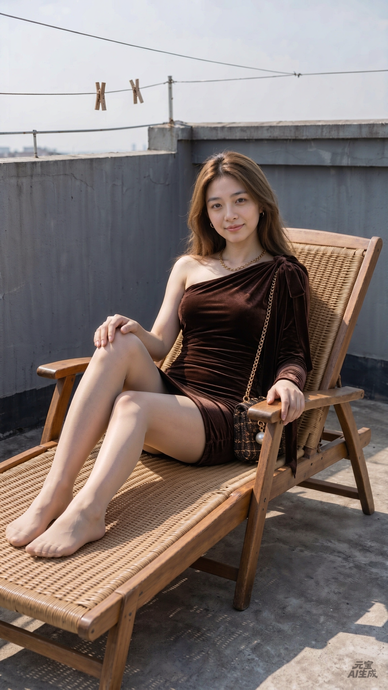

## 终稿提示词

```text
第3张 · 他（躺）·视点高度 0.4 米、隔 0.6 米看她坐到躺椅边把两腿斜伸进太阳里

9:16 满幅 1080×1920，四条边即裁切边，人物与道具铺满整幅。全画只一位成年人物。

三槽分工：衣由第 1 张干净衣装层承担、脸由第 2 张人脸底图承担、姿势由第 3 张线稿承担；发型与丝袜那一层由第一波联网读两类公开资料后合出唯一一份基底写进四份。

初冬午后薄云转晴的老公寓天台：青灰女儿墙与一道背光硬影、旧藤编躺椅与蜜色木纹、晾衣绳与两只木夹、藤编小几、白搪瓷杯、天台铁门与水泥地、墙角一盆枯了半边的天竺葵；她刚从老街拐角那家新挂木匾的烤点心铺子探店回来，左手拎着印店名的牛皮纸袋，小本子与笔搁在小几上，这几样是本轮这一站带回来的实有物

午后白亮直射天光铺满水泥地，天台水泥地一层暖白反光，女儿墙背光一道青灰硬影，藤编躺椅蜜色木纹反光，冷硬影与白亮光面在同一幅里交成一道界线；四张同一片光、同一色号、同一脚尖透明款，这一片光的折光顺着腿线落到袜面与透明脚尖上，光只改折光落点与明暗、不改袜色

深巧克力棕丝绒单肩斜领抽褶迷你连衣裙，右肩头一只同料大蝴蝶结垂下两条长飘带搭到手肘，腰胯横向抽褶，裙摆齐齐落在大腿中段，颈上一圈金色细项链，金链格纹小方包带一颗珍珠斜搭在肩。

雾感浅栗棕透一线暖茶光的及肩胛骨低层次长发，偏左三七浅弧分缝，发身顺直、发尾一道极浅内扣，两缕薄八字刘海从眉尾分向两侧露出额心，耳侧两缕细碎发落到下颌角。
坐姿发束向左侧滑到肩线外，发尾铺在藤编躺椅边散开一小片，额前那一缕随偏头压出另一道弧，耳侧碎发贴着颧骨往耳后散。

25D 浅蜜杏半透包芯丝，哑光低反射里一点漫反射柔光，四张同一色号、不随本张光位改色、四张同一脚尖透明款，脚尖一截同色通透薄纱，薄透度与小腿一致、从脚背平顺连到脚趾，五趾在薄纱里各自分明、脚趾与脚背靠一道织物折光分出同色袜面的包覆边界，透明是薄纱透出趾形、脚趾始终包在同一片袜面里，透明脚尖与脚背连成同一片同色，脚踝与小腿前缘有一道织物折光把袜面与腿肤色分出一层可辨边界，脚趾由同色透明袜面完整包住。
一条腿屈起贴身、另一条朝画外斜斜伸出去，从小腿前缘到脚背那道织物折光被白亮光拉成整条细亮线一路没断，屈腿膝弯一点柔和明暗；十根脚趾在透明袜面里各自分明，脚尖一截通透薄纱把白亮光透到趾形上。

本张鞋的判断（状态：赤足）：她坐到躺椅扶手边挨着你，浅棕软皮平底鞋脱在躺椅脚边、画里只有她两只完整的脚、十趾由同色透明袜面完整包住，因为午后白亮光要整片落到脚背与透明脚尖上；换在第 2→3 张这一步。

全画共两条手臂、两只手、两条腿，两条手臂各自从肩经肘腕连到指尖、各只做一个动作；两只脚各自从腿根连续到脚趾，在画内完整收口。
右手从肩经肘腕到指尖搭在屈起那条腿的膝头，五根手指把丝绒裙边往下按半寸；左手从肩经肘腕到指尖撑在躺椅扶手的藤编面上，五根指头并着压住藤条。

这一眼的取景落点落在袜面、脚背、腿线那一片光与折光上；画面只写画内实有物，脸年轻柔和、神态松弛。

画面里只落她自己这一位人物，两条手臂各自在画内完整收口。
```

## 一句点评

前两张浅棕软皮平底鞋实穿后两张赤足换在第2到3张
