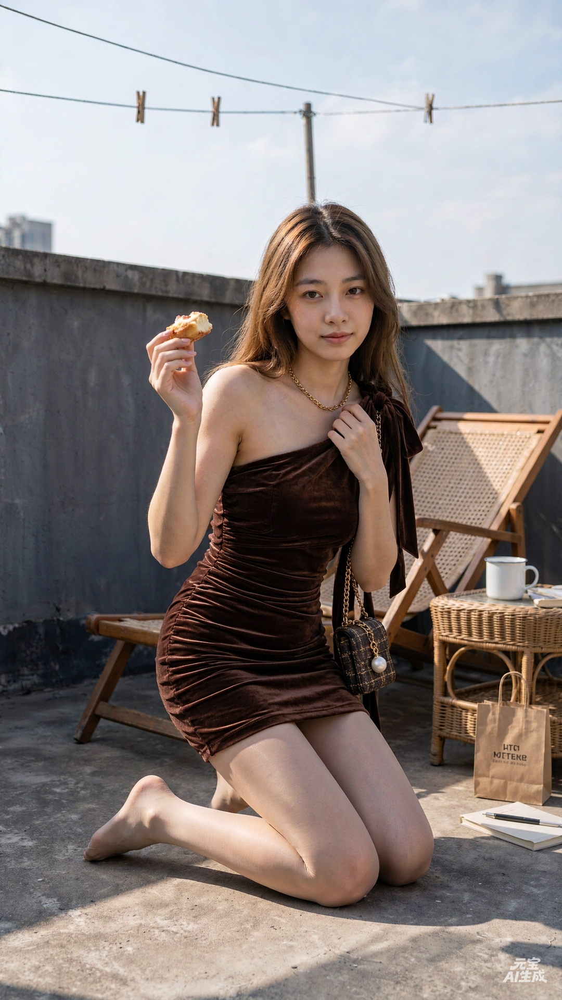

## 终稿提示词

```text
第4张 · 他（躺）·视点高度 0.35 米、隔 0.3 米看她俯身凑近挡住你那片太阳

9:16 满幅 1080×1920，四条边即裁切边，人物与道具铺满整幅。全画只一位成年人物。

三槽分工：衣由第 1 张干净衣装层承担、脸由第 2 张人脸底图承担、姿势由第 3 张线稿承担；发型与丝袜那一层由第一波联网读两类公开资料后合出唯一一份基底写进四份。

初冬午后薄云转晴的老公寓天台：青灰女儿墙与一道背光硬影、旧藤编躺椅与蜜色木纹、晾衣绳与两只木夹、藤编小几、白搪瓷杯、天台铁门与水泥地、墙角一盆枯了半边的天竺葵；她刚从老街拐角那家新挂木匾的烤点心铺子探店回来，左手拎着印店名的牛皮纸袋，小本子与笔搁在小几上，这几样是本轮这一站带回来的实有物

午后白亮直射天光铺满水泥地，天台水泥地一层暖白反光，女儿墙背光一道青灰硬影，藤编躺椅蜜色木纹反光，冷硬影与白亮光面在同一幅里交成一道界线；四张同一片光、同一色号、同一脚尖透明款，这一片光的折光顺着腿线落到袜面与透明脚尖上，光只改折光落点与明暗、不改袜色

深巧克力棕丝绒单肩斜领抽褶迷你连衣裙，右肩头一只同料大蝴蝶结垂下两条长飘带搭到手肘，腰胯横向抽褶，裙摆齐齐落在大腿中段，颈上一圈金色细项链，金链格纹小方包带一颗珍珠斜搭在肩。

雾感浅栗棕透一线暖茶光的及肩胛骨低层次长发，偏左三七浅弧分缝，发身顺直、发尾一道极浅内扣，两缕薄八字刘海从眉尾分向两侧露出额心，耳侧两缕细碎发落到下颌角。
俯身发束整体朝画外这一眼前垂，额前两缕落到眉尾上，发尾擦过锁骨前那只手的指节，耳侧那一缕擦过下颌角。

25D 浅蜜杏半透包芯丝，哑光低反射里一点漫反射柔光，四张同一色号、不随本张光位改色、四张同一脚尖透明款，脚尖一截同色通透薄纱，薄透度与小腿一致、从脚背平顺连到脚趾，五趾在薄纱里各自分明、脚趾与脚背靠一道织物折光分出同色袜面的包覆边界，透明是薄纱透出趾形、脚趾始终包在同一片袜面里，透明脚尖与脚背连成同一片同色，脚踝与小腿前缘有一道织物折光把袜面与腿肤色分出一层可辨边界，脚趾由同色透明袜面完整包住。
两只脚并着从膝弯连到脚趾完完整整落在水泥地上，脚尖那一截通透薄纱最柔，把白亮光透到趾形上，趾根一道织物折光把脚趾与脚背分出同色的包覆边界，五根脚趾在薄纱里一根一根安分排着，从小腿到脚背到脚趾连成平顺同一片。

本张鞋的判断（状态：赤足）：她俯身凑近举着一块小点心，画底只收两只完整的脚并着落在天台水泥地上，十趾由同色透明袜面完整包住、脚尖一截通透薄纱与脚背同一片，因为这一眼要把整片太阳与这一口都收到咱俩中间。

全画共两条手臂、两只手、两条腿，两条手臂各自从肩经肘腕连到指尖、各只做一个动作；两只脚各自从腿根连续到脚趾，在画内完整收口。
右手从肩经肘腕到指尖把一块烤得温热的小点心举到两人正中间，五根手指松松捏着，就停住；左手从肩经肘腕到指尖收在锁骨前，五根手指并着轻轻压住丝绒斜领的边。

这一眼的取景落点落在袜面、脚背、腿线那一片光与折光上；画面只写画内实有物，脸年轻柔和、神态松弛。

画面里只落她自己这一位人物，两条手臂各自在画内完整收口。
```

## 一句点评

第3张初版脚边空鞋判硬伤另起一批重出移出画面
