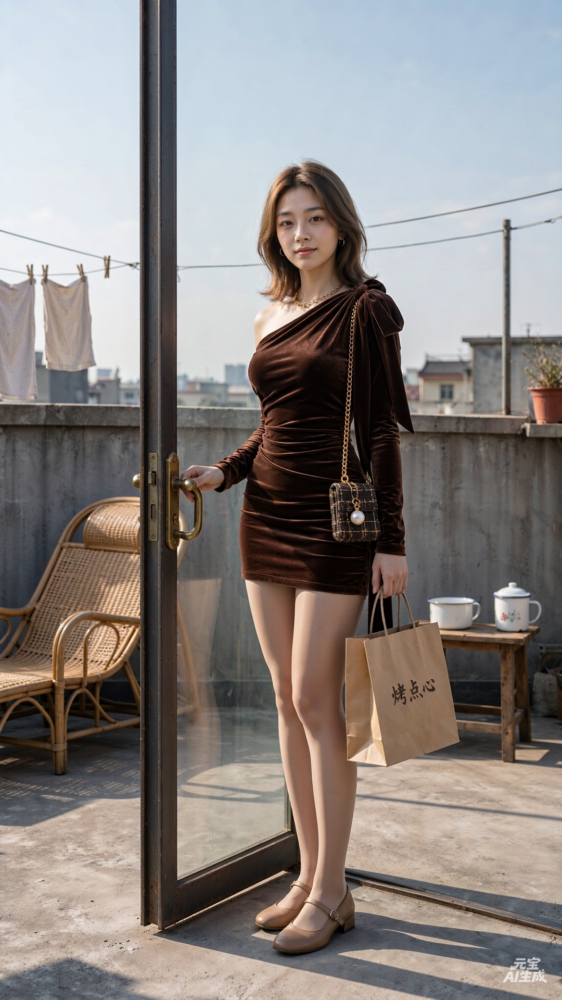
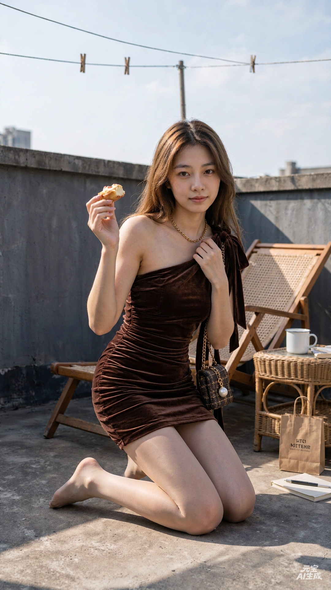

# R068 · 初冬午后天台躺椅晒太阳·探店回来带纸袋上来找你

- 轮次目录：`20261128bd_rooftop-sun`
- 日期：2026-11-28
- 来源：`yuanbao`
- 穿搭：`AUT-0007`
- 发型：未标注
- 场景标签：老街、街拍
- 四张线稿：`full_sexy_P007_side`、full_sexy_P004_low`、full_sexy_P028_low`、full_sexy_P043_side`
- 画幅：1080×1920（9:16），纯画面

## 四张

| 序 | 机位 | 图 | 终稿提示词 |
|---|---|---|---|
| 01 | front |  | [01_front.md](01_front.md) |
| 02 | side |  | [02_side.md](02_side.md) |
| 03 | seat |  | [03_seat.md](03_seat.md) |
| 04 | close |  | [04_close.md](04_close.md) |

## 这一段说了什么

1. 你躺着别动呀，我刚从老街那家新铺子绕回来，纸袋还热着呢，天台门一推就看见你啦。
2. 这家我盯了三天，木匾今早才挂上，第一袋我就拎来给你了，你连眼睛都懒得抬一下？
3. 鞋我脱躺椅脚边啦，太阳正好整片压在脚背上，你从那边看过来，数得清几根脚趾吗。
4. 别抬手，也别说话，就着我的手吃这一口，这一眼太阳归我挡，你只管看我呀。

## 现场记录

- 01_front：男主躺在天台藤椅晒太阳四张首行全写他躺姿低视点
- 02_side：唐唐探店回来拎纸袋推门上来探店动线真进画面
- 03_seat：前两张浅棕软皮平底鞋实穿后两张赤足换在第2到3张
- 04_close：第3张初版脚边空鞋判硬伤另起一批重出移出画面

> 原图 PNG 永不转码、永不覆盖；预览用 `` 缩放原图。
