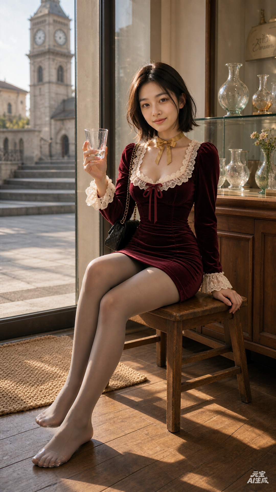

## 终稿提示词

```text
第3张 · 他（坐）·视点高度 0.9 米、隔 0.7 米看她坐进窗边旧木矮凳把玻璃小杯举进斜光里

9:16 满幅 1080×1920，四条边即裁切边，人物与道具铺满整幅。全画只一位成年人物。

三槽分工：衣由第 1 张干净衣装层承担、脸由第 2 张人脸底图承担、姿势由第 3 张线稿承担；发型与丝袜那一层由第一波联网读两类公开资料后合出唯一一份基底写进四份，线稿只管躯干重心与两腿骨架。

钟楼底下新开的玻璃器物铺子「透」，初冬晴冷午后四点二十，卖手工吹制玻璃杯、小花器与玻璃小铃。门外是钟楼青灰石阶与一道斜长钟影、手绘玻璃招牌、铜铃玻璃门、门口麻编脚垫、街面；门里是橱窗一排手工吹制玻璃杯与小花器、旧木柜台、柜上一只试光的玻璃杯与手写价签、窗边旧木矮凳、旧木地板、一盏暖黄小灯。四份首段都落这一站铺子里实有的物；窗边旧木矮凳、橱窗一排玻璃杯与小花器、旧木地板上几片淡暖折射光斑、柜台一角都在画内。

西斜蜜色斜光穿过橱窗玻璃，在旧木柜台与旧木地板上投出几片淡暖的折射光斑，钟楼青灰影贴着街面走，店内暖黄小灯落一小圈在柜角，冷影与蜜光在同一幅里交成一道界线；四张同一片光、同一色号、同一脚尖透明款，这一片光的折光顺着腿线落到袜面与透明脚尖上，光只改折光落点与明暗、不改袜色

深酒红丝绒紧身连衣迷你裙，大 U 形方领镶一圈米白蕾丝花边，领口一只酒红细系带小蝴蝶结，泡泡肩长袖、两只袖口各一圈米白蕾丝喇叭边，腰身收拢、裙摆齐齐落在大腿中段，颈上一只金色缎带蝴蝶结颈链，金色粗链条黑色菱格小方包斜搭在左肩。

雾感鸦羽黑茶棕透一线冷灰的齐锁骨下两厘米低层次锁骨发，偏右二八深侧分，发身带一道松缓 S 弯、发尾齐平留重量带极浅外翻，一缕薄碎法式刘海从眉尾斜落，耳侧两缕细碎发落到下颌角。坐姿发束向左侧滑到肩线外，发尾铺在旧木矮凳边散开一小片，额前那一缕随偏头压出另一道弧，耳侧碎发贴着颧骨往耳后散。

30D 浅燕麦灰微绒哑光半透天鹅绒这一个绝对色号，柔光里一点漫反射的绒面匀光，四张同一色号、不随本张光位改色、四张同一脚尖透明款，脚尖一截同色通透薄纱，薄透度与小腿一致、从脚背平顺连到脚趾，五趾在薄纱里各自分明、脚趾与脚背靠一道织物折光分出同色袜面的包覆边界，透明是薄纱透出趾形、脚趾始终包在同一片袜面里，透明脚尖与脚背连成同一片同色，脚趾由同色透明袜面完整包住，脚踝与小腿前缘有一道织物折光把袜面与腿肤色分出一层可辨边界。一条腿屈起贴身、另一条朝画外斜斜伸出去，从小腿前缘到脚背那道织物折光被蜜光拉成整条细亮线一路没断，屈腿膝弯一点柔和明暗；十根脚趾在透明袜面里各自分明，脚尖一截通透薄纱把蜜光透到趾形上；明暗只在同一色号内深浅，色相与色号在这一张里落定。

本张鞋的判断（状态：赤足）：她坐到窗边旧木矮凳上把一只玻璃小杯举进西斜蜜光里看透光度，栗棕软皮短靴留在门口麻编脚垫边、画里只有她两只完整的脚、十趾由同色透明袜面完整包住，因为蜜色斜光要整片落到脚背与透明脚尖上；换在第 2→3 张这一步。

全画共两条手臂、两只手、两条腿，两条手臂各自从肩经肘腕连到指尖、各只做一个动作；两只脚各自从腿根连续到脚趾，在画内完整收口。
右手从肩经肘腕到指尖把一只手工吹制玻璃小杯举到西斜蜜光里，五根手指松松捏着杯脚；左手从肩经肘腕到指尖撑在旧木矮凳面上，五根指头并着压住木纹。

画面里只落她自己这一位人物，两条手臂各自在画内完整收口。
这一眼的取景落点落在袜面、脚背、腿线那一片光与折光上，画面只写画内实有物，脸年轻柔和、神态松弛。
```

## 一句点评

前两张栗棕短靴实穿后两张赤足换在第2到3张
