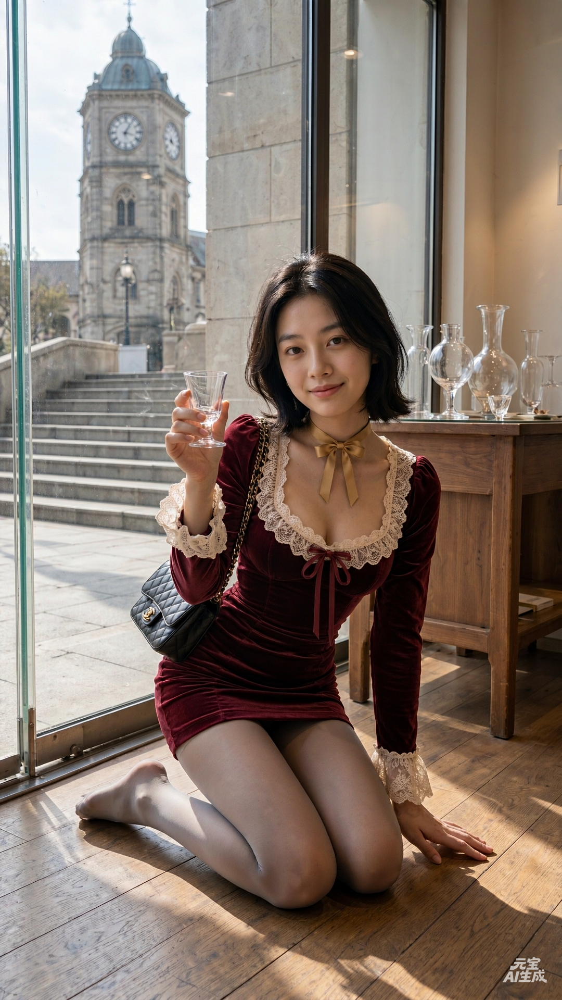

## 终稿提示词

```text
第4张 · 他（撑地）·视点高度 0.35 米、隔 0.3 米看她跪坐凑近把玻璃小杯举到两人正中间

9:16 满幅 1080×1920，四条边即裁切边，人物与道具铺满整幅。全画只一位成年人物。

三槽分工：衣由第 1 张干净衣装层承担、脸由第 2 张人脸底图承担、姿势由第 3 张线稿承担；发型与丝袜那一层由第一波联网读两类公开资料后合出唯一一份基底写进四份，线稿只管躯干重心与两腿骨架。

钟楼底下新开的玻璃器物铺子「透」，初冬晴冷午后四点二十，卖手工吹制玻璃杯、小花器与玻璃小铃。门外是钟楼青灰石阶与一道斜长钟影、手绘玻璃招牌、铜铃玻璃门、门口麻编脚垫、街面；门里是橱窗一排手工吹制玻璃杯与小花器、旧木柜台、柜上一只试光的玻璃杯与手写价签、窗边旧木矮凳、旧木地板、一盏暖黄小灯。四份首段都落这一站铺子里实有的物；旧木地板上几片淡暖折射光斑、柜台一角那排玻璃杯、暖黄小灯一小圈、玻璃门一线青灰街面都在画内。

西斜蜜色斜光穿过橱窗玻璃，在旧木柜台与旧木地板上投出几片淡暖的折射光斑，钟楼青灰影贴着街面走，店内暖黄小灯落一小圈在柜角，冷影与蜜光在同一幅里交成一道界线；四张同一片光、同一色号、同一脚尖透明款，这一片光的折光顺着腿线落到袜面与透明脚尖上，光只改折光落点与明暗、不改袜色

深酒红丝绒紧身连衣迷你裙，大 U 形方领镶一圈米白蕾丝花边，领口一只酒红细系带小蝴蝶结，泡泡肩长袖、两只袖口各一圈米白蕾丝喇叭边，腰身收拢、裙摆齐齐落在大腿中段，颈上一只金色缎带蝴蝶结颈链，金色粗链条黑色菱格小方包斜搭在左肩。

雾感鸦羽黑茶棕透一线冷灰的齐锁骨下两厘米低层次锁骨发，偏右二八深侧分，发身带一道松缓 S 弯、发尾齐平留重量带极浅外翻，一缕薄碎法式刘海从眉尾斜落，耳侧两缕细碎发落到下颌角。俯身发束整体朝画外这一眼前垂，额前两缕落到眉尾上，发尾擦过锁骨前那只手的指节，耳侧那一缕擦过下颌角。

30D 浅燕麦灰微绒哑光半透天鹅绒这一个绝对色号，柔光里一点漫反射的绒面匀光，四张同一色号、不随本张光位改色、四张同一脚尖透明款，脚尖一截同色通透薄纱，薄透度与小腿一致、从脚背平顺连到脚趾，五趾在薄纱里各自分明、脚趾与脚背靠一道织物折光分出同色袜面的包覆边界，透明是薄纱透出趾形、脚趾始终包在同一片袜面里，透明脚尖与脚背连成同一片同色，脚趾由同色透明袜面完整包住，脚踝与小腿前缘有一道织物折光把袜面与腿肤色分出一层可辨边界。两只脚并着从膝弯连到脚趾完完整整落在旧木地板上，脚尖那一截通透薄纱最柔，把蜜色斜光透到趾形上，趾根一道织物折光把脚趾与脚背分出同色的包覆边界，五根脚趾在薄纱里一根一根安分排着，从小腿到脚背到脚趾连成平顺同一片；明暗只在同一色号内深浅，色相与色号在这一张里落定。

本张鞋的判断（状态：赤足）：她跪坐朝画外凑近、把那只玻璃小杯举到两人正中间，画底只收两只完整的脚并着落在旧木地板上，十趾由同色透明袜面完整包住、脚尖一截通透薄纱与脚背同一片，因为这一眼要把那片透光的杯与这一口都收到咱俩中间。

全画共两条手臂、两只手、两条腿，两条手臂各自从肩经肘腕连到指尖、各只做一个动作；两只脚各自从腿根连续到脚趾，在画内完整收口。
右手从肩经肘腕到指尖把一只手工吹制玻璃小杯举到两人正中间，五根手指松松捏着杯脚，就停住；左手从肩经肘腕到指尖撑在身侧旧木地板上，五根手指并着压住木纹。

画面里只落她自己这一位人物，两条手臂各自在画内完整收口。
这一眼的取景落点落在袜面、脚背、腿线那一片光与折光上，画面只写画内实有物，脸年轻柔和、神态松弛。
```

## 一句点评

第1张两次回三槽重出短靴才实穿第2张黑靴局部收成同款栗棕
