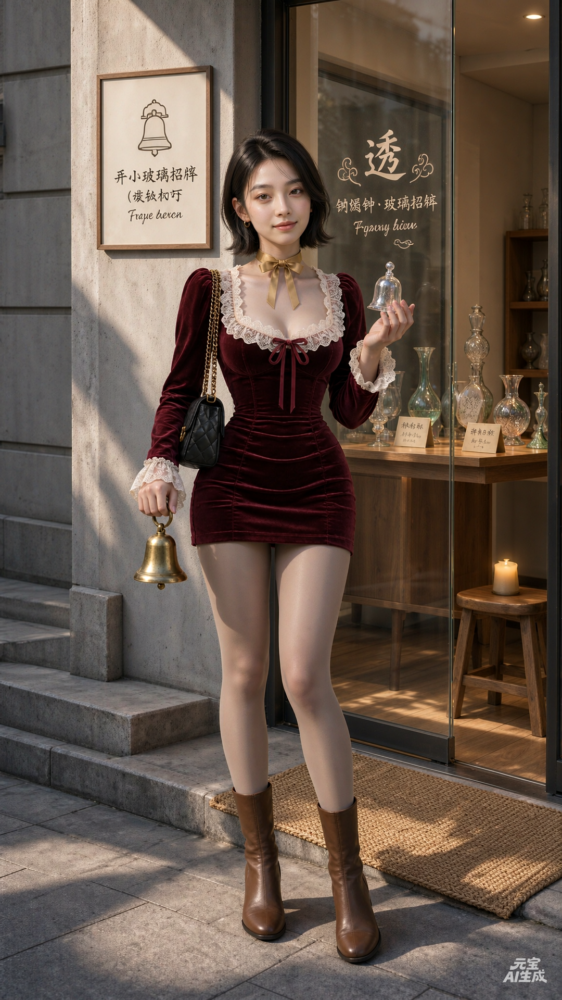
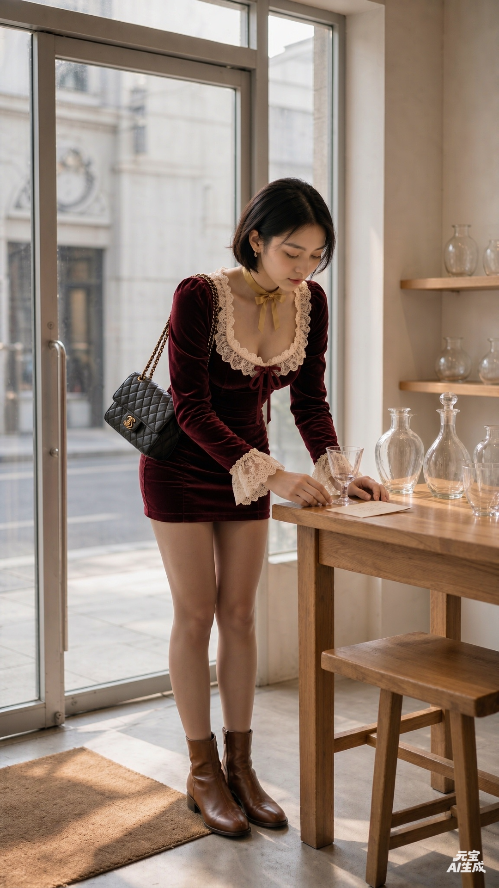
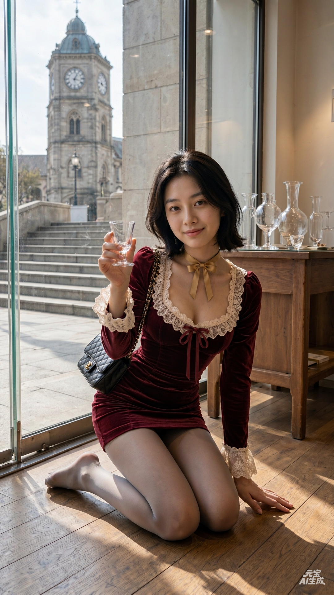

# R069 · 初冬晴冷午后钟楼底下新开玻璃器物铺子透

- 轮次目录：`20261128be_glass-shop`
- 日期：2026-11-28
- 来源：`yuanbao`
- 穿搭：`AUT-0080`
- 发型：未标注
- 场景标签：渡轮
- 四张线稿：`full_sexy_P025_high`、full_sexy_P005_high`、full_sexy_P028_side`、full_sexy_P036_low`
- 画幅：1080×1920（9:16），纯画面

## 四张

| 序 | 机位 | 图 | 终稿提示词 |
|---|---|---|---|
| 01 | front |  | [01_front.md](01_front.md) |
| 02 | side |  | [02_side.md](02_side.md) |
| 03 | seat |  | [03_seat.md](03_seat.md) |
| 04 | close |  | [04_close.md](04_close.md) |

## 这一段说了什么

1. 你慢点走呀，钟楼底下这家「透」我盯了整四天，手绘玻璃招牌今早才挂上，头一只小铃我替你先摇啦。
2. 柜台这只杯子我举到斜光里看过啦，边上一圈淡暖光斑，老板说今早刚出窑，我小本上记了一笔。
3. 靴我搁门口麻编脚垫边啦，太阳斜着整片压在脚背上，你从那边看过来，数得清几根脚趾吗。
4. 别抬手，也别说话，就着我的手接这一只，这一片透光归我举着，你只管看我呀。

## 现场记录

- 01_front：四张首行全写他站坐撑地第一视角与隔X米实数
- 02_side：钟楼底下新开玻璃器物铺子透手绘招牌铜铃玻璃门柜台玻璃杯真进画面
- 03_seat：前两张栗棕短靴实穿后两张赤足换在第2到3张
- 04_close：第1张两次回三槽重出短靴才实穿第2张黑靴局部收成同款栗棕

> 原图 PNG 永不转码、永不覆盖；预览用 `` 缩放原图。
