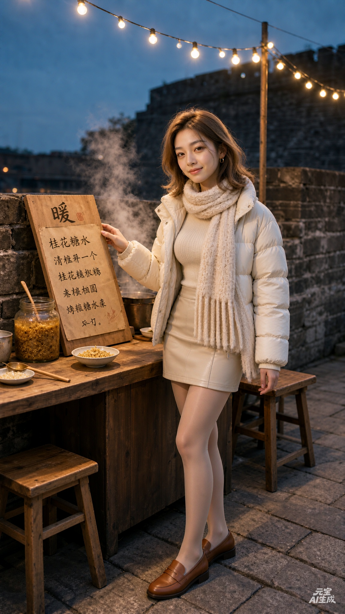

## 终稿提示词

```text
第2张 · 他（站）·视点高度 1.35 米、隔 1.2 米看她侧身站在摊车前翻手写木牌菜单

9:16 满幅 1080×1920，四条边即裁切边，人物与道具铺满整幅。全画只一位成年人物。

三槽分工：衣由第 1 张干净衣装层承担、脸由第 2 张人脸底图承担、姿势由第 3 张线稿承担；发型与丝袜那一层由第一波联网读两类公开资料后合出唯一一份基底写进四份，线稿只管躯干重心与两腿骨架。

老城墙根下傍晚新支起来的桂花糖水摊「暖」，初冬晴冷傍晚五点四十天擦黑，卖桂花糖水、酒酿小圆子与烤糍粑。摊车、铜锅口一缕白汽、手写木牌菜单、试吃小碟、竹凳、青石板街面、旧城墙砖、摊车上方一排刚亮的暖黄串灯、粗陶罐装桂花糖、竹勺、她的小本子与笔，这一站叫什么、卖什么、门口有什么都落在画内；手写木牌菜单、摊车、铜锅口一缕白汽、试吃小碟、粗陶罐装桂花糖与竹勺、一排暖黄串灯都在画内。

青蓝暮色天光铺在青石板与旧城墙砖上，摊车上方一排暖黄串灯刚亮、铜锅口一缕白汽被串灯照暖，冷青蓝与暖黄在同一幅里交成一道界线；四张同一片光、同一色号、同一脚尖透明款，这一片光的折光顺着腿线落到袜面与透明脚尖上，光只改折光落点与明暗、不改袜色

奶白短款连帽羽绒夹克，翻领金属按扣、蓬松长袖与收口袖口，内搭奶白细罗纹高领针织衫，奶白亮面皮质 A 字迷你裙裙摆齐齐落在大腿中段，颈上绕一圈奶白粗棒针流苏围巾、两条长流苏垂到膝上，一只细金色小圆牌项链，焦糖棕软皮小方包斜搭在右肩。

雾感栗金棕透一线蜜光的过肩八厘米低层次松软大波浪，偏左三七虚分线，中段左右交替出松散 S 弯、发尾略直留重量，一缕薄碎刘海从眉尾斜落，耳侧两缕细碎发落到颈侧。侧身发束朝摊车那一侧滑落，发尾擦过手写木牌边薄薄一小片，耳侧细碎发落到颈侧。

15D 浅藕米半透微光锦纶这一个绝对色号，丝光纱线内敛的柔光反射、比腿肤色深一档贴合不假白，四张同一色号、不随本张光位改色、四张同一脚尖透明款，脚尖一截同色通透薄纱，薄透度与小腿一致、从脚背平顺连到脚趾，五趾在薄纱里各自分明、脚趾与脚背靠一道织物折光分出同色袜面的包覆边界，透明是薄纱透出趾形、脚趾始终包在同一片袜面里，透明脚尖与脚背连成同一片同色，脚趾由同色透明袜面完整包住，脚踝与小腿前缘有一道织物折光把袜面与腿肤色分出一层可辨边界。暖黄串灯斜落在小腿外侧连成一小片宽幅微光，鞋口处一道织物折光把袜面与腿肤色分出一层可辨的边界，鞋口与裙摆之间那一小截袜面连成平顺同一片；明暗只在同一色号内深浅，色相与色号在这一张里落定。

本张鞋的判断（状态：同一双焦糖棕软皮乐福鞋实穿，这一条是画面硬要求）：她侧身站在摊车前翻手写木牌菜单、看柜上一只试吃小碟，因为刚从街面走到摊车这一侧、人还在摊外，鞋没换，两只焦糖棕软皮乐福鞋都实实穿在两只脚上、左右各一只、鞋口压在袜面上、丝袜脚背连进鞋口、鞋穿在丝袜外面、鞋面映一点暖黄串灯、两只鞋底稳稳踩在青石板上，两只脚从膝弯到鞋底完完整整落在画内；写明第 1 张还在街面、这一张走到摊车前，换留到第 3 张坐进竹凳那一步。

全画共两条手臂、两只手、两条腿，两条手臂各自从肩经肘腕连到指尖、各只做一个动作；两只脚各自从腿根连续到脚趾，在画内完整收口。
右手从肩经肘腕到指尖压住手写木牌菜单的纸角，五根手指把纸边按平；左手从肩经肘腕到指尖撑在摊车木沿上，五根指头压出五个小小的窝。

画面里只落她自己这一位人物，两条手臂各自在画内完整收口。
这一眼的取景落点落在袜面、脚背、腿线那一片光与折光上，画面只写画内实有物，脸年轻柔和、神态松弛。
```

## 一句点评

城墙根傍晚桂花糖水摊手写木牌铜锅串灯试吃小碟真进画面
