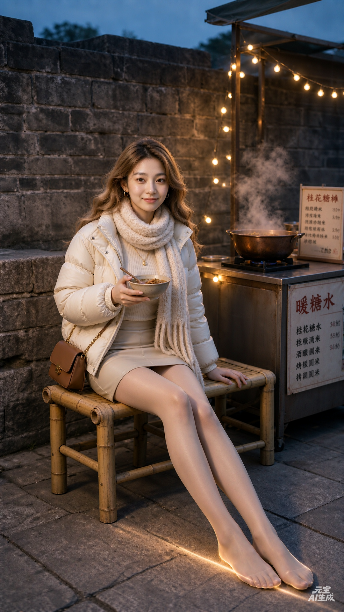

## 终稿提示词

```text
第3张 · 他（坐）·视点高度 0.85 米、隔 0.7 米看她坐进摊边竹凳把两腿伸进串灯暖光里

9:16 满幅 1080×1920，四条边即裁切边，人物与道具铺满整幅。全画只一位成年人物。

三槽分工：衣由第 1 张干净衣装层承担、脸由第 2 张人脸底图承担、姿势由第 3 张线稿承担；发型与丝袜那一层由第一波联网读两类公开资料后合出唯一一份基底写进四份，线稿只管躯干重心与两腿骨架。

老城墙根下傍晚新支起来的桂花糖水摊「暖」，初冬晴冷傍晚五点四十天擦黑，卖桂花糖水、酒酿小圆子与烤糍粑。摊车、铜锅口一缕白汽、手写木牌菜单、试吃小碟、竹凳、青石板街面、旧城墙砖、摊车上方一排刚亮的暖黄串灯、粗陶罐装桂花糖、竹勺、她的小本子与笔，这一站叫什么、卖什么、门口有什么都落在画内；摊边竹凳、摊车、铜锅口一缕白汽、手写木牌菜单、试吃小碟、一排暖黄串灯与青石板街面都在画内。

青蓝暮色天光铺在青石板与旧城墙砖上，摊车上方一排暖黄串灯刚亮、铜锅口一缕白汽被串灯照暖，冷青蓝与暖黄在同一幅里交成一道界线；四张同一片光、同一色号、同一脚尖透明款，这一片光的折光顺着腿线落到袜面与透明脚尖上，光只改折光落点与明暗、不改袜色

奶白短款连帽羽绒夹克，翻领金属按扣、蓬松长袖与收口袖口，内搭奶白细罗纹高领针织衫，奶白亮面皮质 A 字迷你裙裙摆齐齐落在大腿中段，颈上绕一圈奶白粗棒针流苏围巾、两条长流苏垂到膝上，一只细金色小圆牌项链，焦糖棕软皮小方包斜搭在右肩。

雾感栗金棕透一线蜜光的过肩八厘米低层次松软大波浪，偏左三七虚分线，中段左右交替出松散 S 弯、发尾略直留重量，一缕薄碎刘海从眉尾斜落，耳侧两缕细碎发落到颈侧。坐姿发束向左侧滑到肩线外，发尾铺在竹凳边散开一小片，额前那一缕随偏头压出另一道弧，耳侧细碎发贴着颧骨往耳后散。

15D 浅藕米半透微光锦纶这一个绝对色号，丝光纱线内敛的柔光反射、比腿肤色深一档贴合不假白，四张同一色号、不随本张光位改色、四张同一脚尖透明款，脚尖一截同色通透薄纱，薄透度与小腿一致、从脚背平顺连到脚趾，五趾在薄纱里各自分明、脚趾与脚背靠一道织物折光分出同色袜面的包覆边界，透明是薄纱透出趾形、脚趾始终包在同一片袜面里，透明脚尖与脚背连成同一片同色，脚趾由同色透明袜面完整包住，脚踝与小腿前缘有一道织物折光把袜面与腿肤色分出一层可辨边界。一条腿屈起贴身、另一条朝画外斜斜伸出去，从小腿前缘到脚背那道织物折光被串灯拉成整条细亮线一路没断，屈腿膝弯一点柔和明暗；十根脚趾在透明袜面里各自分明，脚尖一截通透薄纱把暖黄光透到趾形上；明暗只在同一色号内深浅，色相与色号在这一张里落定。

本张鞋的判断（状态：赤足）：她坐到摊边竹凳上把一只粗陶碗搁在膝头、两只脚伸进串灯暖光里，焦糖棕软皮乐福鞋留在摊车脚边、画里只有她两只完整的脚、十趾由同色透明袜面完整包住，因为暖黄串灯要整片落到脚背与透明脚尖上；换在第 2→3 张这一步。

全画共两条手臂、两只手、两条腿，两条手臂各自从肩经肘腕连到指尖、各只做一个动作；两只脚各自从腿根连续到脚趾，在画内完整收口。
右手从肩经肘腕到指尖托住膝头那只粗陶碗的碗底，五根手指并着托平；左手从肩经肘腕到指尖撑在竹凳面上，五根指头并着压住竹条。

画面里只落她自己这一位人物，两条手臂各自在画内完整收口。
这一眼的取景落点落在袜面、脚背、腿线那一片光与折光上，画面只写画内实有物，脸年轻柔和、神态松弛。
```

## 一句点评

前两张焦糖棕乐福鞋实穿后两张赤足换在第2到3张
