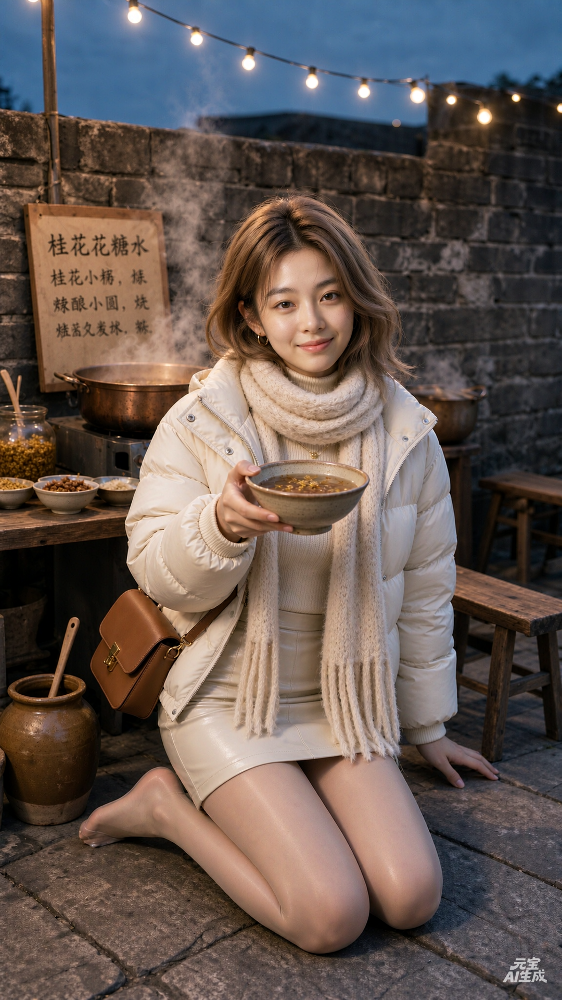

## 终稿提示词

```text
第4张 · 他（撑地）·视点高度 0.35 米、隔 0.3 米看她跪坐凑近把粗陶碗举到两人正中间

9:16 满幅 1080×1920，四条边即裁切边，人物与道具铺满整幅。全画只一位成年人物。

三槽分工：衣由第 1 张干净衣装层承担、脸由第 2 张人脸底图承担、姿势由第 3 张线稿承担；发型与丝袜那一层由第一波联网读两类公开资料后合出唯一一份基底写进四份，线稿只管躯干重心与两腿骨架。

老城墙根下傍晚新支起来的桂花糖水摊「暖」，初冬晴冷傍晚五点四十天擦黑，卖桂花糖水、酒酿小圆子与烤糍粑。摊车、铜锅口一缕白汽、手写木牌菜单、试吃小碟、竹凳、青石板街面、旧城墙砖、摊车上方一排刚亮的暖黄串灯、粗陶罐装桂花糖、竹勺、她的小本子与笔，这一站叫什么、卖什么、门口有什么都落在画内；粗陶碗口一缕白汽、摊车、铜锅、手写木牌菜单、试吃小碟、一排暖黄串灯与旧城墙砖都在画内。

青蓝暮色天光铺在青石板与旧城墙砖上，摊车上方一排暖黄串灯刚亮、铜锅口一缕白汽被串灯照暖，冷青蓝与暖黄在同一幅里交成一道界线；四张同一片光、同一色号、同一脚尖透明款，这一片光的折光顺着腿线落到袜面与透明脚尖上，光只改折光落点与明暗、不改袜色

奶白短款连帽羽绒夹克，翻领金属按扣、蓬松长袖与收口袖口，内搭奶白细罗纹高领针织衫，奶白亮面皮质 A 字迷你裙裙摆齐齐落在大腿中段，颈上绕一圈奶白粗棒针流苏围巾、两条长流苏垂到膝上，一只细金色小圆牌项链，焦糖棕软皮小方包斜搭在右肩。

雾感栗金棕透一线蜜光的过肩八厘米低层次松软大波浪，偏左三七虚分线，中段左右交替出松散 S 弯、发尾略直留重量，一缕薄碎刘海从眉尾斜落，耳侧两缕细碎发落到颈侧。俯身发束整体朝画外这一眼前垂，额前两缕落到眉尾上，发尾擦过举碗那只手的腕骨，耳侧那一缕落到颈侧。

15D 浅藕米半透微光锦纶这一个绝对色号，丝光纱线内敛的柔光反射、比腿肤色深一档贴合不假白，四张同一色号、不随本张光位改色、四张同一脚尖透明款，脚尖一截同色通透薄纱，薄透度与小腿一致、从脚背平顺连到脚趾，五趾在薄纱里各自分明、脚趾与脚背靠一道织物折光分出同色袜面的包覆边界，透明是薄纱透出趾形、脚趾始终包在同一片袜面里，透明脚尖与脚背连成同一片同色，脚趾由同色透明袜面完整包住，脚踝与小腿前缘有一道织物折光把袜面与腿肤色分出一层可辨边界。两只脚并着从膝弯连到脚趾完完整整落在青石板上，脚尖那一截通透薄纱最柔，把暖黄串灯透到趾形上，趾根一道织物折光把脚趾与脚背分出同色的包覆边界，五根脚趾在薄纱里一根一根安分排着，从小腿到脚背到脚趾连成平顺同一片；明暗只在同一色号内深浅，色相与色号在这一张里落定。

本张鞋的判断（状态：赤足）：她跪坐朝画外凑近、把一只盛桂花糖水的粗陶碗举到两人正中间，画底只收两只完整的脚并着落在青石板与竹凳影里，十趾由同色透明袜面完整包住、脚尖一截通透薄纱与脚背同一片，因为这一眼要把那一碗热与这一口都收到咱俩中间。

全画共两条手臂、两只手、两条腿，两条手臂各自从肩经肘腕连到指尖、各只做一个动作；两只脚各自从腿根连续到脚趾，在画内完整收口。
右手从肩经肘腕到指尖把一只盛桂花糖水的粗陶碗举到两人正中间，五根手指松松捏着碗沿，就停住；左手从肩经肘腕到指尖撑在身侧青石板上，五根手指并着压住石板缝。

画面里只落她自己这一位人物，两条手臂各自在画内完整收口。
这一眼的取景落点落在袜面、脚背、腿线那一片光与折光上，画面只写画内实有物，脸年轻柔和、神态松弛。
```

## 一句点评

第1张初版渲成坐姿且鞋裁出画外另起一批回三槽重出站姿实穿
