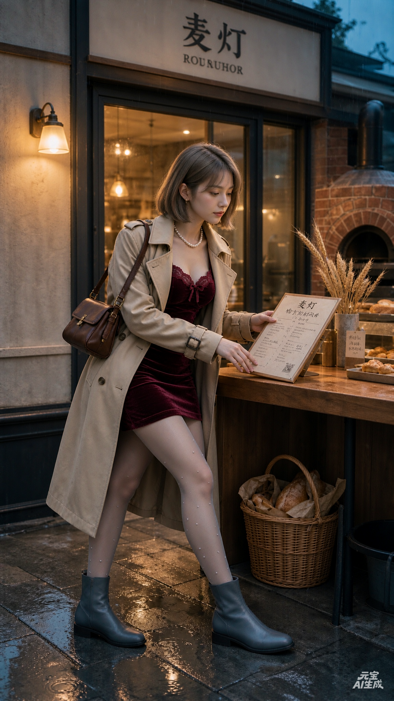

## 终稿提示词

```text
第2张 · 他（站）·视点高度 1.3 米、隔 1.1 米看她侧身站在木质柜台前翻手写菜单牌

9:16 满幅 1080×1920，四条边即裁切边，人物与道具铺满整幅。全画只一位成年人物。

三槽分工：衣由第 1 张干净衣装层承担、脸由第 2 张人脸底图承担、姿势由第 3 张线稿承担；发型与丝袜那一层由第一波联网读两类公开资料后合出唯一一份基底写进四份，线稿只管躯干重心与两腿骨架。

雨刚停的入夜七点十分，巷口新开的窑烤面包房「麦灯」，卖刚出炉的硬欧包、盐可颂与麦穗小面包。门口手绘木招牌、玻璃门、门口棕麻脚垫、湿青石板街面与一路水洼、店外一盏暖黄壁灯；门里砖砌窑炉、木质柜台、柜上一只藤篮装满刚出炉的面包、手写菜单牌、试吃小碟、靠窗木凳、牛皮纸袋、一束干麦穗。四份首段都写足这一站叫什么、卖什么、门口有什么；木质柜台、柜上一只藤篮装满刚出炉的面包、手写菜单牌、试吃小碟、砖砌窑炉口、牛皮纸袋与一束干麦穗都在画内。

雨停后青蓝夜色天光铺在湿青石板与玻璃门上，砖砌窑炉口与店内暖黄灯从玻璃门里漫出来、在水洼里拉成一道一道暖黄反光，冷青蓝与暖黄在同一幅里交成一道界线；四张同一片光、同一色号、同一脚尖透明款，这一片光的折光顺着腿线落到袜面与透明脚尖上，光只改折光落点与明暗、不改袜色

驼色长款双排扣风衣，宽翻领、肩章、两只袖口各一圈同色腰带扣、长摆敞开垂到膝下，内搭酒红丝绒吊带紧身迷你裙，心形领口缀一圈酒红蕾丝、领中一只酒红细系带小蝴蝶结，腰身收拢、裙摆齐齐落在大腿中段，颈上一串小珍珠项链，深棕软皮小方包斜搭在左肩。

雾感冷萃茶棕透一点烟灰的齐肩下三厘米低层次波波，偏右四六浅偏分，发身顺直、发尾一道柔和 C 形内扣，一缕轻薄法式空气碎刘海斜落眉上，耳侧两缕细碎胎毛落到下颌角。侧身发束朝柜台那一侧滑落，发尾擦过手写菜单牌边薄薄一小片，耳侧细碎发落到颈侧。

10D 珍珠雾灰清透水晶丝包芯丝这一个绝对色号，纯色丝光纱线均匀的柔光反射、比腿肤色贴近一档不假白，四张同一色号、不随本张光位改色、四张同一脚尖透明款，脚尖一截同色通透薄纱，薄透度与小腿一致、从脚背平顺连到脚趾，五趾在薄纱里各自分明、脚趾与脚背靠一道织物折光分出同色袜面的包覆边界，透明是薄纱透出趾形、脚趾始终包在同一片袜面里，透明脚尖与脚背连成同一片同色，脚趾由同色透明袜面完整包住，脚踝与小腿前缘有一道织物折光把袜面与腿肤色分出一层可辨边界。窑炉暖黄斜落在小腿外侧连成一小片宽幅微光，靴口处一道织物折光把袜面与腿肤色分出一层可辨的边界，靴口与裙摆之间那一小截袜面连成平顺同一片；明暗只在同一色号内深浅，色相与色号在这一张里落定。

本张鞋的判断（状态：同一双深灰蓝及踝软皮短靴实穿，这一条是画面硬要求）：她刚推门进店、侧身站在木质柜台前翻手写菜单牌、看柜上一只试吃小碟，因为刚从湿街面跨进玻璃门、人还在门内这一步，鞋没换，两只深灰蓝及踝软皮短靴都实实穿在两只脚上、左右各一只、靴口压在袜面上、丝袜脚背连进靴口、鞋穿在丝袜外面、靴面带一点雨后的水光、两只靴底稳稳踩在店内木地板上，两只脚从膝弯到靴底完完整整落在画内；写明第 1 张还在门外街面、这一张已经进门，换留到第 3 张坐进靠窗木凳那一步。

全画共两条手臂、两只手、两条腿，两条手臂各自从肩经肘腕连到指尖、各只做一个动作；两只脚各自从腿根连续到脚趾，在画内完整收口。
右手从肩经肘腕到指尖压住手写菜单牌的纸角，五根手指把纸边按平；左手从肩经肘腕到指尖撑在木质柜台沿上，五根指头压出五个小小的窝。

画面里只落她自己这一位人物，两条手臂各自在画内完整收口。
这一眼的取景落点落在袜面、脚背、腿线那一片光与折光上，画面只写画内实有物，脸年轻柔和、神态松弛。
```

## 一句点评

雨停入夜巷口窑烤面包房麦灯手绘木招牌砖窑炉藤篮试吃小碟真进画面
