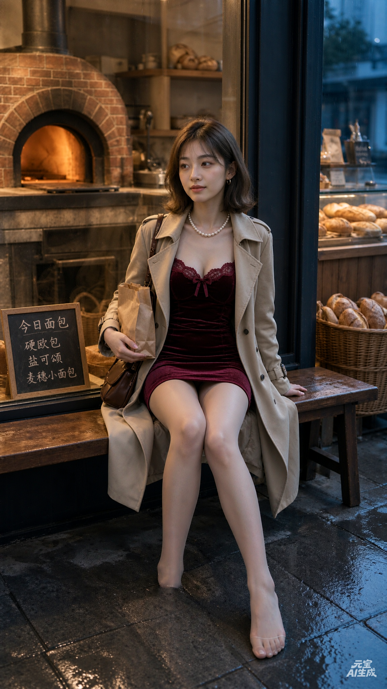

## 终稿提示词

```text
第3张 · 他（坐）·视点高度 0.85 米、隔 0.7 米看她坐进靠窗木凳把两腿伸进窑炉暖光里

9:16 满幅 1080×1920，四条边即裁切边，人物与道具铺满整幅。全画只一位成年人物。

三槽分工：衣由第 1 张干净衣装层承担、脸由第 2 张人脸底图承担、姿势由第 3 张线稿承担；发型与丝袜那一层由第一波联网读两类公开资料后合出唯一一份基底写进四份，线稿只管躯干重心与两腿骨架。

雨刚停的入夜七点十分，巷口新开的窑烤面包房「麦灯」，卖刚出炉的硬欧包、盐可颂与麦穗小面包。门口手绘木招牌、玻璃门、门口棕麻脚垫、湿青石板街面与一路水洼、店外一盏暖黄壁灯；门里砖砌窑炉、木质柜台、柜上一只藤篮装满刚出炉的面包、手写菜单牌、试吃小碟、靠窗木凳、牛皮纸袋、一束干麦穗。四份首段都写足这一站叫什么、卖什么、门口有什么；靠窗木凳、砖砌窑炉口、木质柜台、手写菜单牌、柜上藤篮与试吃小碟、牛皮纸袋、玻璃门一线雨停的青蓝街面都在画内。

雨停后青蓝夜色天光铺在湿青石板与玻璃门上，砖砌窑炉口与店内暖黄灯从玻璃门里漫出来、在水洼里拉成一道一道暖黄反光，冷青蓝与暖黄在同一幅里交成一道界线；四张同一片光、同一色号、同一脚尖透明款，这一片光的折光顺着腿线落到袜面与透明脚尖上，光只改折光落点与明暗、不改袜色

驼色长款双排扣风衣，宽翻领、肩章、两只袖口各一圈同色腰带扣、长摆敞开垂到膝下，内搭酒红丝绒吊带紧身迷你裙，心形领口缀一圈酒红蕾丝、领中一只酒红细系带小蝴蝶结，腰身收拢、裙摆齐齐落在大腿中段，颈上一串小珍珠项链，深棕软皮小方包斜搭在左肩。

雾感冷萃茶棕透一点烟灰的齐肩下三厘米低层次波波，偏右四六浅偏分，发身顺直、发尾一道柔和 C 形内扣，一缕轻薄法式空气碎刘海斜落眉上，耳侧两缕细碎胎毛落到下颌角。坐姿发束向左侧滑到肩线外，发尾铺在木凳边散开一小片，额前那一缕随偏头压出另一道弧，耳侧细碎发贴着颧骨往耳后散。

10D 珍珠雾灰清透水晶丝包芯丝这一个绝对色号，纯色丝光纱线均匀的柔光反射、比腿肤色贴近一档不假白，四张同一色号、不随本张光位改色、四张同一脚尖透明款，脚尖一截同色通透薄纱，薄透度与小腿一致、从脚背平顺连到脚趾，五趾在薄纱里各自分明、脚趾与脚背靠一道织物折光分出同色袜面的包覆边界，透明是薄纱透出趾形、脚趾始终包在同一片袜面里，透明脚尖与脚背连成同一片同色，脚趾由同色透明袜面完整包住，脚踝与小腿前缘有一道织物折光把袜面与腿肤色分出一层可辨边界。一条腿屈起贴身、另一条朝画外斜斜伸出去，从小腿前缘到脚背那道织物折光被炉光拉成整条细亮线一路没断，屈腿膝弯一点柔和明暗；十根脚趾在透明袜面里各自分明，脚尖一截通透薄纱把暖黄炉光透到趾形上；明暗只在同一色号内深浅，色相与色号在这一张里落定。

本张鞋的判断（状态：赤足）：她坐到靠窗木凳上把一只牛皮纸袋搁在膝头、两只脚伸进窑炉暖光里，深灰蓝及踝软皮短靴留在门口棕麻脚垫边、画里只有她两只完整的脚、十趾由同色透明袜面完整包住，因为窑炉那一圈暖黄要整片落到脚背与透明脚尖上；换在第 2→3 张这一步。

全画共两条手臂、两只手、两条腿，两条手臂各自从肩经肘腕连到指尖、各只做一个动作；两只脚各自从腿根连续到脚趾，在画内完整收口。
右手从肩经肘腕到指尖托住膝头那只牛皮纸袋的袋底，五根手指并着托平；左手从肩经肘腕到指尖撑在木凳面上，五根指头并着压住木纹。

画面里只落她自己这一位人物，两条手臂各自在画内完整收口。
这一眼的取景落点落在袜面、脚背、腿线那一片光与折光上，画面只写画内实有物，脸年轻柔和、神态松弛。
```

## 一句点评

前两张深灰蓝及踝短靴实穿后两张赤足换在第2到3张
