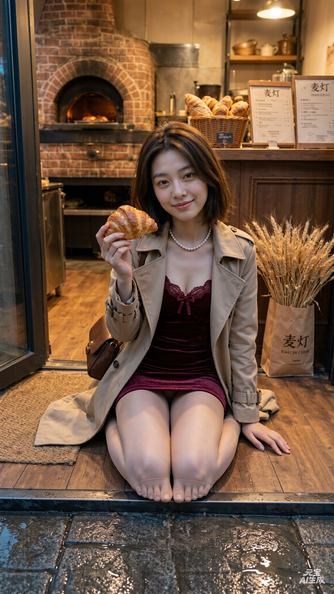

## 终稿提示词

```text
第4张 · 他（撑地）·视点高度 0.35 米、隔 0.3 米看她跪坐凑近把盐可颂举到两人正中间

9:16 满幅 1080×1920，四条边即裁切边，人物与道具铺满整幅。全画只一位成年人物。

三槽分工：衣由第 1 张干净衣装层承担、脸由第 2 张人脸底图承担、姿势由第 3 张线稿承担；发型与丝袜那一层由第一波联网读两类公开资料后合出唯一一份基底写进四份，线稿只管躯干重心与两腿骨架。

雨刚停的入夜七点十分，巷口新开的窑烤面包房「麦灯」，卖刚出炉的硬欧包、盐可颂与麦穗小面包。门口手绘木招牌、玻璃门、门口棕麻脚垫、湿青石板街面与一路水洼、店外一盏暖黄壁灯；门里砖砌窑炉、木质柜台、柜上一只藤篮装满刚出炉的面包、手写菜单牌、试吃小碟、靠窗木凳、牛皮纸袋、一束干麦穗。四份首段都写足这一站叫什么、卖什么、门口有什么；牛皮纸袋、砖砌窑炉口、木质柜台、柜上藤篮、手写菜单牌与试吃小碟、一束干麦穗、玻璃门一线雨停的青蓝街面都在画内。

雨停后青蓝夜色天光铺在湿青石板与玻璃门上，砖砌窑炉口与店内暖黄灯从玻璃门里漫出来、在水洼里拉成一道一道暖黄反光，冷青蓝与暖黄在同一幅里交成一道界线；四张同一片光、同一色号、同一脚尖透明款，这一片光的折光顺着腿线落到袜面与透明脚尖上，光只改折光落点与明暗、不改袜色

驼色长款双排扣风衣，宽翻领、肩章、两只袖口各一圈同色腰带扣、长摆敞开垂到膝下，内搭酒红丝绒吊带紧身迷你裙，心形领口缀一圈酒红蕾丝、领中一只酒红细系带小蝴蝶结，腰身收拢、裙摆齐齐落在大腿中段，颈上一串小珍珠项链，深棕软皮小方包斜搭在左肩。

雾感冷萃茶棕透一点烟灰的齐肩下三厘米低层次波波，偏右四六浅偏分，发身顺直、发尾一道柔和 C 形内扣，一缕轻薄法式空气碎刘海斜落眉上，耳侧两缕细碎胎毛落到下颌角。俯身发束整体朝画外这一眼前垂，额前两缕落到眉尾上，发尾擦过举可颂那只手的腕骨，耳侧那一缕落到颈侧。

10D 珍珠雾灰清透水晶丝包芯丝这一个绝对色号，纯色丝光纱线均匀的柔光反射、比腿肤色贴近一档不假白，四张同一色号、不随本张光位改色、四张同一脚尖透明款，脚尖一截同色通透薄纱，薄透度与小腿一致、从脚背平顺连到脚趾，五趾在薄纱里各自分明、脚趾与脚背靠一道织物折光分出同色袜面的包覆边界，透明是薄纱透出趾形、脚趾始终包在同一片袜面里，透明脚尖与脚背连成同一片同色，脚趾由同色透明袜面完整包住，脚踝与小腿前缘有一道织物折光把袜面与腿肤色分出一层可辨边界。两只脚并着从膝弯连到脚趾完完整整落在木地板上，脚尖那一截通透薄纱最柔，把窑炉暖黄透到趾形上，趾根一道织物折光把脚趾与脚背分出同色的包覆边界，五根脚趾在薄纱里一根一根安分排着，从小腿到脚背到脚趾连成平顺同一片；明暗只在同一色号内深浅，色相与色号在这一张里落定。

本张鞋的判断（状态：赤足）：她跪坐朝画外凑近、把牛皮纸袋里一只盐可颂举到两人正中间，画底只收两只完整的脚并着落在店内木地板上，十趾由同色透明袜面完整包住、脚尖一截通透薄纱与脚背同一片，因为这一眼要把那一袋刚出炉的热与这一口都收到咱俩中间。

全画共两条手臂、两只手、两条腿，两条手臂各自从肩经肘腕连到指尖、各只做一个动作；两只脚各自从腿根连续到脚趾，在画内完整收口。
右手从肩经肘腕到指尖把一只盐可颂举到两人正中间，五根手指松松捏着可颂的纸托，就停住；左手从肩经肘腕到指尖撑在身侧木地板上，五根手指并着压住木纹。

画面里只落她自己这一位人物，两条手臂各自在画内完整收口。
这一眼的取景落点落在袜面、脚背、腿线那一片光与折光上，画面只写画内实有物，脸年轻柔和、神态松弛。
```

## 一句点评

第4张初版脚掌压在身下另起一批回三槽重出脚背脚尖收进画底
