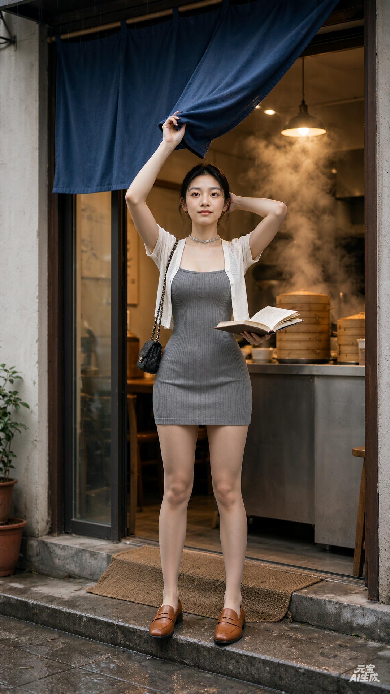

## 终稿提示词

```text
第1张 · 他（站）·视点高度 1.6 米、隔 2.8 米看她站在门外青石台阶上仰头看靛蓝布幌

9:16 满幅 1080×1920，四条边即裁切边，人物与道具铺满整幅。全画只一位成年人物。这一张是全身站姿：两条腿直立站定、从发顶到两只鞋底完完整整收进画内，画幅下缘留出一掌青石台阶地面，两只焦糖棕软皮乐福鞋整只落在台阶露水上、鞋底与台阶接触那道湿痕清晰；这一眼从街面望过去，玻璃门里只看得见一片暖黄与白汽、竹蒸笼顶那圈白汽在玻璃上糊成柔边，木质柜台与手写木牌今日单的轮廓藏在白汽后面只露一道木色边。画面下缘压在乐福鞋鞋底与带露水台阶的接触线下一掌处，上缘留出布幌顶端一拳，布幌被风掀起那角正好压在画面竖向三分上交点，2.8 米里青灰街面占左三成、玻璃门暖黄占右四成、她本人居中偏右，袜面那道青灰折光落在画幅正中一条竖带上。

三槽分工：衣由槽 1 干净衣装层承担、脸由槽 2 人脸底图承担、姿势由槽 3 线稿承担；线稿只管躯干重心、脊线肩髋与两腿骨架。

初冬清晨六点五十，薄雾还没散，老街巷口新开的早茶小馆「雾檐」，卖头汤面、竹蒸笼小点与手写在木牌上的今日单。门口一块新漆木招牌、靛蓝布幌、竹帘半卷、青石台阶带着一层露水、门口棕麻脚垫、玻璃门与湿亮街面；门里木质柜台、一摞竹蒸笼冒着白汽、手写木牌今日单、试吃小碟里一小块新出的芝麻糕、靠窗长条凳、粗陶茶壶与两只小茶杯、一摞竹编蒸笼盖。新漆木招牌、靛蓝布幌、竹帘半卷、门口棕麻脚垫、带露水的青石台阶、玻璃门与湿亮街面各自占好位置、从画左招牌到画右台阶连成一条进门动线。

初冬清晨薄雾的青灰天光铺在湿亮街面与玻璃门上，店里一盏暖黄吊灯与竹蒸笼白汽从玻璃门里漫出来、在青石台阶上落一层薄薄的暖，青灰一段、暖黄一段在同一幅里接成一道软界线，这道软界线落在她左小腿外侧的袜面上泛出一道细而柔的浅亮；四张同一片光、同一色号、同一脚尖透明款，这一片光的折光顺着腿线落到袜面与透明脚尖上，光只改折光落点与明暗，浅雾灰褐这一色号从画左青灰段到画右暖黄段浓淡如一。

奶白薄针织短袖开衫，前襟一排同色小扣、袖口一道罗纹窄边、衣长齐腰、门襟两侧薄透织纹；内搭炭灰罗纹吊带紧身连衣短裙，平直抹胸领、裙身竖向细罗纹、裙摆齐齐落在大腿中段；颈上一圈细水钻短颈链，一只黑色菱格链条小方包斜搭在左肩。这套利落薄打配这一站：清晨薄雾里推门进小馆，抬手翻木牌、蹲下看蒸笼都方便，裙摆齐齐落在大腿中段，大腿中段往下整段袜面从门口青灰天光里一直连到透明脚尖，店里蒸笼白汽比外头暖，薄开衫搭着刚好。

深墨茶黑发、发长过肩十六厘米落在肩胛骨下缘、右侧三七偏分（分缝自额角向右后方斜开）、发身顺直仅发尾一道极浅内扣、薄八字刘海长到颧骨中点中间留一道窄缝、耳侧左右各一缕约八厘米碎发带浅弧、披发不束发无任何发饰、发量中等蓬松颅顶轻垫起。

仰头这一眼整片发身顺脊背垂直往下坠、肩后最外那一缕被巷口晨风带离肩线约一掌，额前那一片随头位后仰压出一道向上翻的浅弧，耳侧两缕碎发离开颌线悬在耳垂前下方。

15D 锦纶包芯丝连裤袜、绝对色名浅雾灰褐、低档丝光半哑微光、薄透到青灰天光下透出腿本色一层雾、小腿前缘与脚踝各一道细而连续的织物折光、脚尖透明款袜尖与脚背同织法不加厚、趾部透光度与小腿完全一致五趾轮廓在薄纱里各自分明、四张同一色号、不随本张光位改色、四张同一脚尖透明款。

按 `[女主设定]` 24h 穿一层连裤丝袜从腿根连包到脚趾，脚趾由同色透明袜面完整包住、五趾在透明袜面里各自分明，袜面从小腿到脚背到脚尖连成平顺同一片；这一层是脚尖透明款，脚尖一截同色通透薄纱，薄透度与小腿一致、从脚背平顺连到脚趾，五趾在薄纱里各自分明，脚趾与脚背靠一道织物折光分出同色袜面的包覆边界，透明是薄纱透出趾形、脚趾始终包在同一片袜面里，透明脚尖与脚背连成同一片同色；脚踝与小腿前缘有一道织物折光把袜面与腿肤色分出一层可辨边界。四张同一色号、不随本张光位改色、四张同一脚尖透明款。

膝弯直立受力处只留一道极浅横向松弛纹，小腿前缘那道折光顺着青灰天光走成一条细直线、过脚踝收窄成一点，脚背迎着玻璃门漫出的暖黄落一片宽幅微光，乐福鞋鞋口上方那一截袜面折光收窄，透明脚尖在包趾鞋里把这点暖黄透到趾形上、五趾由趾根到趾端深浅匀整同一片薄纱，明暗只在同一浅雾灰褐内深浅，色相与色号不许变、整层不许差过一档。

本张鞋的判断（状态：焦糖棕软皮乐福鞋实穿）：她刚从雾里那条老街走过来、站在店门外青石台阶上仰头看靛蓝布幌，因为台阶带着一层露水、鞋底还沾着街面那点凉，人还在门外这一侧；画面下缘两只脚各实实穿着一只焦糖棕软皮乐福鞋，左右各一只、鞋面一道同色横带、低方跟、鞋口压到脚背、丝袜脚背连进鞋口、鞋穿在丝袜外面、两只鞋底稳稳踩在带露水的青石台阶上、两只鞋整只完整落在画内，两只脚从膝弯到鞋底完完整整落在画内，鞋口与裙摆之间那一小截袜面连成平顺同一片。

全画共两条手臂、两只手、两条腿，两条手臂各自从肩经肘腕连到指尖、各只做一个动作；两只脚各自从腿根连续到脚趾，在画内完整收口。
右手从肩经肘腕到指尖抬起扶住靛蓝布幌被风掀起那一角，五根手指松松捏着布边；左手从肩经肘腕到指尖把一本摊开的小本托到胸前布幌那片青灰天光里，五根指头并着托住本子底、小本封皮朝玻璃门那一侧；黑色菱格链条小方包贴稳斜搭在左肩，全画共两条手臂、两只手，仰头这一眼由颈线与眼尾去够布幌下端那一角，两腿直立站定、两只焦糖棕软皮乐福鞋实穿、从发顶到鞋底完完整整落在画内。

画面里只落她自己这一位人物，两条手臂各自在画内完整收口。
这一眼的取景落点落在袜面、脚背、腿线那一片光与折光上，她眼睛落在布幌下端被风掀起那一角、下巴微抬、嘴角先弯一点，脸年轻柔和、神态松弛。
```

## 一句点评

四张首行全写他站坐撑地第一视角与视点高度隔X米实数
