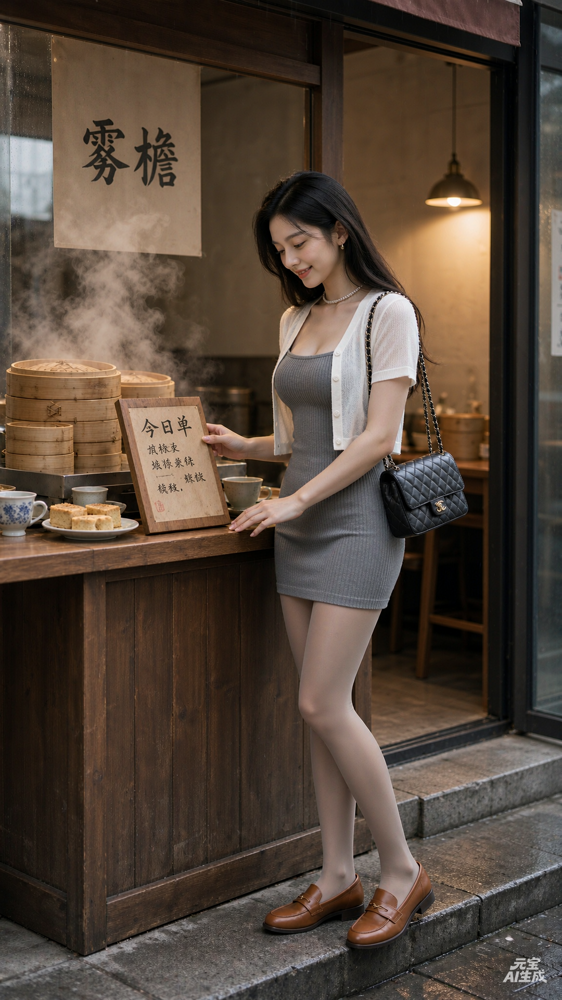

## 终稿提示词

```text
第2张 · 他（站）·视点高度 1.35 米、隔 1.2 米看她侧身站在木质柜台前翻手写木牌今日单

9:16 满幅 1080×1920，四条边即裁切边，人物与道具铺满整幅。全画只一位成年人物。这一张是侧身站姿：两条腿前后错半步站定，前脚脚尖朝柜台、后脚跟微微提起一点，两只焦糖棕软皮乐福鞋的鞋底与木地板接缝清晰、整双脚连同鞋头落在画面下缘以内。取景沿柜台长边往她右手前方挪半步、斜侧前 30° 看向她左侧身，画面下缘压在乐福鞋鞋头下方一掌处、上缘留木牌顶端一指空，青灰天光从画左打进来、暖黄吊灯从画右后侧勾她右肩与柜台沿，这一眼的主光带正好横过前脚脚背与透明脚尖。

三槽分工：衣由槽 1 干净衣装层承担、脸由槽 2 人脸底图承担、姿势由槽 3 线稿承担；线稿只管躯干重心、脊线肩髋与两腿骨架。

初冬清晨六点五十，薄雾还没散，老街巷口新开的早茶小馆「雾檐」，卖头汤面、竹蒸笼小点与手写在木牌上的今日单。门口一块新漆木招牌、靛蓝布幌、竹帘半卷、青石台阶带着一层露水、门口棕麻脚垫、玻璃门与湿亮街面；门里木质柜台、一摞竹蒸笼冒着白汽、手写木牌今日单、试吃小碟里一小块新出的芝麻糕、靠窗长条凳、粗陶茶壶与两只小茶杯、一摞竹编蒸笼盖。门里木质柜台上一摞竹蒸笼冒着白汽，手写木牌今日单斜靠在蒸笼边，试吃小碟里一小块芝麻糕、粗陶茶壶与两只小茶杯、靠窗长条凳、一摞竹编蒸笼盖，透过玻璃门看得见门外一线薄雾街面，都在画内。

初冬清晨薄雾的青灰天光铺在湿亮街面与玻璃门上，店里一盏暖黄吊灯与竹蒸笼白汽从玻璃门里漫出来、在青石台阶上落一层薄薄的暖，这道软界线正落在她左小腿外侧的袜面上，青灰一段、暖黄一段，交界处袜面泛出一道细而柔的浅亮；四张同一片光、同一色号、同一脚尖透明款，这一片光的折光顺着腿线落到袜面与透明脚尖上，光只改折光落点与明暗，浅雾灰褐这一色号从画左青灰段到画右暖黄段浓淡如一。

奶白薄针织短袖开衫，前襟一排同色小扣、袖口一道罗纹窄边、衣长齐腰、门襟两侧薄透织纹；内搭炭灰罗纹吊带紧身连衣短裙，平直抹胸领、裙身竖向细罗纹、裙摆齐齐落在大腿中段；颈上一圈细水钻短颈链，一只黑色菱格链条小方包斜搭在左肩。这套利落薄打配这一站：清晨薄雾里推门进小馆，抬手翻木牌、蹲下看蒸笼都方便，裙摆齐齐落在大腿中段，大腿中段往下整段袜面从门口青灰天光里一直连到透明脚尖，店里蒸笼白汽比外头暖，薄开衫搭着刚好。

深墨茶黑发、发长过肩十六厘米落在肩胛骨下缘、右侧三七偏分（分缝自额角向右后方斜开）、发身顺直仅发尾一道极浅内扣、薄八字刘海长到颧骨中点中间留一道窄缝、耳侧左右各一缕约八厘米碎发带浅弧、披发不束发无任何发饰、发量中等蓬松颅顶轻垫起。

她低头看木牌这一下，整片发丝顺着侧身朝柜台那一侧前滑、后脑一缕搭上开衫肩线不再回弹，额前那一缕被压出一道贴着眉骨走的弧，靠柜台这侧的耳侧碎发落在颧骨下一点、尖端微微朝腮边收。

15D 锦纶包芯丝连裤袜、绝对色名浅雾灰褐、低档丝光半哑微光、薄透到青灰天光下透出腿本色一层雾、小腿前缘与脚踝各一道细而连续的织物折光、脚尖透明款袜尖与脚背同织法不加厚、趾部透光度与小腿完全一致五趾轮廓在薄纱里各自分明、四张同一色号、不随本张光位改色、四张同一脚尖透明款。

按 `[女主设定]` 24h 穿一层连裤丝袜从腿根连包到脚趾，脚趾由同色透明袜面完整包住、五趾在透明袜面里各自分明，袜面从小腿到脚背到脚尖连成平顺同一片；这一层是脚尖透明款，脚尖一截同色通透薄纱，薄透度与小腿一致、从脚背平顺连到脚趾，五趾在薄纱里各自分明，脚趾与脚背靠一道织物折光分出同色袜面的包覆边界，透明是薄纱透出趾形、脚趾始终包在同一片袜面里，透明脚尖与脚背连成同一片同色；脚踝与小腿前缘有一道织物折光把袜面与腿肤色分出一层可辨边界。四张同一色号、不随本张光位改色、四张同一脚尖透明款。

织物折光只落两道——左小腿外侧那道青灰软界线上一道细长浅亮、右脚脚背迎暖黄吊灯一处宽幅微光，膝弯因前腿微屈只在腘窝下缘压出两道浅而短的回弹褶，透明脚尖那一截把门口青灰与店内暖黄交界的那点光透进趾形，大趾与二趾之间最亮、小趾一侧暗半档，折光在脚趾与脚背交界收成一道同色细线，明暗只在同一浅雾灰褐里深浅、色相不动。

本张鞋的判断（状态：同一双焦糖棕软皮乐福鞋实穿）：她刚推门进店、侧身站在木质柜台前翻手写木牌今日单、看柜上一只试吃小碟，因为刚从带露水的青石台阶跨进玻璃门、人还在门内这一步，鞋没换；两只焦糖棕软皮乐福鞋都实实穿在两只脚上、左右各一只、鞋口压在袜面上、丝袜脚背连进鞋口、鞋穿在丝袜外面、鞋面带一点雾气的水光、两只鞋底稳稳踩在店内木地板上，两只脚从膝弯到鞋底完完整整落在画内；第 1 张她还在门外青石台阶、这一张已经进门站在门内木地板上，那双鞋到第 3 张坐进靠窗长条凳那一步才离脚。

全画共两条手臂、两只手、两条腿，两条手臂各自从肩经肘腕连到指尖、各只做一个动作；两只脚各自从腿根连续到脚趾，在画内完整收口。
右手从肩经肘腕到指尖压住手写木牌今日单的纸角，五根手指把纸边按平、指腹落在木牌右下角；左手从肩经肘腕到指尖撑在木质柜台沿上，五根指头压出五个小小的窝、掌根贴着柜台木纹。

画面里只落她自己这一位人物，两条手臂各自在画内完整收口。
这一眼的取景落点落在袜面、脚背、腿线那一片光与折光上，她垂睫读牌、嘴角一点认出来的笑，脸年轻柔和、神态松弛。
```

## 一句点评

初冬清晨薄雾老街巷口早茶小馆雾檐靛蓝布幌手写木牌今日单竹蒸笼白汽试吃小碟真进画面
