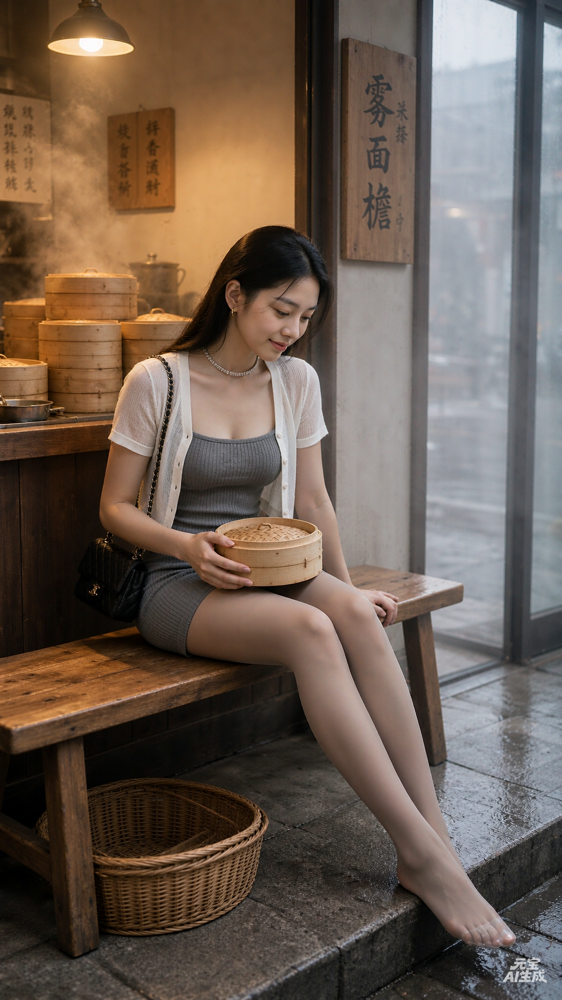

## 终稿提示词

```text
第3张 · 他（坐）·视点高度 0.9 米、隔 0.75 米看她坐进靠窗长条凳把两腿伸进蒸笼白汽与吊灯暖光里

9:16 满幅 1080×1920，四条边即裁切边，人物与道具铺满整幅。全画只一位成年人物。这一张是坐姿：一条腿屈起贴身、另一条顺着长条凳前沿朝画面右下斜伸，两只脚脚尖朝画面右下并齐、脚尖一截落在画幅下缘内侧一掌宽处，整片落进那一圈暖里。取景坐在她斜伸出去那条腿的正前方偏右约 20 度、视线沿那条腿的脚背往膝头方向看过去，画幅下缘压在两只脚尖往前一掌宽的凳前地面上，上缘齐她偏头后发顶再留一指，长条凳的木纹从画面左下角斜着带进右下角、把脚背那片暖黄光托在画面下三分之一的横带上。

三槽分工：衣由槽 1 干净衣装层承担、脸由槽 2 人脸底图承担、姿势由槽 3 线稿承担；线稿只管躯干重心、脊线肩髋与两腿骨架。

初冬清晨六点五十，薄雾还没散，老街巷口新开的早茶小馆「雾檐」，卖头汤面、竹蒸笼小点与手写在木牌上的今日单。门口一块新漆木招牌、靛蓝布幌、竹帘半卷、青石台阶带着一层露水、门口棕麻脚垫、玻璃门与湿亮街面；门里木质柜台、一摞竹蒸笼冒着白汽、手写木牌今日单、试吃小碟里一小块新出的芝麻糕、靠窗长条凳、粗陶茶壶与两只小茶杯、一摞竹编蒸笼盖。靠窗长条凳、一摞竹蒸笼冒着白汽、木质柜台、手写木牌今日单、试吃小碟、粗陶茶壶、竹帘半卷与玻璃门一线薄雾街面都在画内。

初冬清晨薄雾的青灰天光压在玻璃门与街面一侧，店里暖黄吊灯光落在长条凳、膝头与脚背一侧，两片光在蒸笼白汽边缘接成一道柔和的过渡带；四张同一色号，袜面折光随本张灯位落在脚背与透明脚尖，色号与小腿、脚尖三处连成同一片浅雾灰褐，这一片光的折光顺着腿线落到袜面与透明脚尖上，光只改折光落点与明暗。

奶白薄针织短袖开衫，前襟一排同色小扣、袖口一道罗纹窄边、衣长齐腰、门襟两侧薄透织纹；内搭炭灰罗纹吊带紧身连衣短裙，平直抹胸领、裙身竖向细罗纹、裙摆齐齐落在大腿中段；颈上一圈细水钻短颈链，一只黑色菱格链条小方包斜搭在左肩。这套利落薄打配这一站：清晨薄雾里推门进小馆，抬手翻木牌、蹲下看蒸笼都方便，裙摆齐齐落在大腿中段，大腿中段往下整段袜面从门口青灰天光里一直连到透明脚尖，店里蒸笼白汽比外头暖，薄开衫搭着刚好。

深墨茶黑发、发长过肩十六厘米落在肩胛骨下缘、右侧三七偏分（分缝自额角向右后方斜开）、发身顺直仅发尾一道极浅内扣、薄八字刘海长到颧骨中点中间留一道窄缝、耳侧左右各一缕约八厘米碎发带浅弧、披发不束发无任何发饰、发量中等蓬松颅顶轻垫起。

她偏头看自己脚尖时，发丝整体顺重力往她左侧肩前垂落一片、靠凳背那侧滑到肩胛前贴着开衫薄透织纹搭下小半段，额前那一缕随偏头压出一道朝下的弧掠过眉尾，耳侧碎发沿腮边落到下颌线下方一指处轻轻往内收。

15D 锦纶包芯丝连裤袜、绝对色名浅雾灰褐、低档丝光半哑微光、薄透到青灰天光下透出腿本色一层雾、小腿前缘与脚踝各一道细而连续的织物折光、脚尖透明款袜尖与脚背同织法不加厚、趾部透光度与小腿完全一致五趾轮廓在薄纱里各自分明、四张同一色号、不随本张光位改色、四张同一脚尖透明款。

按 `[女主设定]` 24h 穿一层连裤丝袜从腿根连包到脚趾，脚趾由同色透明袜面完整包住、五趾在透明袜面里各自分明，袜面从小腿到脚背到脚尖连成平顺同一片；这一层是脚尖透明款，脚尖一截同色通透薄纱，薄透度与小腿一致、从脚背平顺连到脚趾，五趾在薄纱里各自分明，脚趾与脚背靠一道织物折光分出同色袜面的包覆边界，透明是薄纱透出趾形、脚趾始终包在同一片袜面里，透明脚尖与脚背连成同一片同色；脚踝与小腿前缘有一道织物折光把袜面与腿肤色分出一层可辨边界。四张同一色号、不随本张光位改色、四张同一脚尖透明款。

吊灯暖黄从画面右上方压下来，织物折光在屈起那条腿的小腿前缘收成一道细亮线、到伸出去那条腿的脚背摊成一条宽幅微光直送脚尖，膝弯因屈腿受力叠出两道浅而顺的横向褶影、褶谷只压半档深色，透明脚尖那一截把同一圈暖黄透成趾腹上一点一点的圆润亮头、趾缝间留一道细窄的暗线分出五趾，脚尖最前端薄纱边缘亮过脚背半档、与脚背仍连成同一片同色。

本张鞋的判断（状态：赤足）：她坐到靠窗长条凳上把一只竹编蒸笼盖搁在膝头、两只脚伸进蒸笼白汽与吊灯暖光里，那一双焦糖棕软皮乐福鞋留在门口棕麻脚垫边、画里就收她两只完整的脚、十趾由同色透明袜面完整包住，因为吊灯那一圈暖黄要整片落到脚背与透明脚尖上；这双鞋在第 2 张推门进店时还穿在脚上，到本张坐进靠窗长条凳这一步离脚，换在第 2→3 张这一步。

全画共两条手臂、两只手、两条腿，两条手臂各自从肩经肘腕连到指尖、各只做一个动作；两只脚各自从腿根连续到脚趾，在画内完整收口。
右手从肩经肘腕到指尖托住膝头那只竹编蒸笼盖的边，五根手指并着托平、指腹压在竹编细条上；左手从肩经肘腕到指尖撑在她身体左侧、身后的长条凳面上，五指并齐压住木纹、肘往外打开一拳。

画面里只落她自己这一位人物，两条手臂各自在画内完整收口。
这一眼的取景落点落在袜面、脚背、腿线那一片光与折光上，她眼皮微垂、视线落在自己透明脚尖上、嘴角一侧提一点，脸年轻柔和、神态松弛。
```

## 一句点评

前两张焦糖棕软皮乐福鞋实穿后两张赤足换在第2到3张
