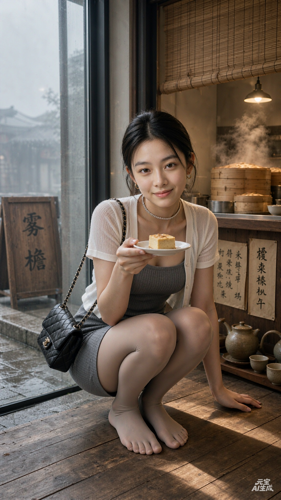

## 终稿提示词

```text
第4张 · 他（撑地）·视点高度 0.4 米、隔 0.35 米看她蹲坐凑近把试吃小碟举到两人正中间

9:16 满幅 1080×1920，四条边即裁切边，人物与道具铺满整幅。全画只一位成年人物。硬约束前置：这一眼离地 0.4 米、与她并拢的两只脚背同一水平线、隔 0.35 米平视略仰；初冬清晨薄雾未散，干爽的店内木地板从门槛一直铺到画幅下缘、木纹上落一层薄薄的晨光，青灰天光与吊灯暖黄在木纹上接成一道软界线；她整个人在门内，两只脚并拢踩在店内干燥木地板上，脚趾尖下方留一指宽木地板；这一张是蹲坐俯身：她压低下巴朝画外凑近、把试吃小碟往镜头前送到两人正中间，两只脚并着、两只脚背朝下平落在店内木地板上、脚跟微微提起、十根脚趾朝画外并着完完整整落在画幅下缘以内、在透明袜面里各自分明由近到远依次排开，膝盖与小腿与脚背连成一条完整连续的线。取景眼睛压到离地 0.4 米、与蹲坐后并拢的那两只脚背同一水平线，隔 0.35 米平视略仰往她胸口与举来的小碟之间看，下缘切在脚趾尖下方一指宽木地板处、上缘刚收住压低的下巴与额前那两缕。

三槽分工：衣由槽 1 干净衣装层承担、脸由槽 2 人脸底图承担、姿势由槽 3 线稿承担；线稿只管躯干重心、脊线肩髋与两腿骨架。

初冬清晨六点五十，薄雾还没散，老街巷口新开的早茶小馆「雾檐」，卖头汤面、竹蒸笼小点与手写在木牌上的今日单。门口一块新漆木招牌、靛蓝布幌、竹帘半卷、青石台阶带着一层露水、门口棕麻脚垫、玻璃门与湿亮街面；门里木质柜台、一摞竹蒸笼冒着白汽、手写木牌今日单、试吃小碟里一小块新出的芝麻糕、靠窗长条凳、粗陶茶壶与两只小茶杯、一摞竹编蒸笼盖。试吃小碟里一小块芝麻糕、身后一摞竹蒸笼冒着的白汽、木质柜台与手写木牌今日单、粗陶茶壶与两只小茶杯、一摞竹编蒸笼盖，都在画内同一片暖里。

初冬清晨薄雾未散的青灰天光铺在干爽的玻璃门与店内木地板上，店里一盏暖黄吊灯与竹蒸笼白汽从门里漫出来、在木地板上落一层薄薄的暖，冷青灰与暖黄在同一幅里交出一道软界线、这道软界线正好横过她小腿中段；四张同一片光、同一色号、同一脚尖透明款，这一片光的折光顺着腿线落到袜面与透明脚尖上，光只改折光落点与明暗，浅雾灰褐这一色号从画左青灰段到画右暖黄段浓淡如一。

奶白薄针织短袖开衫，前襟一排同色小扣、袖口一道罗纹窄边、衣长齐腰、门襟两侧薄透织纹；内搭炭灰罗纹吊带紧身连衣短裙，平直抹胸领、裙身竖向细罗纹、裙摆齐齐落在大腿中段；颈上一圈细水钻短颈链，一只黑色菱格链条小方包斜搭在左肩。这套利落薄打配这一站：清晨薄雾里推门进小馆，抬手翻木牌、蹲下看蒸笼都方便，裙摆齐齐落在大腿中段，大腿中段往下整段袜面从门口青灰天光里一直连到透明脚尖，店里蒸笼白汽比外头暖，薄开衫搭着刚好。

深墨茶黑发、发长过肩十六厘米落在肩胛骨下缘、右侧三七偏分（分缝自额角向右后方斜开）、发身顺直仅发尾一道极浅内扣、薄八字刘海长到颧骨中点中间留一道窄缝、耳侧左右各一缕约八厘米碎发带浅弧、披发不束发无任何发饰、发量中等蓬松颅顶轻垫起。

她朝画外俯身凑下来，整片发丝顺着低头方向朝小碟前垂、在肩前汇成一束往地面指，额前两缕一长一短贴着眉骨垂到快要碰上瓷沿，发尾随俯身扫过左手撑地那侧的腕骨，耳侧两缕顺着颧骨往前、落进腮边不往外翘。

15D 锦纶包芯丝连裤袜、绝对色名浅雾灰褐、低档丝光半哑微光、薄透到青灰天光下透出腿本色一层雾、小腿前缘与脚踝各一道细而连续的织物折光、脚尖透明款袜尖与脚背同织法不加厚、趾部透光度与小腿完全一致五趾轮廓在薄纱里各自分明、四张同一色号、不随本张光位改色、四张同一脚尖透明款。

按 `[女主设定]` 24h 穿一层连裤丝袜从腿根连包到脚趾，脚趾由同色透明袜面完整包住、五趾在透明袜面里各自分明，袜面从小腿到脚背到脚尖连成平顺同一片；这一层是脚尖透明款，脚尖一截同色通透薄纱，薄透度与小腿一致、从脚背平顺连到脚趾，五趾在薄纱里各自分明，脚趾与脚背靠一道织物折光分出同色袜面的包覆边界，透明是薄纱透出趾形、脚趾始终包在同一片袜面里，透明脚尖与脚背连成同一片同色；脚踝与小腿前缘有一道织物折光把袜面与腿肤色分出一层可辨边界。四张同一色号、不随本张光位改色、四张同一脚尖透明款。

本张织物折光只落三处——小腿前缘那道折光被青灰天光压成一条细冷线、脚背宽幅微光吃满吊灯暖黄拉成一片横向亮带、膝弯因蹲坐深屈压出三四道放射状细褶影且褶沟里留一点青灰，透明脚尖那一截把头顶暖黄吊灯的光透到趾形上，大趾与二趾背最亮、往小趾依次暗半档、趾缝里留一线冷灰，十趾在薄纱里各自分明、与脚背同属一片同色，明暗只在这一色号内深浅、色相与色号与另外三张完全一致。

本张鞋的判断（状态：赤足）：她蹲坐朝画外凑近、把试吃小碟里那一小块芝麻糕举到两人正中间，画底收两只完整的脚并着落在店内干燥木地板上、木纹从脚跟一路连到画幅下缘，十趾由同色透明袜面完整包住、脚尖一截通透薄纱与脚背同一片，因为这一眼要把刚出笼的那一口热与这一层同色透明袜面整片都收到咱俩中间。

全画共两条手臂、两只手、两条腿，两条手臂各自从肩经肘腕连到指尖、各只做一个动作；两只脚各自从腿根连续到脚趾，在画内完整收口。
右手从肩经肘腕到指尖把一只试吃小碟举到两人正中间，五根手指松松捏着小碟的瓷沿，就停住；左手从肩经肘腕到指尖撑在身侧木地板上，五根手指并着压住木纹。

画面里只落她自己这一位人物，小碟的瓷沿与她右手指尖同在画幅中线偏左一点。
这一眼的取景落点落在袜面、脚背、腿线那一片光与折光上，她眼皮微抬、嘴角先弯一点，下巴往小碟方向压低，脸年轻柔和、神态松弛。
```

## 一句点评

三波黑盒委托真派留证齐第1张seed8第4张seed9回三槽重出终审四张全过
