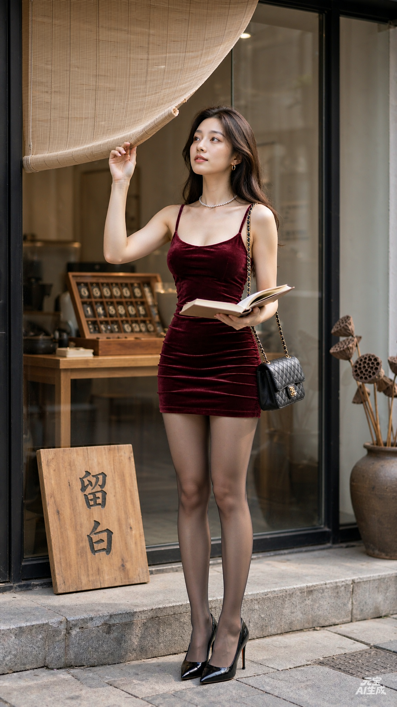

## 终稿提示词

```text
第1张 · 他（站）·视点高度 1.62 米、隔 3.2 米看她站在店门外青石台阶上仰头看新钉的木匾

9:16 满幅 1080×1920，四条边即裁切边，人物与道具铺满整幅。全画只一位成年人物。这一张是全身站姿：两条腿直立站定、从发顶到两只鞋跟与鞋底完完整整收进画内，画幅下缘三分之一是晴冷正午的青石板街面与两只黑色漆皮尖头细高跟的细影，两只鞋整只落在青石板上、9 厘米细跟与鞋底在石板缝上落一道细而清楚的影，画幅上缘与木匾之间留一指天光，「留白」两字压在画右上角的斜角里；他这个高度仰头看匾时视线先过她小腿与鞋跟、再沿撑直的腿线往上走到匾，半卷竹帘后的玻璃门里看得见一整排分格铅活字盘与长木柜台的一线暖木色反光，门口新钉的原木小匾、素麻门口脚垫、门侧陶盆里几枝干莲蓬各自占好位置、从画左小匾到画右台阶连成一条进门动线。

三槽分工：衣由槽 1 干净衣装层承担、脸由槽 2 人脸底图承担、姿势由槽 3 线稿承担；线稿只管躯干重心、脊线肩髋与两腿骨架。

初冬晴冷正午十二点十分，老街尾新开的活字拓印与手工笺纸铺「留白」，卖手工笺纸、活字拓印与试印小笺。门口新钉一块原木小匾刻着「留白」两字、半卷竹帘、青石板街面、门侧一只陶盆里立着几枝干莲蓬、素麻门口脚垫；门里长木柜台、分格铅活字盘、棕刷与滚筒、裁齐的一叠手工笺纸、镇纸与墨碟、靠窗矮木凳、木格窗。她站在门外这一侧仰头看匾，右手扶着竹帘被风掀起那一角，左手把摊开的小本托在胸前。

初冬晴冷正午的白亮直射铺在青石板街面与半卷竹帘上，木格窗把一片柔白天光反进柜台那一侧，长木柜台的暖木色在白亮里泛出一层极浅的蜜；这道白亮与柜台暖木在她右小腿一线接成一道软界线、在袜面上泛出一道细而柔的浅亮，四张同一片光、同一色号，这一片光的折光顺着腿线落到袜面与脚背上，光只改折光落点与明暗，烟熏灰褐这一色号从画左白亮段到画右暖木段浓淡如一。

酒红天鹅绒吊带紧身迷你连衣短裙，心形领、两条细肩带、裙身贴身收腰带竖向细抽褶、裙摆齐齐落在大腿中段；颈上一圈细水钻短颈链，一只黑色菱格链条小方包斜搭在左肩。这套利落短打配这一站：正午白亮里推门进笺纸铺，抬手扶竹帘、俯身翻笺纸、蹲下递小笺都方便，酒红天鹅绒在白亮里吸出一层深绒光，裙摆齐齐落在大腿中段，把整条腿线让给那一层袜面与正午那道白亮；颈上一圈细水钻短颈链与黑色菱格链条小方包是这一身两处亮与硬的点，正好接住那双黑色漆皮尖头细高跟。

栗棕黑调的深可可棕长发，发尾落在肩胛骨下约八厘米处，左侧三七分缝自额角斜向后脑分开、多的一侧压向额前，大幅低速的懒卷从耳下起卷、卷峰松而整，刘海是偏左扫开的长八字弧片、内片止于眉尾下缘、外片搭到颧骨上沿，耳侧左右各一缕约至下颌角的细碎发，不束发、无发饰，发量厚而颅顶蓬起一指、发身有空气感不贴头皮。

仰头看匾这一下，整片发顺脊线向后背滑落、贴肩胛铺成一层，额前那道弧片被头位抬起、在眉尾上方挑出一道饱满的弓形留出额头，耳侧两缕被扶帘带进来的街风各向后扬起约三厘米、缕尖轻轻扫过耳垂下缘。

15D 极薄半透包芯连裤丝袜，绝对色名烟熏灰褐（带一丝冷调的中明度灰褐，非茶非驼），锦纶包芯纱平织微丝光、低光泽缎面档而非油亮档，袜面薄到透出腿部肤色与肌理、像在腿上匀了一层冷灰薄雾，四张同一色号、不随本张光位改色。

直立重心压后跟时，右小腿前缘那道织物折光顺着正午白亮拉成一条细直线、过脚踝收窄成一点后接进鞋口，膝弯只留一道极浅横向松弛褶影、左膝受力侧比右膝深半档，脚背迎木格窗柔白反光亮一片宽幅微光、到鞋口被漆皮压住收窄，脚背经浅口鞋口连进鞋内、丝袜脚背到脚尖那一整片在尖头收口的漆皮鞋里由亮到灰依次退一层、五趾在袜面里各自分明，明暗只在同一烟熏灰褐内深浅、色相与色号不变、整层不差过一档。

按 `[女主设定]` 24h 穿一层连裤丝袜从腿根连包到脚趾，脚趾由同色透明袜面完整包住、五趾在透明袜面里各自分明，袜面从小腿到脚背到脚尖连成平顺同一片，脚踝与小腿前缘有一道织物折光把袜面与腿肤色分出一层可辨边界；这一层四张同一色号，只随姿势与光位落折光与褶影。

本张鞋的判断（状态：穿和这套穿搭协调的黑色漆皮尖头细高跟鞋）：她刚从晴冷的老街青石板走过来、站在店门外台阶上仰头看新钉木匾，因为人还在门外这一侧、脚下是正午晒得干爽的青石板，9 厘米细跟在石板上落一道细影，浅口鞋口与细跟把脚背线条撑起来；画面下缘两只脚各实实穿着一只黑色漆皮尖头细高跟鞋，左右各一只、尖头收口、9 厘米细高跟、一道细踝带配一枚金色小圆扣、浅口鞋口压在袜面上、丝袜脚背连进鞋口、鞋穿在丝袜外面、鞋跟与鞋底在画里实有，漆皮硬亮映着正午白亮、金扣与左肩菱格包上的金链同一色，尖头收口的漆皮鞋面把脚尖收在鞋内、袜面从脚背一路连进鞋口。

全画共两条手臂、两只手、两条腿，两条手臂各自从肩经肘腕连到指尖、各只做一个动作；两只脚各自从腿根连续到脚趾，在画内完整收口。
右手从肩经肘腕到指尖抬起扶住竹帘被风掀起那一角、肘往外打开一点、竹帘角被带得贴着她小臂卷上半圈，五根手指松松捏着竹帘边；左手从肩经肘腕到指尖把一本摊开的小本托到胸前那片正午白亮里，五根指头并着托住本子底、小本封皮朝木匾那一侧；黑色菱格链条小方包贴稳斜搭在左肩，仰头这一眼由颈线与眼尾去够木匾下端那两字，两腿直立站定、人往台阶边沿再前半步、后脚跟虚点地、重心微微压在后脚跟。

画面里只落她自己这一位人物，两条手臂各自在画内完整收口。
这一眼的取景落点落在袜面、脚背、腿线那一片光与折光上，她眼睛落在木匾「留白」两字上、下巴微抬、嘴角先弯一点刚认出这家新店、那点弯已经偏向他站的方向，白亮正好卡在前脚鞋口到膝那一线，脸年轻柔和、神态松弛。
```

## 一句点评

用户中途点掉黑高领细罗纹长袖内搭，槽1重做为单穿酒红天鹅绒细肩带吊带迷你裙且肩颈锁骨双臂全露，四份提示词穿搭锚与高跟鞋协调文字一起对齐
