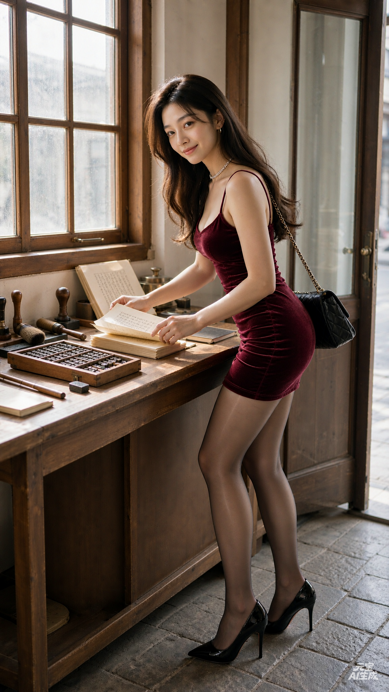

## 终稿提示词

```text
第2张 · 他（俯身）·视点高度 1.15 米、隔 0.9 米看她侧身站在长木柜台前翻一叠手工笺纸

9:16 满幅 1080×1920，四条边即裁切边，人物与道具铺满整幅。全画只一位成年人物。这一张是侧身半身偏全身站姿：脊线朝柜台微微前折、两腿前后错半步站定，视线从笺纸边缘斜切下去，画幅上缘压在门侧原木小匾下沿、下缘切在柜台前木地板第二道拼缝，前脚那只漆皮鞋尖落在画面右下三分之一处、后脚细跟往左上带回一条斜线，这条斜线与柜台前沿的横线在脚背位置交成一个锐角，白亮窗光压在这个交角上，铅字盘与镇纸退到画面左上虚一格；长木柜台面上一只分格铅活字盘、一把棕刷、一只滚筒、裁齐的一叠手工笺纸、一方镇纸与一只墨碟全在画内实有，玻璃门半掩、门侧素麻门口脚垫与新钉原木小匾在画幅左上那一角收进一小截。

三槽分工：衣由槽 1 干净衣装层承担、脸由槽 2 人脸底图承担、姿势由槽 3 线稿承担；线稿只管躯干重心、脊线肩髋与两腿骨架。

初冬晴冷正午十二点二十分，老街尾新开的活字拓印与手工笺纸铺「留白」，卖手工笺纸、活字拓印与试印小笺。门里长木柜台、分格铅活字盘里一格子一格子立着铅字、棕刷与滚筒搁在木托上、裁齐的一叠手工笺纸、镇纸与墨碟、木格窗与窗下一只靠窗矮木凳；门外青石板街面透过半掩的玻璃门收成一道亮边。她侧身站在柜台前，指尖压着最上面那张笺纸的一角往下翻。

初冬晴冷正午的白亮直射从木格窗斜切进柜台这一侧，柔白天光铺在手工笺纸的纤维纹与铅字盘的金属边上，长木柜台的暖木色在白亮里泛出一层极浅的蜜；这道白亮与柜台暖木在她左小腿一线接成一道软界线、在袜面上泛出一道细而柔的浅亮，四张同一片光、同一色号，这一片光的折光顺着腿线落到袜面与脚背上，光只改折光落点与明暗，烟熏灰褐这一色号从窗光段到柜台段浓淡如一。

酒红天鹅绒吊带紧身迷你连衣短裙，心形领、两条细肩带、裙身贴身收腰带竖向细抽褶、裙摆齐齐落在大腿中段；颈上一圈细水钻短颈链，一只黑色菱格链条小方包斜搭在左肩。这套利落短打配这一站：俯身翻笺纸时细肩带稳稳贴住、裸露的小臂随前伸拉出一道细线，酒红天鹅绒在柜台暖木反光里显出一层深绒光，裙摆齐齐落在大腿中段，把整条腿线让给那一层袜面与木格窗那道白亮；细水钻短颈链与黑色菱格链条小方包接住那双黑色漆皮尖头细高跟，漆皮硬亮与天鹅绒吸光一硬一软各留一道自己的反光。

栗棕黑调的深可可棕长发，发尾落在肩胛骨下约八厘米处，左侧三七分缝自额角斜向后脑分开、多的一侧压向额前，大幅低速的懒卷从耳下起卷、卷峰松而整，刘海是偏左扫开的长八字弧片、内片止于眉尾下缘、外片搭到颧骨上沿，耳侧左右各一缕约至下颌角的细碎发，不束发、无发饰，发量厚而颅顶蓬起一指、发身有空气感不贴头皮。

低头翻笺这一眼，整片发幕顺着前折的脊线朝柜台面垂下去、大半散在左肩前侧与锁骨边，后片最外那一缕被俯身带得晚半拍、离肩翘出一小段弧，额前那一弯随头位压成贴额的一弯弧、尖端指向笺纸那道帘纹，耳侧两缕沿腮前滑到颌角上方、梢头轻搭在细颈链外侧。

15D 极薄半透包芯连裤丝袜，绝对色名烟熏灰褐（带一丝冷调的中明度灰褐，非茶非驼），锦纶包芯纱平织微丝光、低光泽缎面档而非油亮档，袜面薄到透出腿部肤色与肌理、像在腿上匀了一层冷灰薄雾，四张同一色号、不随本张光位改色。

侧身前折时前腿承重、后腿点地，左小腿前缘那道织物折光顺木格窗白亮走成一条细直线、过脚踝收窄成一点，膝弯后侧压出一道极浅横向松弛褶影、前膝面绷平起一片匀光，脚背迎窗光落一片宽幅微光、再往脚尖一路收成一条窄而连续的折光直到袜面包住的趾尖，鞋口压线下方留一道更浅的暗阶，明暗只在同一烟熏灰褐内深浅、色相与色号不变、整层不差过一档。

按 `[女主设定]` 24h 穿一层连裤丝袜从腿根连包到脚趾，脚趾由同色透明袜面完整包住、五趾在透明袜面里各自分明，袜面从小腿到脚背到脚尖连成平顺同一片，脚踝与小腿前缘有一道织物折光把袜面与腿肤色分出一层可辨边界；这一层四张同一色号，只随姿势与光位落折光与褶影。

本张鞋的判断（状态：穿和这套穿搭协调的黑色漆皮尖头细高跟鞋）：她刚从门外青石台阶跨进玻璃门这一步、侧身站在长木柜台前翻那叠手工笺纸，因为人已经进门却还停在柜台前这一步、脚下的木地板是干的，鞋还没到脱的时候，换留到第 3 张坐进靠窗矮木凳那一步；画面下缘两只脚各实实穿着一只黑色漆皮尖头细高跟鞋，左右各一只、尖头收口、9 厘米细高跟、一道细踝带配一枚金色小圆扣、浅口鞋口压在袜面上、丝袜脚背连进鞋口、鞋穿在丝袜外面、鞋跟与鞋底在画里实有，前脚外旋一点、细跟在木地板上落一道细影，尖头收口的漆皮鞋面把脚尖收在鞋内、袜面从脚背一路连进鞋口。

全画共两条手臂、两只手、两条腿，两条手臂各自从肩经肘腕连到指尖、各只做一个动作；两只脚各自从腿根连续到脚趾，在画内完整收口。
右手从肩经肘腕到指尖伸向柜台那叠笺纸、五根手指并着压住最上面一张的右下角往下翻、指尖停住不动；左手从肩经肘腕到指尖把摊开的小本按在柜台面上往自己这边带半寸、五根指头分开压住本子左页，小本封皮朝木格窗那一侧；黑色菱格链条小方包贴稳斜搭在左肩，俯身这一眼由眼尾去够笺纸纤维里那道帘纹，两腿前后错半步站定、肩随之往前再送一点、后脚细跟顺势离地一指高、踝带金扣转出一个亮点。

画面里只落她自己这一位人物，两条手臂各自在画内完整收口。
这一眼的取景落点落在袜面、脚背、腿线那一片光与折光上，她眼睛落在笺纸那道帘纹上、睫毛压低一点、嘴角那点弯往上提一分，全身只有脚尖那片窄折光在动，脸年轻柔和、神态松弛。
```

## 一句点评

第1与第2张黑色漆皮尖头九厘米细高跟实穿，第3与第4张不穿鞋露脚且鞋写明已经脱下落在靠窗矮木凳脚边木地板实有落点
