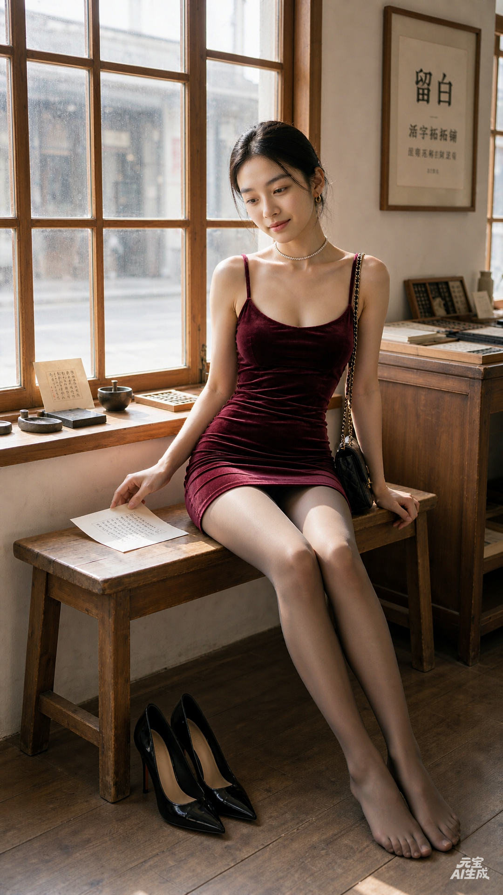

## 终稿提示词

```text
第3张 · 他（坐）·视点高度 0.72 米、隔 1.4 米看她坐进靠窗矮木凳把两腿斜伸进木格窗白亮光里

9:16 满幅 1080×1920，四条边即裁切边，人物与道具铺满整幅。全画只一位成年人物。这一张是坐姿斜伸腿：她坐进靠窗矮木凳、脊线靠稳窗下木框、两腿朝画幅下缘斜斜伸直，视点 0.72 米齐她膝头高度、隔 1.4 米略微由下往上收，取景下沿压在矮木凳凳腿与那双脱下的鞋之间留一指木地板、上沿切在窗台镇纸上缘，斜伸的两条腿从画幅左下角起笔、经画面中线推到右下角那两只包在袜面里的脚，木格窗的白亮整片压在这条斜线上；画底收两只完整的脚与木地板那一线暖木色，黑色漆皮尖头细高跟一双已经脱下、鞋尖朝矮木凳腿左右并拢搁在凳脚边木地板木纹上、金扣朝上映一小点窗白；木格窗、窗台上一叠试印小笺、一方镇纸与一只墨碟、靠窗矮木凳、门里长木柜台的一角全在画内实有。

三槽分工：衣由槽 1 干净衣装层承担、脸由槽 2 人脸底图承担、姿势由槽 3 线稿承担；线稿只管躯干重心、脊线肩髋与两腿骨架。

初冬晴冷正午十二点三十五分，老街尾新开的活字拓印与手工笺纸铺「留白」，卖手工笺纸、活字拓印与试印小笺。靠窗这一角有木格窗、窗台上一叠刚试印好的小笺、镇纸与墨碟、一只靠窗矮木凳、凳边木地板、门里长木柜台与分格铅活字盘的一角；门外青石板街面透过木格窗收成一道亮边。她坐进矮木凳把两腿斜伸进窗光里，一只手搭在膝头那张试印小笺上。

初冬晴冷正午的白亮直射从木格窗整片压进来，柔白天光铺满窗台那一叠试印小笺与木地板的木纹，长木柜台的暖木色在白亮里泛出一层极浅的蜜；这道白亮与柜台暖木顺着她斜伸的两条腿在袜面上接成一道软界线、泛出一道细而柔的浅亮，四张同一片光、同一色号，这一片光的折光顺着腿线落到袜面与脚背上，光只改折光落点与明暗，烟熏灰褐这一色号从窗光段到地板段浓淡如一。

酒红天鹅绒吊带紧身迷你连衣短裙，心形领、两条细肩带、裙身贴身收腰带竖向细抽褶、裙摆齐齐落在大腿中段；颈上一圈细水钻短颈链，一只黑色菱格链条小方包斜搭在左肩。这套利落短打配这一站：坐进矮木凳、两腿斜伸时裙摆顺着大腿摊开一道软褶，裸露的小臂搭在膝头拉出一道细线，酒红天鹅绒在整片正午白亮里显出一层深绒光，裙摆齐齐落在大腿中段，把整条腿线让给那一层袜面与木格窗那一整片白亮；细水钻短颈链与黑色菱格链条小方包接住凳边那双黑色漆皮尖头细高跟，鞋虽脱下仍与这一身同色。

栗棕黑调的深可可棕长发，发尾落在肩胛骨下约八厘米处，左侧三七分缝自额角斜向后脑分开、多的一侧压向额前，大幅低速的懒卷从耳下起卷、卷峰松而整，刘海是偏左扫开的长八字弧片、内片止于眉尾下缘、外片搭到颧骨上沿，耳侧左右各一缕约至下颌角的细碎发，不束发、无发饰，发量厚而颅顶蓬起一指、发身有空气感不贴头皮。

脊线靠稳窗框、头微侧低的这一坐，发身顺着重力沿右肩前与左肩后垂成两片顺滑扇面，靠窗那片发尾搭过凳沿往外摊一小段，窗风把耳前一缕带离颧线轻扬起来，额前那道弧随低头压贴眉弓成浅弓，耳侧一缕贴颌线、一缕落在锁骨边。

15D 极薄半透包芯连裤丝袜，绝对色名烟熏灰褐（带一丝冷调的中明度灰褐，非茶非驼），锦纶包芯纱平织微丝光、低光泽缎面档而非油亮档，袜面薄到透出腿部肤色与肌理、像在腿上匀了一层冷灰薄雾，四张同一色号、不随本张光位改色。

两腿朝画幅下缘斜伸、膝弯舒展，木格窗整片白亮正压在小腿前缘，那道织物折光从膝下起走成一条细长直线、过脚踝收成针尖一点，膝弯内侧留一道极浅横向褶影、影随腿伸展开只余一线灰，脚背迎光落一片宽幅微光，从脚背经大趾根一直推到脚尖那一整片把窗白透成由亮到柔的三段深浅、脚尖一截同色通透薄纱与脚背同一层织法不加厚、薄透度与小腿一致，十趾在薄纱里一根一根分清且每趾背各点一粒细长亮线，明暗只在同一烟熏灰褐内深浅、色相与色号不变、整层不差过一档。

按 `[女主设定]` 24h 穿一层连裤丝袜从腿根连包到脚趾，脚趾由同色透明袜面完整包住、五趾在透明袜面里各自分明，袜面从小腿到脚背到脚尖连成平顺同一片，脚踝与小腿前缘有一道织物折光把袜面与腿肤色分出一层可辨边界；这一层四张同一色号，只随姿势与光位落折光与褶影。

本张鞋的判断（状态：不穿鞋露脚）：她坐进靠窗矮木凳、把两腿斜伸进木格窗那一整片正午白亮里，因为这一眼要的就是让袜面脚背到脚尖那一整片落进光里；那双黑色漆皮尖头细高跟已经脱下、鞋尖朝凳腿并拢搁在矮木凳脚边的木地板上写明已经脱下；画里只有她两只完整的脚落进窗光、十趾由同色透明袜面完整包住、脚尖一截同色通透薄纱与脚背连成平顺同一片、这一片落进本张那道白亮里，五趾在薄纱里各自分明，脚踝与小腿前缘一道织物折光把袜面与腿肤色分出一层可辨边界。

全画共两条手臂、两只手、两条腿，两条手臂各自从肩经肘腕连到指尖、各只做一个动作；两只脚各自从腿根连续到脚趾，在画内完整收口。
右手从肩经肘腕到指尖搭在膝头那张试印小笺上、五根手指并着压住小笺下沿、无名指指甲尖把纸边角轻轻翘起一角、纸角阴影正好落在自己脚背那片最亮的微光上；左手从肩经肘腕到指尖撑在矮木凳面身体左侧身后、五根指头分开按稳凳沿；黑色菱格链条小方包贴稳斜搭在左肩，这一眼由眼尾从窗台上那叠小笺往下瞟一寸到脚背那片光，两腿朝画幅下缘斜斜伸直。

画面里只落她自己这一位人物，两条手臂各自在画内完整收口。
这一眼的取景落点落在袜面、脚背、腿线那一片光与折光上，她眼睛落在脚背那片白亮上、下巴微收、嘴角先弯一点自己先看入了神，脸年轻柔和、神态松弛。
```

## 一句点评

第一波主笔份合出本轮唯一基底深可可棕懒卷长发与15D烟熏灰褐极薄半透包芯连裤丝袜，四份逐字一致并各补一句本张重力落点
