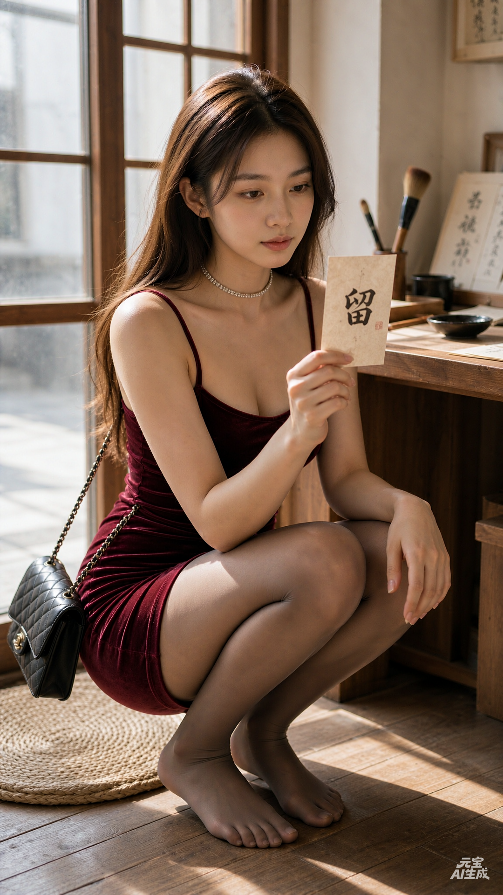

## 终稿提示词

```text
第4张 · 他（撑地）·视点高度 0.38 米、隔 0.45 米看她蹲坐凑近把一张试印小笺举到两人正中间

9:16 满幅 1080×1920，四条边即裁切边，人物与道具铺满整幅。全画只一位成年人物。这一张是低机位蹲坐近景：髋膝双折蹲坐凑近、脊线朝前微微送，镜头贴木地板往上抬约十度，画幅下沿压在两只脚掌前缘再留一指木地板，试印小笺的中心落在画面横向中点、纵向三分之二处、小笺上沿刚好齐她下颌下缘，木格窗那道白亮从左上一路切过小笺纸角、膝弯、脚背到画底右脚尖外侧收住；画底收两只完整的脚与木地板那一线暖木色，门口素麻脚垫、门里长木柜台的一角、棕刷与墨碟、窗台那叠手工笺纸在画内各自占好位置，一张刚试印好的小笺被举到画幅正中两人之间、纸上那枚刚拓出来的「留」字带着一点墨光。

三槽分工：衣由槽 1 干净衣装层承担、脸由槽 2 人脸底图承担、姿势由槽 3 线稿承担；线稿只管躯干重心、脊线肩髋与两腿骨架。

初冬晴冷正午十二点四十分，老街尾新开的活字拓印与手工笺纸铺「留白」，卖手工笺纸、活字拓印与试印小笺。这一眼凑近的是柜台前这一小方木地板：门口素麻脚垫、长木柜台的一角、柜台上一把棕刷与一只墨碟、窗台那叠裁齐的手工笺纸、木格窗；门外青石板街面透过半掩的玻璃门收成一道亮边。她蹲坐凑近把一张试印小笺举到两人正中间。

初冬晴冷正午的白亮直射从木格窗斜切进来，柔白天光铺在试印小笺的纤维纹与墨色上，长木柜台的暖木色在白亮里泛出一层极浅的蜜；这道白亮与柜台暖木顺着她蹲坐的小腿在袜面上接成一道软界线、泛出一道细而柔的浅亮，四张同一片光、同一色号，这一片光的折光顺着腿线落到袜面与脚背上，光只改折光落点与明暗，烟熏灰褐这一色号从窗光段到地板段浓淡如一。

酒红天鹅绒吊带紧身迷你连衣短裙，心形领、两条细肩带、裙身贴身收腰带竖向细抽褶、裙摆齐齐落在大腿中段；颈上一圈细水钻短颈链，一只黑色菱格链条小方包斜搭在左肩。这套利落短打配这一站：蹲坐凑近时细肩带稳稳贴住、裙摆顺着大腿折出一道软褶，裸露的小臂随前举拉出一道细线，酒红天鹅绒在正午白亮里吸出一层深绒光，裙摆齐齐落在大腿中段，把整条腿线让给那一层袜面与脚背上那道白亮；细水钻短颈链与黑色菱格链条小方包接住第 3 张留在凳边那双黑色漆皮尖头细高跟，鞋虽在这一张的画外仍与这一身同色。

栗棕黑调的深可可棕长发，发尾落在肩胛骨下约八厘米处，左侧三七分缝自额角斜向后脑分开、多的一侧压向额前，大幅低速的懒卷从耳下起卷、卷峰松而整，刘海是偏左扫开的长八字弧片、内片止于眉尾下缘、外片搭到颧骨上沿，耳侧左右各一缕约至下颌角的细碎发，不束发、无发饰，发量厚而颅顶蓬起一指、发身有空气感不贴头皮。

脊线朝前送、头位压低约二十度，整片发丝顺着低头方向朝前下方垂落、贴着颧侧滑到锁骨前，顶心一缕被俯身带起往前多探两厘米，额前那一片随头位压成一道贴额的弯弧、弧底刚搭在眉骨上，耳侧两缕离开耳廓往前挂在颊边、末端点在举笺的右手腕背上方。

15D 极薄半透包芯连裤丝袜，绝对色名烟熏灰褐（带一丝冷调的中明度灰褐，非茶非驼），锦纶包芯纱平织微丝光、低光泽缎面档而非油亮档，袜面薄到透出腿部肤色与肌理、像在腿上匀了一层冷灰薄雾，四张同一色号、不随本张光位改色。

髋膝双折蹲坐时，木格窗白亮从左上压下来，小腿前缘那道织物折光走成一条细直线、过脚踝收窄成一点亮，膝弯受力处堆出两道极浅横褶、褶底留一线浅影，大腿前侧被裙摆压出一小段柔亮，脚背迎光落一片宽幅微光，从脚背经趾根到脚尖那一整片把这道白亮透成亮到浅再到更浅的三段过渡、趾缝间各留一道极浅织物折光把十趾分开、袜尖与脚背同一层薄纱不加厚，十趾由同色透明袜面完整包住、各自分明，明暗只在同一烟熏灰褐内深浅、色相与色号不变、整层不差过一档。

按 `[女主设定]` 24h 穿一层连裤丝袜从腿根连包到脚趾，脚趾由同色透明袜面完整包住、五趾在透明袜面里各自分明，袜面从小腿到脚背到脚尖连成平顺同一片，脚踝与小腿前缘有一道织物折光把袜面与腿肤色分出一层可辨边界；这一层四张同一色号，只随姿势与光位落折光与褶影。

本张鞋的判断（状态：不穿鞋露脚）：她蹲坐凑近把一张试印小笺举到两人正中间，因为画底这一眼收两只完整的脚、让白亮顺着脚背平顺落到脚尖那一整片上；那双黑色漆皮尖头细高跟留在第 3 张靠窗矮木凳脚边那个实有落点、与这一张的两只脚隔着整段柜台前木地板；画底只收她两只完整的脚、两只脚掌平落在木地板上、脚踝后是干净的木地板木纹、十趾由同色透明袜面完整包住、脚尖一截同色通透薄纱与脚背同一层织法不加厚、薄透度与小腿一致、袜面从脚背到脚尖连成平顺同一片、这一片落进本张那道白亮里，五趾在薄纱里各自分明，脚踝与小腿前缘一道织物折光把袜面与腿肤色分出一层可辨边界。

全画共两条手臂、两只手、两条腿，两条手臂各自从肩经肘腕连到指尖、各只做一个动作；两只脚各自从腿根连续到脚趾，在画内完整收口。
右手从肩经肘腕到指尖把那张试印小笺举到画幅正中两人之间、五根手指松松捏着小笺右上角、纸上「留」字朝他那一边斜开十五度、食指指腹在「留」字墨光上轻按一下再抬起来；左手从肩经肘腕到指尖搭在自己左膝头、五根指头并着按住裙摆那一道软褶；黑色菱格链条小方包贴稳斜搭在左肩，这一眼由眼尾从纸上那枚字抬起来去够他、下巴往掌心那边压低半寸、嘴角那点小得意收住一半，髋膝双折蹲坐凑近、两脚脚掌平落在木地板上、脚尖朝他这边并拢转过去五度、脚背那片宽幅微光正落在转过去的面上。

画面里只落她自己这一位人物，两条手臂各自在画内完整收口。
这一眼的取景落点落在袜面、脚背、腿线那一片光与折光上，她眼睛从纸上抬起来落在他这一边、嘴角先弯一点带一点小得意，脸年轻柔和、神态松弛。
```

## 一句点评

上一版第4张脚踝后鞋帮与脚趾尖加深不透明块两处硬伤另起一批seed7全量重出修掉，第二波四份审图与主agent终审逐张放大亲眼看全过
