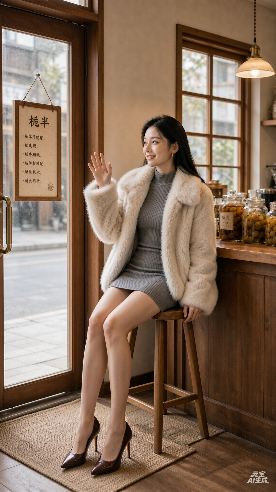

## 终稿提示词

```text
第1张 · 他（站）·视点高度 1.62 米、隔 2.4 米看她推门进店在高脚木凳上侧坐回身朝门外招手

9:16 满幅 1080×1920，四条边即裁切边，人物与道具铺满整幅。全画只一位成年人物。这一张是门里门外连成一条动线的远景：她侧坐在柜台前第一张高脚木凳上、身体柔弯回身朝玻璃门这一侧，一腿屈起踩稳凳横档、一腿垂下让细跟点在木地板上，画幅左上是门外青石板巷面与门侧木框手写菜单牌的一角，原木小匾刻着「栀半」两字压在画右上角的斜角里再往角上收半指，玻璃门与黄铜门把半掩、素麻门口脚垫在画下缘铺成一条暖褐横线、这条线从画左进画在她垂下那只细跟前拐一个钝角指向画右，画下缘另留一条掌宽的地脚，门里长木柜台的一角、柜台上一排糖渍栀子玻璃罐、白瓷试吃小碟与铜勺、暖黄小吊灯、木格窗各自占好位置；柜台后那一排玻璃罐被她回身的肩背挡住半截、这一眼看不见罐子最上层那两格的标签，玻璃门外街面更远处收成一道青亮的天边。他这个高度隔 2.4 米看过去，视线顺着脚垫那个钝角先过素麻脚垫与她那只细跟、再沿垂下的腿线往上走到她回身的下颌与眼尾，小匾的「栀半」两字落在画右上那一指余天里，画外收边干净。

三槽分工：衣由槽 1 干净衣装层承担、脸由槽 2 人脸底图承担、姿势由槽 3 线稿承担；线稿只管躯干重心、脊线肩髋与两腿骨架。

初冬晴冷黄昏五点二十，老街转角新开的栀子糖水铺「栀半」，卖栀子冻、桂花酒酿小圆子、现熬栀子糖水与糖渍栀子玻璃罐。门外青石板巷面、新钉的原木小匾、玻璃门与黄铜门把、素麻门口脚垫、门侧木框手写菜单牌、门边矮木架上一排糖渍栀子玻璃罐；门里长木柜台、玻璃罐、白瓷试吃小碟与铜勺、高脚木凳与靠门长凳、暖黄小吊灯、木格窗、摊开的小本与铅笔。她推门进来先占柜台前第一张高凳、侧坐回身朝门外招手。

初冬晴冷黄昏五点二十，天还剩一层青亮，日头西斜从朝西的玻璃门斜切进来，蜜色斜光铺过素麻脚垫与木地板头两道拼缝，屋里暖黄小吊灯已经亮、长木柜台与黄铜勺反出一层暖木色，木格窗把门外那道青亮收成一条细边；这道蜜色斜光与吊灯暖黄顺着她垂下的那条腿在袜面上接成一道软界线、在袜面泛出一道细而柔的浅亮，四张同一片光、同一色号，这一片光的折光顺着腿线落到袜面与脚背上，光只改折光落点与明暗，浅栀灰这一色号从门口斜光段到柜台暖木段浓淡如一。

雾灰细罗纹高领长袖紧身针织迷你连衣裙，高领贴颈、长袖收到腕骨、裙身顺着腰肋收出细密竖罗纹、裙摆齐齐落在大腿中段；一件米白长绒短外套敞披在肩外，绒尖在领口与袖笼外圈蓬起一层。这套配这一站：初冬黄昏从青石板巷面拐进糖水铺，推门、侧坐高凳、半跪够矮架、前倾递小碟都利落，米白长绒在暖黄吊灯里泛出柔绒光，雾灰罗纹在蜜色斜光里压成一层哑光，裙摆落在大腿中段把整条腿线让给那一层袜面与门口那片斜光。本轮那双深栗棕漆皮尖头细高跟鞋：尖头收口、9 厘米细高跟、一道一字细踝带配一枚黄铜小圆扣、深栗棕绝对色号 #4A2C22 的漆皮硬亮；尖头收口接高领与裙摆齐切的直线同为收口语言，9 厘米细跟把大腿中段到脚背那条线拉成一道斜提的弧，黄铜小圆扣接玻璃门黄铜门把与柜台上那把铜勺、全身金件只此三处互答，深栗棕接熬糖木色与玻璃罐里琥珀色栀子糖渍，漆皮硬亮映着门口蜜色斜光、亮面里透 #4A2C22 的栗棕底，漆皮硬亮与雾灰罗纹的哑光一硬一软各留一道自己的反光，初冬干爽青石板配细跟走得稳、门里素麻脚垫接住脱鞋那一步。

发色冷调黑茶棕、发长过肩胛骨下缘八厘米发尾齐平收钝角、头顶偏她右侧三七分缝由额角向后梳出一道斜白线、发身大弧度低速卷只发尾十五厘米走一个向内 C 形弯中段顺直、薄法式八字刘海前短后长最长一缕落颧骨上方一指、耳侧左右各一缕细碎发长到下颌角下两厘米、不束发无发饰耳后露出耳廓与一枚小金耳钉、发量偏厚颅顶蓬起约两厘米；她侧坐回身下巴微抬朝门外看，发丝顺重力往她左肩背后垂、大半个发尾搭在米白绒外套肩面压出一道浅沟，回身带起右侧耳前那一缕细碎发离颊约一厘米外扬、梢端擦过下颌角，八字刘海随头位后仰在额前压成左高右低的浅弧、弧底离眉一指，颅顶蓬度在门口斜光里留出一圈透亮发边，前颈拉出一道长弧。

杏仁甲、长度超出指尖三毫米甲尖圆收不尖、绝对色号 #6E3B2C 栀子糖壳棕、光疗硬式封层高亮镜面档甲面中段一道纵向细光带、无钻无贴片无手绘只每枚甲尖一道零点五毫米 #C9973F 细金法式边与黄铜小圆扣同色，十指同一款四张同一款；右手抬到齐耳朝玻璃门招手、掌心朝门，右手中指食指无名指三枚甲面的纵向细光带正迎蜜色斜光连成一小片亮，甲缘那道细亮最尖一点落在右手食指指尖金边上，左手后撑凳沿掌心压住凳面、只拇指与无名指甲尖的金边蹭到一线柜台吊灯回光、亮度比右手低一档。

15D、绝对色名浅栀灰 #C9BCAE、包芯锦纶氨纶无缝一体织、微光档哑光打底覆一层极细丝光不到油亮、半透膝上透肤色一层暖小腿以下织密略收、织物折光沿腿线走一道连续细银灰亮线受力处膝弯踝骨前脚背弓起拉开浅一档细褶影非受力面平顺如薄釉、贴肤如第二层皮腿根膝头踝骨三处轮廓清晰不空不鼓与肤色是透出而非盖上、四张同一色号不随本张光位改色；本张织物折光主亮线落垂下那条腿胫骨前缘由踝骨上方收进浅口鞋口，膝弯屈腿叠两道浅一档细褶影褶底仍透浅栀灰本色，脚背弓起处一道宽两指蜜色微光前收到鞋口前沿被漆皮硬亮接住，脚背到脚尖鞋内透出的一整片明暗为鞋口边最亮、脚背中段次亮、尖头收口处沉半档的连续蜜色渐变，明暗只在浅栀灰这一色号内做深浅、色相与色号不变、整层与另外三张不差过一档。

按 `[女主设定]` 24h 穿一层连裤丝袜从腿根连包到脚趾，脚趾由同色透明袜面完整包住、五趾在透明袜面里各自分明，袜面从小腿到脚背到脚尖连成平顺同一片，脚踝与小腿前缘有一道织物折光把袜面与腿肤色分出一层可辨边界；这一层四张同一色号，只随姿势与光位落折光与褶影。

本张鞋的判断（状态：穿和这套穿搭协调的深栗棕漆皮尖头细高跟鞋）：她刚从老街青石板巷面拐到转角、推门进店这一步，因为人还带着门外那截街面的干爽、细跟在素麻脚垫边点住没到脱的时候，这一眼让浅口鞋口与 9 厘米细跟把脚背线条撑起来；画幅下缘两只脚各实实穿着一只深栗棕漆皮尖头细高跟鞋，左右各一只、尖头收口、9 厘米细高跟、一道一字细踝带配一枚黄铜小圆扣、浅口鞋口压在袜面上、丝袜脚背连进鞋口、鞋穿在丝袜外面、鞋跟与鞋底在画里实有，漆皮硬亮映着门口蜜色斜光、亮面里透 #4A2C22 的栗棕底，黄铜小圆扣与玻璃门黄铜门把同一色，尖头收口的漆皮鞋面把脚尖收在鞋内、袜面从脚背一路连进鞋口、五趾在袜面里各自分明。换留到第 2 张踩上素麻脚垫那一步写明已经脱下。

全画共两条手臂、两只手、两条腿，两条手臂各自从肩经肘腕连到指尖、各只做一个动作；两只脚各自从腿根连续到脚趾，在画内完整收口。
右手从肩经肘腕到指尖抬到齐耳高度朝玻璃门这一侧招一下、五根手指松松张开又收拢半寸、指尖停在小匾「栀半」那两字下方；左手从肩经肘腕到指尖撑在高脚木凳凳沿身体左侧身后、五根指头分开按稳凳面边、腕骨压出一道细棱；米白长绒短外套敞披在两肩外、绒尖随回身往外让出一圈，左袖笼的绒顺着后撑的方向贴向背侧压平、露出腕骨到凳沿一截完整的臂线，这一眼由颈线与眼尾越过自己肩头去够门外站着的他，一腿屈起踩稳凳横档、一腿垂下让细跟点在木地板上、脊线朝门这侧柔弯出一道弧；招手那半寸收拢停住的同时，垂下那只脚的鞋尖在木地板上往回勾一小下、细跟原地碾出半寸、木地板拼缝上留一道半寸的擦痕亮，膝弯那两道褶影跟着松一道，人已经回身迎过来、脚还朝着门外他这一步。

画面里只落她自己这一位人物，两条手臂各自在画内完整收口。
这一眼的取景落点落在袜面、脚背、腿线那一片光与折光上，蜜色斜光正好卡在垂下那只脚的鞋口到膝那一线，她眼睛越过肩头落在门外那一层青亮里、下巴微抬、嘴角先弯一点刚把这家新铺子认出来、那点弯已经偏向他站的方向，她招手的手指收拢那半寸停住时眼尾先于嘴角弯一下、视线越过自己肩头钉在门外他站的那块青石板上，脸年轻柔和、神态松弛。
```

## 一句点评

推门回身招手细高跟点在木地板上
