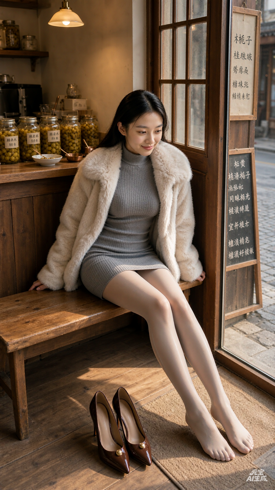

## 终稿提示词

```text
第2张 · 他（俯身）·视点高度 0.92 米、隔 1.1 米看她在靠门长凳上侧肘撑着把两腿斜伸进门口那片蜜色斜光里

9:16 满幅 1080×1920，四条边即裁切边，人物与道具铺满整幅。全画只一位成年人物。这一张是坐姿斜伸腿中近景：她坐进靠门那张长木凳、凳面进深够一侧肘稳稳后撑、身体侧过去而非端正正坐、一侧肘撑在凳面身后、脊线往后靠出一道柔弯、两腿朝画幅下缘斜斜伸直并且不并拢、右腿压左腿一寸、下压那只脚的大趾轻轻勾住另一只脚的脚踝外侧，画幅上沿压在暖黄小吊灯灯罩下缘、下缘往下再压三厘米收到两只脚趾尖前一指、趾尖几乎顶到裁切边但两只脚连同十趾仍完完整整落在画内，斜伸的两条腿从画左下角起笔、压着画面横向中线下方一掌处推到右下角那两只包在袜面里的脚，脚背弓顶正落在画面右下三分点上，门口那片蜜色斜光整片压在这条斜线上；画底收两只完整的脚与木地板那一线暖木色；那双深栗棕漆皮尖头细高跟已经脱下、鞋尖朝长凳腿左右并拢搁在素麻门口脚垫与凳腿夹角那一小块实有落点上、两只鞋跟鞋底都在画内实有、黄铜小圆扣朝上映一小点吊灯暖黄、鞋面漆皮硬亮里透深栗棕 #4A2C22 的底、写明已经脱下所以不是空鞋也不是第三态；长木柜台一角、一排糖渍栀子玻璃罐、一只白瓷试吃小碟与一把铜勺、木格窗与门侧木框手写菜单牌都在画内实有，门外青石板巷面透过半掩的玻璃门收成一道青亮的边，画外收边干净。

三槽分工：衣由槽 1 干净衣装层承担、脸由槽 2 人脸底图承担、姿势由槽 3 线稿承担；线稿只管躯干重心、脊线肩髋与两腿骨架。

初冬晴冷黄昏五点二十，老街转角新开的栀子糖水铺「栀半」，卖栀子冻、桂花酒酿小圆子、现熬栀子糖水与糖渍栀子玻璃罐。这一眼凑近的是靠门这一张长凳与素麻门口脚垫：长木柜台的一角、柜台上一排糖渍栀子玻璃罐、白瓷试吃小碟与铜勺、木格窗、摊开的小本与铅笔、门侧木框手写菜单牌；门外青石板巷面隔着玻璃门收成一道亮边。她坐进靠门长凳把两腿斜伸进门口斜光里，一只手搭在膝头那本摊开的小本上。

初冬晴冷黄昏五点二十，天还剩一层青亮，日头西斜从朝西的玻璃门斜切进来，蜜色斜光整片铺过素麻脚垫与斜伸的两条腿，屋里暖黄小吊灯已经亮、长木柜台与黄铜勺反出一层暖木色，木格窗把门外青亮收成一条细边；这道蜜色斜光与吊灯暖黄顺着她斜伸的两条腿在袜面上接成一道软界线、泛出一道细而柔的浅亮，四张同一片光、同一色号，这一片光的折光顺着腿线落到袜面与脚背上，光只改折光落点与明暗，浅栀灰这一色号从门口斜光段到柜台暖木段浓淡如一。

雾灰细罗纹高领长袖紧身针织迷你连衣裙，高领贴颈、长袖收到腕骨、裙身顺着腰肋收出细密竖罗纹、裙摆齐齐落在大腿中段；一件米白长绒短外套敞披在肩外，绒尖在领口与袖笼外圈蓬起一层。这套配这一站：初冬黄昏从青石板巷面拐进糖水铺，推门、侧坐高凳、半跪够矮架、前倾递小碟都利落，米白长绒在暖黄吊灯里泛出柔绒光，雾灰罗纹在蜜色斜光里压成一层哑光，裙摆落在大腿中段把整条腿线让给那一层袜面与门口那片斜光。本轮那双深栗棕漆皮尖头细高跟鞋：尖头收口、9 厘米细高跟、一道一字细踝带配一枚黄铜小圆扣、深栗棕绝对色号 #4A2C22 的漆皮硬亮；尖头收口接高领与裙摆齐切的直线同为收口语言，9 厘米细跟把大腿中段到脚背那条线拉成一道斜提的弧，黄铜小圆扣接玻璃门黄铜门把与柜台上那把铜勺、全身金件只此三处互答，深栗棕接熬糖木色与玻璃罐里琥珀色栀子糖渍，漆皮硬亮与雾灰罗纹的哑光一硬一软各留一道自己的反光，鞋已脱下，与这一身同色放在素麻脚垫边接住进店那一步。

发色冷调黑茶棕、发长过肩胛骨下缘八厘米发尾齐平收钝角、头顶偏她右侧三七分缝由额角向后梳出一道斜白线、发身大弧度低速卷只发尾十五厘米走一个向内 C 形弯中段顺直、薄法式八字刘海前短后长最长一缕落颧骨上方一指、耳侧左右各一缕细碎发长到下颌角下两厘米、不束发无发饰耳后露出耳廓与一枚小金耳钉、发量偏厚颅顶蓬起约两厘米；她侧肘后撑、脊线往后靠出柔弯、头微低往脚背瞟，长发整片顺着右肩前方与后背滑坠、大半铺在长凳面她髋侧往后那一段木面上并随凳沿垂下一绺，左肩前一缕被后靠的劲带离肩线两厘米再落回，八字刘海随头低压出一道贴眉尾的浅弧、弧心留一点缝透出额头，耳侧两缕细碎发一长一短往前垂、长的那缕尖端扫到颧骨下缘停住。

杏仁甲、长度超出指尖三毫米甲尖圆收不尖、绝对色号 #6E3B2C 栀子糖壳棕深棕镜面甲面、十枚甲面都是这个深棕色不渲成乳白浅杏珠光、光疗硬式封层高亮镜面档甲面中段一道纵向细光带、无钻无贴片无手绘只每枚甲尖一道零点五毫米 #C9973F 细金法式边与黄铜小圆扣同色，十指同一款四张同一款；搭小本那只右手的食指、中指、无名指三枚甲面正迎门口蜜色斜光、光疗镜面档那道纵向细光带在甲面中段连成一道细亮，甲尖那道细金法式边最亮的一点落在撑凳那只左手的食指指尖上、压住凳沿木纹时点出一粒米大的暖点，左手其余四指甲面转向凳面只留侧缘一线光。

15D、绝对色名浅栀灰 #C9BCAE、包芯锦纶氨纶无缝一体织、微光档哑光打底覆一层极细丝光不到油亮、半透膝上透肤色一层暖小腿以下织密略收、织物折光沿腿线走一道连续细银灰亮线受力处膝弯踝骨前脚背弓起拉开浅一档细褶影非受力面平顺如薄釉、贴肤如第二层皮腿根膝头踝骨三处轮廓清晰不空不鼓与肤色是透出而非盖上、四张同一色号不随本张光位改色；本张织物折光落在小腿前缘与踝骨外侧那道细亮边上、经脚弓转到脚背成一片宽幅微光，膝弯因腿伸直、织物被拉平只在膝窝后侧收出两道细浅褶影，脚背弓起最高处最亮、往脚尖一路柔柔收暗半档，脚背到脚尖那一整片把门口蜜色斜光透成亮、柔、微深的三段折光、大趾侧缘再回一道细亮勾出五趾边界，深浅只在浅栀灰 #C9BCAE 一色之内走、色相与色号不变、整层与另外三张不差过一档。

按 `[女主设定]` 24h 穿一层连裤丝袜从腿根连包到脚趾，这一层 15D 浅栀灰 #C9BCAE 半透包芯丝在小腿前缘与踝骨外侧落成一道连续可辨的细银灰织物折光、清楚把袜面与腿肤色分出一层同色包覆边界，膝头踝骨脚背三处轮廓贴肤不空不鼓，脚背到脚尖整片由同色透明袜面完整包住、十趾在袜面里各自分明、趾根一道折光把趾形与脚背分出同色边界、趾缝平顺、脚尖与脚背连成平顺同一片，薄透贴肤色也算这一层、不渲成裸腿也不渲成加深袜尖；这一层四张同一色号，只随姿势与光位落折光与褶影。

本张鞋的判断（状态：不穿鞋露脚）：她坐进靠门长凳、把两腿斜伸进门口那一整片蜜色斜光里，因为这一眼要的就是让袜面脚背到脚尖那一整片落进光里；那双深栗棕漆皮尖头细高跟在第 1 张推门进店踩上素麻脚垫那一步已经脱下、鞋尖朝长凳腿左右并拢搁在素麻门口脚垫边写明已经脱下；画里只收她两只完整的脚落进斜光、十趾由同色透明袜面完整包住、袜面从脚背到脚尖连成平顺同一片、这一片落进本张那道蜜色斜光里，五趾在袜面里各自分明，脚踝与小腿前缘一道织物折光把袜面与腿肤色分出一层可辨边界。

全画共两条手臂、两只手、两条腿，两条手臂各自从肩经肘腕连到指尖、各只做一个动作；两只脚各自从腿根连续到脚趾，在画内完整收口。
右手从肩经肘腕到指尖搭在膝头那本摊开的小本上、五根手指并着压住小本下沿、无名指指甲尖把纸边角轻轻翘起一角后就那么压着不收回、纸角那点细影正好落在自己脚背最亮的那片微光上、随脚尖在光里轻蹭一下而轻轻颤一下；左手从肩经肘腕到指尖撑在长凳面身体左侧身后、五根指头分开按稳凳沿；米白长绒短外套敞披在两肩外、绒尖随往后靠的动作在凳沿摊开一小片，这一眼由眼尾从膝头小本往下瞟一寸到脚背那片光、眼睛仍不抬、下巴微收，两腿朝画幅下缘斜斜伸直、脚尖朝玻璃门那一侧并拢转过去七度、像自己也没察觉地在光里蹭了一下袜面、脚背那片宽幅微光正落在转过去的面上。

画面里只落她自己这一位人物，两条手臂各自在画内完整收口。
这一眼的取景落点落在袜面、脚背、腿线那一片光与折光上，蜜色斜光的亮块整块落在画面下三分之一、人的脸在上方阴影里弯着嘴角，她眼睛落在脚背那片蜜色斜光上、下巴微收、嘴角先弯一点自己先看入了神，脸年轻柔和、神态松弛。
```

## 一句点评

两腿斜伸进蜜色斜光鞋并排搁脚垫边
